<!-- ts:begin header -->
<picture>
  <source media="(prefers-color-scheme: dark)" srcset="assets/banner-dark.svg">
  <source media="(prefers-color-scheme: light)" srcset="assets/banner-light.svg">
  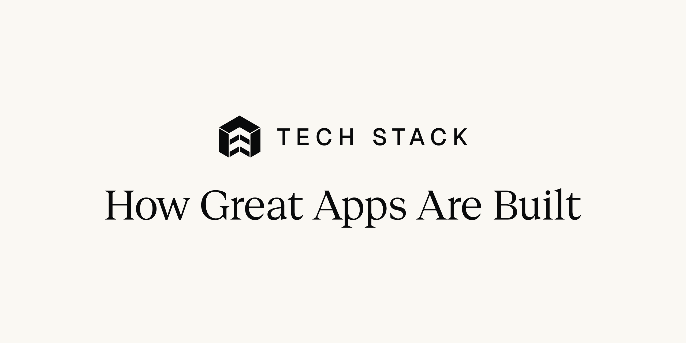
</picture>
<!-- ts:end header -->

<!-- ts:begin intro -->

The SDKs, languages and frameworks in public App Store and Google Play builds, read from the binaries. One JSON file per app version.

324 apps · 421 versions · 205 companies · 3,962 SDKs

<a href="#how-apps-are-built">Findings</a> · <a href="#explore-the-apps">Browse the apps</a> · <a href="docs/data-notes.md">About the data</a>

 
<!-- ts:end intro -->

<!-- ts:begin story -->
## How apps are built

SwiftUI is in all 159 iOS apps, and Jetpack Compose is in 130 of 165 Android apps. 80 apps also use a cross-platform runtime.

<picture><source media="(prefers-color-scheme: dark)" srcset="assets/charts/languages-dark.svg">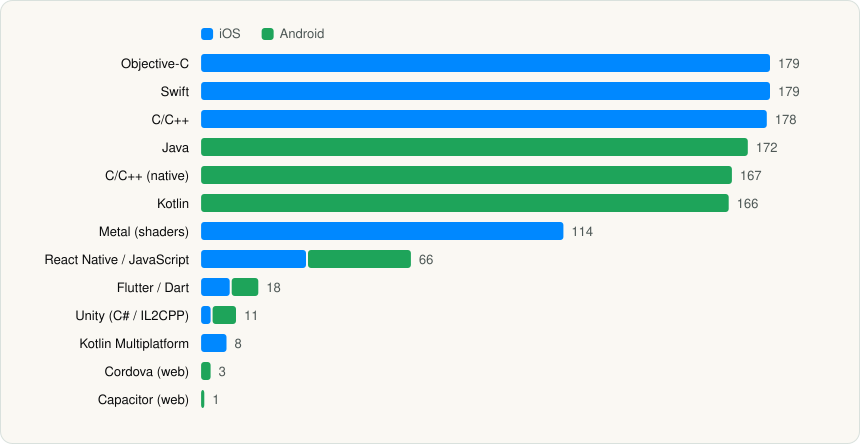</picture>

 

## What most apps ship

Firebase is in 209 of 324 apps. 78% of apps ship at least one analytics SDK.

**Most used SDKs**

<picture><source media="(prefers-color-scheme: dark)" srcset="assets/charts/top-sdks-dark.svg">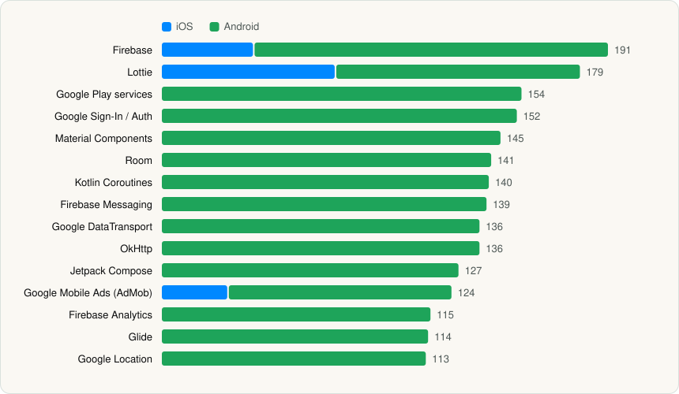</picture>

 

**Apps with at least one SDK in each category**

<picture><source media="(prefers-color-scheme: dark)" srcset="assets/charts/sdk-categories-dark.svg">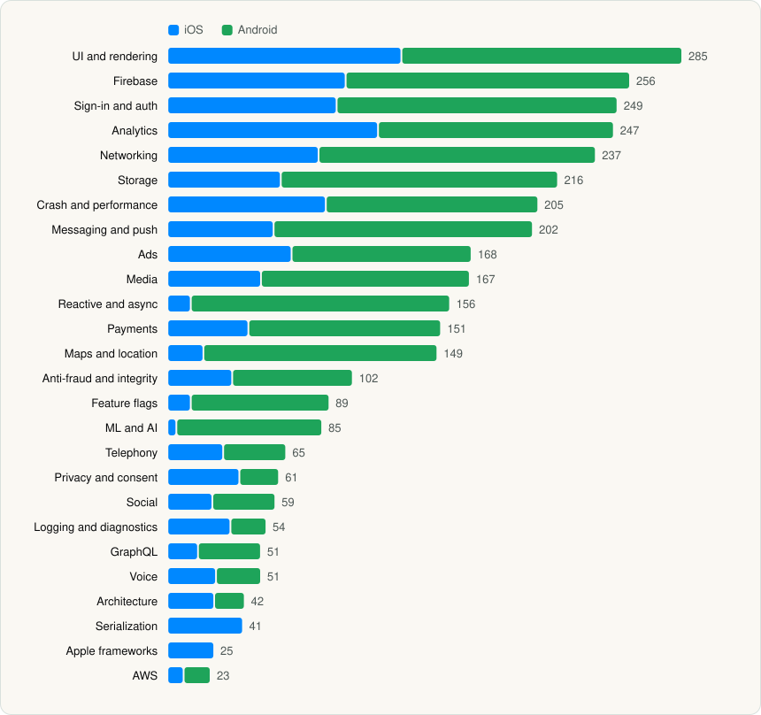</picture>

 

## How big an SDK list gets

The median app ships 34 SDKs on iOS and 29 on Android. Whatnot (iOS) has the most, at 349.

**Apps by number of SDKs**

<picture><source media="(prefers-color-scheme: dark)" srcset="assets/charts/sdk-count-distribution-dark.svg">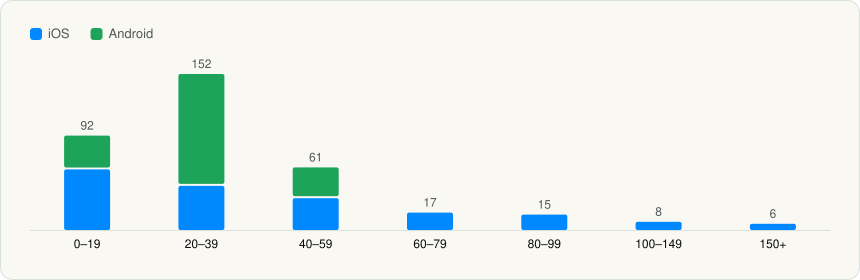</picture>

 

**The same app on both stores (16 largest of 66)**

<picture><source media="(prefers-color-scheme: dark)" srcset="assets/charts/both-platforms-dark.svg">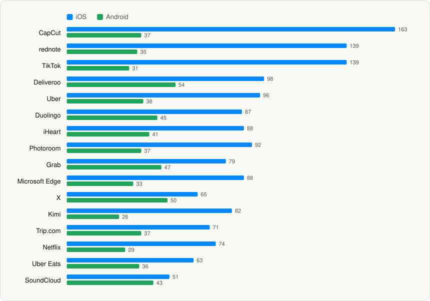</picture>

 

## Privacy and permissions

50% of iOS apps declare tracking. The median Android app asks for 31 permissions.

**Most declared iOS collected data types**

<picture><source media="(prefers-color-scheme: dark)" srcset="assets/charts/ios-data-types-dark.svg">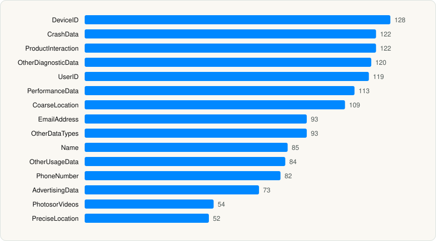</picture>

 

**Most requested Android permissions**

<picture><source media="(prefers-color-scheme: dark)" srcset="assets/charts/android-permissions-dark.svg">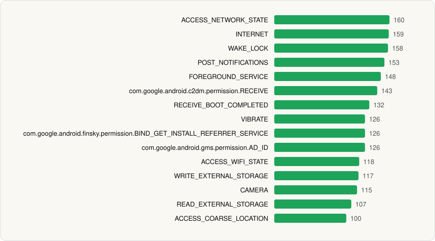</picture>

 

## How apps change between versions

58 of 97 updates changed the SDK list. Together they added 188 SDKs and removed 203.

**SDKs added and removed between versions**

<picture><source media="(prefers-color-scheme: dark)" srcset="assets/charts/sdk-changes-dark.svg">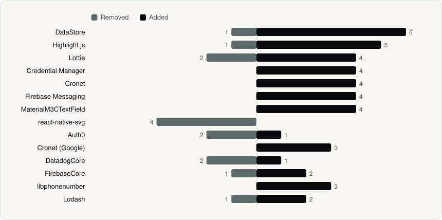</picture>

 

**SDK count across versions**

<picture><source media="(prefers-color-scheme: dark)" srcset="assets/charts/sdk-count-over-versions-dark.svg">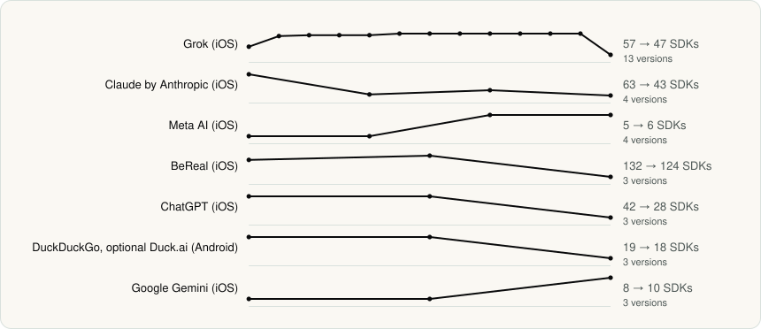</picture>

 

## Which OS versions apps support

The most common minimum is iOS 16 and Android API 29. The most common Android target is API 36.

**Minimum iOS version**

<picture><source media="(prefers-color-scheme: dark)" srcset="assets/charts/ios-min-os-dark.svg">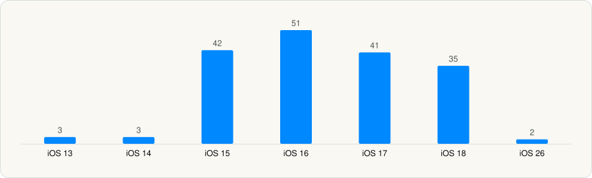</picture>

 

**Android minimum and target API levels**

<picture><source media="(prefers-color-scheme: dark)" srcset="assets/charts/android-sdk-levels-dark.svg">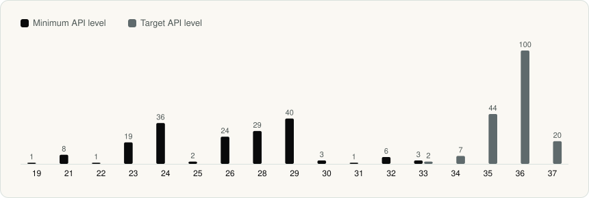</picture>

 

## Who makes the apps

Google and Google LLC share the most apps, with 21 each. 158 of 205 companies have one app each.

<picture><source media="(prefers-color-scheme: dark)" srcset="assets/charts/top-companies-dark.svg">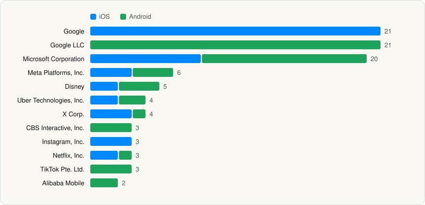</picture>

 

[All companies](companies/README.md)
<!-- ts:end story -->

## Explore the apps

<!-- ts:begin explore -->
### Largest SDK lists

<table>
<tr><td align="center" valign="top" width="16%"> <a href="apps/ios/whatnot-inc/whatnot/README.md"><b>Whatnot</b></a> iOS · 349 SDKs</td><td align="center" valign="top" width="16%"> <a href="apps/ios/depop-ltd/depop/README.md"><b>Depop</b></a> iOS · 344 SDKs</td><td align="center" valign="top" width="16%"> <a href="apps/ios/beijing-zhizhetianxia-technology-co-ltd/zhihu/README.md"><b>知乎</b></a> iOS · 214 SDKs</td><td align="center" valign="top" width="16%"><a href="apps/ios/beijing-baidu-netcom-science-technology-co-ltd/baidu/README.md">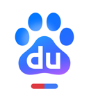</a> <a href="apps/ios/beijing-baidu-netcom-science-technology-co-ltd/baidu/README.md"><b>百度-AI智能搜索</b></a> iOS · 188 SDKs</td><td align="center" valign="top" width="16%"> <a href="apps/ios/bytedance-pte-ltd/capcut/README.md"><b>CapCut</b></a> iOS · 163 SDKs</td><td align="center" valign="top" width="16%"> <a href="apps/ios/xingin/rednote/README.md"><b>rednote</b></a> iOS · 139 SDKs</td></tr>
<tr><td align="center" valign="top" width="16%"> <a href="apps/ios/tiktok-ltd/tiktok/README.md"><b>TikTok</b></a> iOS · 139 SDKs</td><td align="center" valign="top" width="16%"> <a href="apps/ios/life360/life360/README.md"><b>Life360</b></a> iOS · 137 SDKs</td><td align="center" valign="top" width="16%"> <a href="apps/ios/bereal/bereal/README.md"><b>BeReal</b></a> iOS · 124 SDKs</td><td align="center" valign="top" width="16%"> <a href="apps/ios/microsoft-corporation/microsoft-bing-search/README.md"><b>Microsoft Bing Search</b></a> iOS · 117 SDKs</td><td align="center" valign="top" width="16%"> <a href="apps/ios/warnermedia-global-digital-services-llc/hbo-max/README.md"><b>HBO Max</b></a> iOS · 107 SDKs</td><td align="center" valign="top" width="16%"> <a href="apps/ios/speechify-inc/speechify/README.md"><b>Speechify</b></a> iOS · 103 SDKs</td></tr>
</table>

### Recently analysed

<table>
<tr><td align="center" valign="top" width="16%"> <a href="apps/android/alibaba-mobile/alibaba-com/README.md"><b>Alibaba.com</b></a> Android · 2026-11-06</td><td align="center" valign="top" width="16%"> <a href="apps/ios/esame-marketing-limited/iamor-family-location-tracker/README.md"><b>iAmor Family Location Tracker</b></a> iOS · 2026-11-06</td><td align="center" valign="top" width="16%"> <a href="apps/ios/the-college-board/bigfuture-school/README.md"><b>BigFuture School</b></a> iOS · 2026-11-06</td><td align="center" valign="top" width="16%"> <a href="apps/ios/microsoft-corporation/microsoft-teams/README.md"><b>Microsoft Teams</b></a> iOS · 2026-11-06</td><td align="center" valign="top" width="16%"> <a href="apps/android/drawnames/drawnames-secret-santa-app/README.md"><b>drawnames</b></a> Android · 2026-11-05</td><td align="center" valign="top" width="16%"> <a href="apps/android/goat/goat/README.md"><b>GOAT</b></a> Android · 2026-11-05</td></tr>
<tr><td align="center" valign="top" width="16%"> <a href="apps/ios/shopify-inc/shop/README.md"><b>Shop</b></a> iOS · 2026-11-05</td><td align="center" valign="top" width="16%"> <a href="apps/ios/google/google-meet/README.md"><b>Google Meet</b></a> iOS · 2026-11-05</td><td align="center" valign="top" width="16%"><a href="apps/android/naver-corp/app/README.md">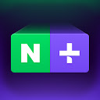</a> <a href="apps/android/naver-corp/app/README.md"><b>네이버플러스 스토어</b></a> Android · 2026-11-05</td><td align="center" valign="top" width="16%"> <a href="apps/android/american-airlines-inc/american-airlines/README.md"><b>American Airlines</b></a> Android · 2026-11-05</td><td align="center" valign="top" width="16%"><a href="apps/ios/naver-corp/app/README.md">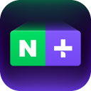</a> <a href="apps/ios/naver-corp/app/README.md"><b>네이버플러스 스토어</b></a> iOS · 2026-11-05</td><td align="center" valign="top" width="16%"> <a href="apps/ios/instagram-inc/instants-an-instagram-app/README.md"><b>Instants</b></a> iOS · 2026-11-05</td></tr>
</table>

### All apps

iOS (159 apps)

| | App | Company | Latest | SDKs |
|---|---|---|---|---|
|  | [A101: Tek Uygulama](apps/ios/yeni-magazacilik-anonim-sirketi/a101/README.md) | [YENİ MAĞAZACILIK ANONİM ŞİRKETİ](companies/yeni-magazacilik-anonim-sirketi.md) | 3.0.6 | 51 |
|  | [Airbnb](apps/ios/airbnb-inc/airbnb/README.md) | [Airbnb, Inc.](companies/airbnb-inc.md) | 26.43.1 | 23 |
|  | [AliExpress - Shopping App](apps/ios/alibaba/aliexpress/README.md) | [Alibaba](companies/alibaba.md) | 8.180.0 | 61 |
|  | [Amazon Music: Songs & Podcasts](apps/ios/amzn-mobile-llc/amazon-music/README.md) | [AMZN Mobile LLC](companies/amzn-mobile-llc.md) | 26.17.0 | 72 |
|  | [Amazon Prime Video](apps/ios/amzn-mobile-llc/amazon-prime-video/README.md) | [AMZN Mobile LLC](companies/amzn-mobile-llc.md) | 10.134 | 48 |
|  | [Audible: Audiobooks & Podcasts](apps/ios/audible-inc/audible/README.md) | [Audible, Inc.](companies/audible-inc.md) | 4.71.1 | 29 |
|  | [BeReal: Photos & Friends Daily](apps/ios/bereal/bereal/README.md) | [BeReal](companies/bereal.md) | 4.99.0 | 124 |
|  | [BigFuture School](apps/ios/the-college-board/bigfuture-school/README.md) | [The College Board](companies/the-college-board.md) | 3.1.0 | 6 |
|  | [Bluesky Social](apps/ios/bluesky-pbllc/bluesky/README.md) | [Bluesky PBLLC](companies/bluesky-pbllc.md) | 1.136.0 | 13 |
|  | [Bring Tracking](apps/ios/posten/bring-tracking/README.md) | [Posten](companies/posten.md) | 8.4.9 | 24 |
|  | [Canva AI Photo & Video Editor](apps/ios/canva/canva-ai-photo-video-editor/README.md) | [Canva](companies/canva.md) | 4.232.1 | 57 |
|  | [CapCut: Photo & Video Editor](apps/ios/bytedance-pte-ltd/capcut/README.md) | [Bytedance Pte. Ltd](companies/bytedance-pte-ltd.md) | 19.9.0 | 163 |
|  | [Capital One Shopping: Save Now](apps/ios/wikibuy-llc/capital-one-shopping/README.md) | [Wikibuy, LLC](companies/wikibuy-llc.md) | 2.162.0 | 22 |
|  | [Character AI: Chat, Talk, Text](apps/ios/character-ai/character-ai/README.md) | [Character.AI](companies/character-ai.md) | 1.17.4 | 74 |
| 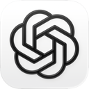 | [ChatGPT](apps/ios/openai-opco-llc/chatgpt/README.md) | [OpenAI OpCo, LLC](companies/openai-opco-llc.md) | 1.2026.286 | 28 |
|  | [Claude by Anthropic](apps/ios/anthropic-pbc/claude/README.md) | [Anthropic PBC](companies/anthropic-pbc.md) | 1.261021.20 | 43 |
|  | [Cleanup: Phone Storage Cleaner](apps/ios/deep-flow-software-services/cleanup/README.md) | [DEEP FLOW SOFTWARE SERVICES](companies/deep-flow-software-services.md) | 6.25.1 | 42 |
|  | [Clubhouse](apps/ios/alpha-exploration-co/clubhouse/README.md) | [Alpha Exploration Co.](companies/alpha-exploration-co.md) | 26.10.29 | 32 |
|  | [Crunchyroll](apps/ios/crunchyroll-llc/crunchyroll/README.md) | [Crunchyroll, LLC](companies/crunchyroll-llc.md) | 4.109.3 | 33 |
|  | [DealSeek: Coupons & Discounts](apps/ios/dealseek-llc/dealseek/README.md) | [DealSeek LLC](companies/dealseek-llc.md) | 1.64.0 | 32 |
|  | [Deliveroo: Food & Shopping](apps/ios/deliveroo/deliveroo/README.md) | [Deliveroo](companies/deliveroo.md) | 3.346.0 | 98 |
|  | [Depop - Buy & Sell Clothes](apps/ios/depop-ltd/depop/README.md) | [Depop Ltd](companies/depop-ltd.md) | 2.418 | 344 |
|  | [Discord - Talk, Play, Hang Out](apps/ios/discord-inc/discord/README.md) | [Discord Inc.](companies/discord-inc.md) | 350.0 | 15 |
|  | [Disney+](apps/ios/disney/disney/README.md) | [Disney](companies/disney.md) | 5.20.5 | 53 |
|  | [DoorDash: Food, Grocery, More](apps/ios/doordash-inc/doordash/README.md) | [DoorDash, Inc.](companies/doordash-inc.md) | 8.41.0 | 98 |
|  | [DramaWave - Dramas & Reels](apps/ios/skywork-ai-pte-ltd/dramawave/README.md) | [SKYWORK AI PTE LTD](companies/skywork-ai-pte-ltd.md) | 2.0.30 | 93 |
|  | [Dropbox: Cloud Storage Backup](apps/ios/dropbox-inc/dropbox/README.md) | [Dropbox, Inc.](companies/dropbox-inc.md) | 476.2 | 19 |
|  | [Duolingo: Learn Languages](apps/ios/duolingo/duolingo/README.md) | [Duolingo](companies/duolingo.md) | 7.145.1 | 87 |
|  | [Edits: Video Editor](apps/ios/instagram-inc/edits/README.md) | [Instagram, Inc.](companies/instagram-inc.md) | 452.1.0 | 6 |
|  | [ESPN: Live Sports & Scores](apps/ios/disney/espn/README.md) | [Disney](companies/disney.md) | 8.19.0 | 54 |
|  | [Facebook](apps/ios/meta-platforms-inc/facebook/README.md) | [Meta Platforms, Inc.](companies/meta-platforms-inc.md) | 564.0.0 | 11 |
|  | [FIFA World Cup 2026™](apps/ios/fifa/fifa-world-cup-2026/README.md) | [FIFA](companies/fifa.md) | 3.1.1 | 69 |
|  | [FreeDrama: Watch Short Stories](apps/ios/kuku-technologies-limited/freedrama/README.md) | [Kuku Technologies Limited](companies/kuku-technologies-limited.md) | 3.8.7 | 81 |
| 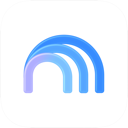 | [Gemini Notebook](apps/ios/google/gemini-notebook/README.md) | [Google](companies/google.md) | 1.64.1 | 14 |
| 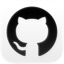 | [GitHub](apps/ios/github/github/README.md) | [GitHub](companies/github.md) | 1.282.1 | 65 |
|  | [Gmail - Email by Google](apps/ios/google/gmail-email-by-google/README.md) | [Google](companies/google.md) | 6.0.260525 | 14 |
|  | [Google](apps/ios/google/google/README.md) | [Google](companies/google.md) | 423.5 | 13 |
|  | [Google Authenticator](apps/ios/google/google-authenticator/README.md) | [Google](companies/google.md) | 5.0.0 | 16 |
| 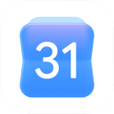 | [Google Calendar: Get Organized](apps/ios/google/google-calendar/README.md) | [Google](companies/google.md) | 26.20.0 | 9 |
|  | [Google Classroom](apps/ios/google/google-classroom/README.md) | [Google](companies/google.md) | 3.59.300048840 | 11 |
| 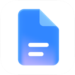 | [Google Docs](apps/ios/google/google-docs/README.md) | [Google](companies/google.md) | 1.2026.22203 | 12 |
| 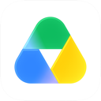 | [Google Drive](apps/ios/google/google-drive/README.md) | [Google](companies/google.md) | 4.2622.41005 | 7 |
| 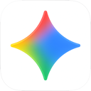 | [Google Gemini](apps/ios/google/gemini/README.md) | [Google](companies/google.md) | 1.2026.4171302 | 10 |
| 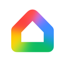 | [Google Home](apps/ios/google/google-home/README.md) | [Google](companies/google.md) | 4.17.55 | 23 |
| 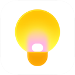 | [Google Keep - Notes and lists](apps/ios/google/google-keep/README.md) | [Google](companies/google.md) | 2.2026.43101 | 9 |
| 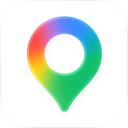 | [Google Maps](apps/ios/google/google-maps/README.md) | [Google](companies/google.md) | 26.22.2 | 15 |
|  | [Google Meet](apps/ios/google/google-meet/README.md) | [Google](companies/google.md) | 383.1 | 14 |
|  | [Google News](apps/ios/google/google-news/README.md) | [Google](companies/google.md) | 5.118 | 13 |
| 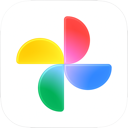 | [Google Photos: Backup & Edit](apps/ios/google/google-photos/README.md) | [Google](companies/google.md) | 7.79.0 | 13 |
|  | [Google Sheets](apps/ios/google/google-sheets/README.md) | [Google](companies/google.md) | 1.2026.22200 | 11 |
|  | [Google Slides](apps/ios/google/google-slides/README.md) | [Google](companies/google.md) | 1.2026.22200 | 13 |
|  | [Google Translate](apps/ios/google/google-translate/README.md) | [Google](companies/google.md) | 10.21.273 | 9 |
|  | [Google Voice](apps/ios/google/google-voice/README.md) | [Google](companies/google.md) | 26.22 | 3 |
|  | [GoWish - Your Digital Wishlist](apps/ios/onskeskyen-aps/gowish/README.md) | [Onskeskyen ApS](companies/onskeskyen-aps.md) | 9.2.4 | 45 |
|  | [Grab: Taxi Ride, Food Delivery](apps/ios/grab-com/grab/README.md) | [Grab.com](companies/grab-com.md) | 5.432.0 | 79 |
|  | [Granola - AI Meeting Notes](apps/ios/granola-inc/granola/README.md) | [Granola inc](companies/granola-inc.md) | 1.15.11 | 31 |
|  | [Grok - AI Chat & Video](apps/ios/x-corp/grok/README.md) | [X Corp.](companies/x-corp.md) | 1.4.58 | 47 |
|  | [Grok Bot](apps/ios/x-corp/grok-bot/README.md) | [X Corp.](companies/x-corp.md) | 1.0.0 | 18 |
|  | [GroupMe](apps/ios/skype-communications-s-a-r-l/groupme/README.md) | [Skype Communications S.a.r.l](companies/skype-communications-s-a-r-l.md) | 15.76.3 | 76 |
|  | [HBO Max: Stream Movies & TV](apps/ios/warnermedia-global-digital-services-llc/hbo-max/README.md) | [WarnerMedia Global Digital Services, LLC](companies/warnermedia-global-digital-services-llc.md) | 7.4.0 | 107 |
|  | [Hulu: Stream TV shows & movies](apps/ios/hulu-llc/hulu/README.md) | [Hulu, LLC](companies/hulu-llc.md) | 9.34.0 | 28 |
|  | [i-Kfz](apps/ios/kraftfahrt-bundesamt/i-kfz/README.md) | [Kraftfahrt-Bundesamt](companies/kraftfahrt-bundesamt.md) | 1.1.8 | 4 |
|  | [iAmor Family Location Tracker](apps/ios/esame-marketing-limited/iamor-family-location-tracker/README.md) | [Esame Marketing Limited](companies/esame-marketing-limited.md) | 1.0.6 | 72 |
|  | [Ideogram AI - Image Generator](apps/ios/ideogram/ideogram-ai/README.md) | [Ideogram](companies/ideogram.md) | 2026.41 | 19 |
|  | [iHeart: Radio, Music, Podcasts](apps/ios/iheartmedia-management-services-inc/iheart/README.md) | [iHeartMedia Management Services, Inc.](companies/iheartmedia-management-services-inc.md) | 10.64.0 | 88 |
|  | [Instagram](apps/ios/instagram-inc/instagram/README.md) | [Instagram, Inc.](companies/instagram-inc.md) | 432.0.0 | 13 |
|  | [Instants – an Instagram app](apps/ios/instagram-inc/instants-an-instagram-app/README.md) | [Instagram, Inc.](companies/instagram-inc.md) | 454.0.0 | 7 |
|  | [Kalo: AI Calorie Counter](apps/ios/shelgaon-ltd/kalo/README.md) | [Shelgaon Ltd](companies/shelgaon-ltd.md) | 1.6.9 | 24 |
|  | [Kimi - Your Personal AI Agent](apps/ios/moonshot-ai/kimi/README.md) | [Moonshot AI](companies/moonshot-ai.md) | 3.1.6 | 82 |
|  | [Koupon: Vouchers & Discounts](apps/ios/koupon-inc/koupon/README.md) | [Koupon Inc.](companies/koupon-inc.md) | 3.1.4 | 38 |
|  | [Le Chat by Mistral AI](apps/ios/mistral-ai/le-chat/README.md) | [Mistral AI](companies/mistral-ai.md) | 2.16.0 | 24 |
|  | [Lemon8 - Lifestyle Community](apps/ios/tiktok-ltd/lemon8/README.md) | [TikTok Ltd.](companies/tiktok-ltd.md) | 15.1.0 | 57 |
|  | [Lensa AI: Photo Editor](apps/ios/prisma-labs-inc/lensa-ai/README.md) | [Prisma labs, inc.](companies/prisma-labs-inc.md) | 8.13.0 | 68 |
|  | [Life360: Family Safety & GPS](apps/ios/life360/life360/README.md) | [Life360](companies/life360.md) | 26.41.0 | 137 |
|  | [LinkedIn: Community & Network](apps/ios/linkedin-corporation/linkedin/README.md) | [LinkedIn Corporation](companies/linkedin-corporation.md) | 2026.0601.2241 | 18 |
|  | [Lyft](apps/ios/lyft-inc/lyft/README.md) | [Lyft, Inc.](companies/lyft-inc.md) | 2026.41.3 | 14 |
|  | [Manus - AI Agent & Automation](apps/ios/butterfly-effect-pte-ltd/manus/README.md) | [BUTTERFLY EFFECT PTE. LTD.](companies/butterfly-effect-pte-ltd.md) | 26.19.2 | 63 |
|  | [Mastodon](apps/ios/mastodon-gmbh/mastodon/README.md) | [Mastodon GmbH](companies/mastodon-gmbh.md) | 2026.07 | 14 |
|  | [Messenger](apps/ios/meta-platforms-inc/messenger/README.md) | [Meta Platforms, Inc.](companies/meta-platforms-inc.md) | 563.0.0 | 1 |
| 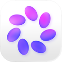 | [Meta AI](apps/ios/meta-platforms-inc/meta-ai/README.md) | [Meta Platforms, Inc.](companies/meta-platforms-inc.md) | 297.0.0 | 6 |
|  | [Microsoft Authenticator](apps/ios/microsoft-corporation/microsoft-authenticator/README.md) | [Microsoft Corporation](companies/microsoft-corporation.md) | 6.8.48 | 11 |
|  | [Microsoft Bing Search](apps/ios/microsoft-corporation/microsoft-bing-search/README.md) | [Microsoft Corporation](companies/microsoft-corporation.md) | 33.4.440605001 | 117 |
| 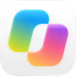 | [Microsoft Copilot](apps/ios/microsoft-corporation/microsoft-copilot/README.md) | [Microsoft Corporation](companies/microsoft-corporation.md) | 2.115.1 | 10 |
|  | [Microsoft Edge](apps/ios/microsoft-corporation/microsoft-edge/README.md) | [Microsoft Corporation](companies/microsoft-corporation.md) | 156.4314.56 | 88 |
| 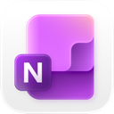 | [Microsoft OneNote](apps/ios/microsoft-corporation/microsoft-onenote/README.md) | [Microsoft Corporation](companies/microsoft-corporation.md) | 16.109.3 | 2 |
| 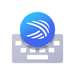 | [Microsoft SwiftKey AI Keyboard](apps/ios/swiftkey/microsoft-swiftkey-ai-keyboard/README.md) | [SwiftKey](companies/swiftkey.md) | 4.3.2 | 46 |
|  | [Microsoft Teams](apps/ios/microsoft-corporation/microsoft-teams/README.md) | [Microsoft Corporation](companies/microsoft-corporation.md) | 8.19.3 | 51 |
|  | [Microsoft To Do](apps/ios/microsoft-corporation/microsoft-to-do/README.md) | [Microsoft Corporation](companies/microsoft-corporation.md) | 2.177 | 12 |
|  | [Microsoft Word](apps/ios/microsoft-corporation/microsoft-word/README.md) | [Microsoft Corporation](companies/microsoft-corporation.md) | 2.115.2 | 11 |
| 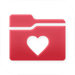 | [MyChart](apps/ios/epic/mychart/README.md) | [Epic](companies/epic.md) | 11.9.5 | 0 |
|  | [NBA: Live Games & Scores](apps/ios/nba-media-ventures-llc/nba/README.md) | [NBA MEDIA VENTURES, LLC](companies/nba-media-ventures-llc.md) | 120722.1 | 43 |
|  | [Netflix](apps/ios/netflix-inc/netflix/README.md) | [Netflix, Inc.](companies/netflix-inc.md) | 18.34.0 | 74 |
|  | [Netflix Game Controller](apps/ios/netflix-inc/netflix-game-controller/README.md) | [Netflix, Inc.](companies/netflix-inc.md) | 3.21 | 40 |
|  | [New York Road Runners](apps/ios/new-york-road-runners-inc/new-york-road-runners/README.md) | [New York Road Runners, Inc.](companies/new-york-road-runners-inc.md) | 3.0.0 | 32 |
|  | [Nextdoor: Neighborhood Network](apps/ios/nextdoor/nextdoor/README.md) | [Nextdoor](companies/nextdoor.md) | 6.201.2 | 98 |
| 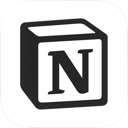 | [Notion: Notes, Tasks, AI](apps/ios/notion-labs-incorporated/notion/README.md) | [Notion Labs, Incorporated](companies/notion-labs-incorporated.md) | 0.4.2133 | 38 |
|  | [NYTimes: Breaking World News](apps/ios/the-new-york-times-company/nytimes/README.md) | [The New York Times Company](companies/the-new-york-times-company.md) | 11.98.0 | 30 |
| 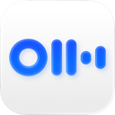 | [Otter Transcribe Voice Notes](apps/ios/otter-ai-inc/otter-transcribe-voice-notes/README.md) | [Otter.ai, Inc.](companies/otter-ai-inc.md) | 3.110.1 | 36 |
|  | [Pandora: Music & Podcasts](apps/ios/pandora-media-llc/pandora/README.md) | [Pandora Media, LLC](companies/pandora-media-llc.md) | 2606.1 | 41 |
|  | [Paramount+](apps/ios/cbs-interactive/paramount/README.md) | [CBS Interactive](companies/cbs-interactive.md) | 15.18.2 | 30 |
|  | [Partiful: Party Invite Maker](apps/ios/partiful/partiful/README.md) | [Partiful](companies/partiful.md) | 3.10.23 | 23 |
| 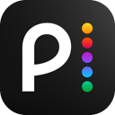 | [Peacock TV: Stream TV & Movies](apps/ios/peacock-tv-llc/peacock-tv/README.md) | [Peacock TV LLC](companies/peacock-tv-llc.md) | 7.5.21 | 40 |
| 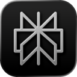 | [Perplexity - AI Search & Chat](apps/ios/perplexity-ai-inc/perplexity/README.md) | [Perplexity AI, Inc.](companies/perplexity-ai-inc.md) | 26.42.0 | 26 |
|  | [Photoroom: AI Photo Editor](apps/ios/photoroom/photoroom/README.md) | [Photoroom](companies/photoroom.md) | 2026.45.01 | 87 |
|  | [Picsart AI Photo Editor, Video](apps/ios/picsart-inc/picsart-ai-photo-editor-video/README.md) | [PicsArt, Inc.](companies/picsart-inc.md) | 30.9.2 | 47 |
| 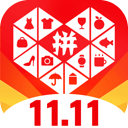 | [Pinduoduo](apps/ios/shanghai-xunmeng-information-technology-co-ltd/pinduoduo/README.md) | [上海寻梦信息技术有限公司](companies/shanghai-xunmeng-information-technology-co-ltd.md) | 8.30.0 | 71 |
|  | [Pinterest](apps/ios/pinterest-inc/pinterest/README.md) | [Pinterest, Inc.](companies/pinterest-inc.md) | 14.21 | 28 |
|  | [PLAYFUL REWARDS: Earn Rewards](apps/ios/playful-rewards/playful-rewards/README.md) | [Playful Rewards](companies/playful-rewards.md) | 3.2.2 | 44 |
|  | [Plex: Find Movies and TV Shows](apps/ios/plex-inc/plex/README.md) | [Plex Inc.](companies/plex-inc.md) | 2026.11.0 | 38 |
|  | [PlutoTV: Stream Free Movies/TV](apps/ios/pluto-tv/plutotv/README.md) | [Pluto.tv](companies/pluto-tv.md) | 5.75.1 | 39 |
|  | [Poe – Fast AI Chat](apps/ios/quora-inc/poe/README.md) | [Quora, Inc.](companies/quora-inc.md) | 6.1.0 | 22 |
|  | [Posh – Create & Find Events](apps/ios/posh-group-inc/posh/README.md) | [Posh Group Inc.](companies/posh-group-inc.md) | 8.25.0 | 32 |
| 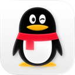 | [QQ](apps/ios/tencent-technology-shenzhen-company-limited/qq/README.md) | [Tencent Technology (Shenzhen) Company Limited](companies/tencent-technology-shenzhen-company-limited.md) | 9.3.78 | 44 |
|  | [Rakuten Viber Messenger](apps/ios/viber-media-sarl/viber-messenger/README.md) | [Viber Media SARL.](companies/viber-media-sarl.md) | 28.0.2 | 26 |
|  | [Reco Social](apps/ios/reco-social-inc/reco-social/README.md) | [Reco Social, Inc.](companies/reco-social-inc.md) | 1.8.6 | 82 |
|  | [Reddit](apps/ios/reddit-inc/reddit/README.md) | [REDDIT, INC.](companies/reddit-inc.md) | 2026.22.0 | 33 |
|  | [rednote](apps/ios/xingin/rednote/README.md) | [Xingin](companies/xingin.md) | 9.51.1 | 139 |
|  | [ReelShort - Stream Drama & TV](apps/ios/newleaf-publishing/reelshort/README.md) | [NewLeaf Publishing](companies/newleaf-publishing.md) | 4.2.00 | 84 |
|  | [Remini - AI Photo Enhancer](apps/ios/bending-spoons-operations-spa/remini/README.md) | [BENDING SPOONS OPERATIONS SPA](companies/bending-spoons-operations-spa.md) | 2.10.222 | 87 |
|  | [Replika - AI Companion Chat](apps/ios/luka-inc/replika/README.md) | [Luka, Inc.](companies/luka-inc.md) | 12.5.1 | 80 |
|  | [Roku Remote (Official)](apps/ios/roku-inc/roku-remote-official/README.md) | [ROKU INC](companies/roku-inc.md) | 14.1.2 | 39 |
|  | [setlog - friends camera](apps/ios/new-chat/setlog/README.md) | [new chat](companies/new-chat.md) | 2.7.7 | 1 |
|  | [Shazam: Find Music & Concerts](apps/ios/apple/shazam/README.md) | [Apple](companies/apple.md) | 26.11.0 | 1 |
|  | [SHEIN - Shopping Online](apps/ios/roadget-business-pte-ltd/shein/README.md) | [ROADGET BUSINESS PTE. LTD.](companies/roadget-business-pte-ltd.md) | 15.5.6 | 41 |
|  | [Shop: Track, Pay, Discover](apps/ios/shopify-inc/shop/README.md) | [Shopify Inc.](companies/shopify-inc.md) | 3.17.0 | 34 |
|  | [Signal - Private Messenger](apps/ios/signal-messenger-llc/signal-private-messenger/README.md) | [Signal Messenger, LLC](companies/signal-messenger-llc.md) | 8.34 | 9 |
|  | [Snapchat](apps/ios/snap-inc/snapchat/README.md) | [Snap, Inc.](companies/snap-inc.md) | 13.95.1 | 7 |
|  | [Sony LIV](apps/ios/sony-pictures-networks-india-pvt-ltd/sony-liv/README.md) | [SONY PICTURES NETWORKS INDIA PVT LTD](companies/sony-pictures-networks-india-pvt-ltd.md) | 9.2.6 | 53 |
|  | [SoundCloud: The Music You Love](apps/ios/soundcloud-global-limited-co-kg/soundcloud/README.md) | [SoundCloud Global Limited & Co KG](companies/soundcloud-global-limited-co-kg.md) | 8.63.1 | 51 |
|  | [Speechify – Text to Speech PDF](apps/ios/speechify-inc/speechify/README.md) | [Speechify Inc.](companies/speechify-inc.md) | 5.5.17 | 103 |
|  | [Spotify: Music and Podcasts](apps/ios/spotify/spotify/README.md) | [Spotify](companies/spotify.md) | 9.1.92 | 22 |
|  | [Strava: Run, Bike, Walk](apps/ios/strava-inc/strava/README.md) | [Strava, Inc.](companies/strava-inc.md) | 466.0.0 | 50 |
|  | [Suno - AI Songs, Music, Lyrics](apps/ios/suno-inc/suno/README.md) | [Suno, Inc.](companies/suno-inc.md) | 1.93.0 | 35 |
|  | [Telegram Messenger](apps/ios/telegram-fz-llc/telegram-messenger/README.md) | [Telegram FZ-LLC](companies/telegram-fz-llc.md) | 13.1.1 | 2 |
|  | [Temu: Shop Like a Billionaire](apps/ios/temu/temu/README.md) | [Temu](companies/temu.md) | 4.95.0 | 30 |
|  | [Threads](apps/ios/instagram-inc/threads/README.md) | [Instagram, Inc.](companies/instagram-inc.md) | 452.1.0 | 10 |
|  | [TikTok - Videos, Shop & LIVE](apps/ios/tiktok-ltd/tiktok/README.md) | [TikTok Ltd.](companies/tiktok-ltd.md) | 45.4.0 | 139 |
|  | [Trip.com: Book Flights, Hotels](apps/ios/trip-com-travel-singapore-pte-ltd/trip-com/README.md) | [Trip.com Travel Singapore Pte. Ltd.](companies/trip-com-travel-singapore-pte-ltd.md) | 8.59.0 | 71 |
|  | [Tubi: Movies & Live TV](apps/ios/tubi-inc/tubi/README.md) | [Tubi, Inc](companies/tubi-inc.md) | 10.22.1 | 40 |
|  | [Tumblr: Social Media & Art](apps/ios/tumblr-inc/tumblr/README.md) | [Tumblr, Inc.](companies/tumblr-inc.md) | 44.8 | 60 |
|  | [Twitch: Live Streaming](apps/ios/twitch-interactive-inc/twitch/README.md) | [Twitch Interactive, Inc.](companies/twitch-interactive-inc.md) | 29.7 | 38 |
|  | [Uber - Rides, Eats, Hotels](apps/ios/uber-technologies-inc/uber/README.md) | [Uber Technologies, Inc.](companies/uber-technologies-inc.md) | 3.744.10001 | 96 |
|  | [Uber Eats: Food & Groceries](apps/ios/uber-technologies-inc/uber-eats/README.md) | [Uber Technologies, Inc.](companies/uber-technologies-inc.md) | 6.346.10000 | 63 |
|  | [Vinted: Pre-loved marketplace](apps/ios/vinted-limited/vinted/README.md) | [Vinted Limited](companies/vinted-limited.md) | 26.41.1 | 82 |
|  | [WayShot:Aesthetic Photo Editor](apps/ios/romangic-lab-llc/wayshot-aesthetic-photo-editor/README.md) | [Romangic Lab LLC](companies/romangic-lab-llc.md) | 2.14.0 | 59 |
|  | [Waze Navigation & Live Traffic](apps/ios/waze-inc/waze-navigation-live-traffic/README.md) | [Waze Inc.](companies/waze-inc.md) | 5.26.0 | 4 |
|  | [WeChat](apps/ios/wechat/wechat/README.md) | [WeChat](companies/wechat.md) | 8.0.74 | 17 |
|  | [Whatnot: Shop, Sell, Connect](apps/ios/whatnot-inc/whatnot/README.md) | [Whatnot Inc.](companies/whatnot-inc.md) | 26.45.0 | 349 |
|  | [WhatsApp Business](apps/ios/whatsapp-inc/whatsapp-business/README.md) | [WhatsApp Inc.](companies/whatsapp-inc.md) | 26.42.77 | 6 |
|  | [WhatsApp Messenger](apps/ios/whatsapp-inc/whatsapp-messenger/README.md) | [WhatsApp Inc.](companies/whatsapp-inc.md) | 26.41.75 | 6 |
|  | [Workout Director - Gym & Home](apps/ios/shelgaon-ltd/workout-director-gym-home/README.md) | [Shelgaon Ltd](companies/shelgaon-ltd.md) | 1.0.89 | 7 |
|  | [X](apps/ios/x-corp/x/README.md) | [X Corp.](companies/x-corp.md) | 11.97 | 65 |
|  | [YouTube](apps/ios/google/youtube/README.md) | [Google](companies/google.md) | 21.42.4 | 19 |
|  | [YouTube Music](apps/ios/google/youtube-music/README.md) | [Google](companies/google.md) | 9.44.2 | 19 |
|  | [Zoom Workplace](apps/ios/zoom-communications-inc/zoom-workplace/README.md) | [Zoom Communications, Inc.](companies/zoom-communications-inc.md) | 7.2.3 | 18 |
|  | [微博](apps/ios/sina-corporation/weibo/README.md) | [SINA Corporation](companies/sina-corporation.md) | 16.10.2 | 51 |
|  | [百度-AI智能搜索](apps/ios/beijing-baidu-netcom-science-technology-co-ltd/baidu/README.md) | [Beijing Baidu Netcom Science & Technology Co.,Ltd](companies/beijing-baidu-netcom-science-technology-co-ltd.md) | 15.81.0 | 188 |
|  | [知乎](apps/ios/beijing-zhizhetianxia-technology-co-ltd/zhihu/README.md) | [Beijing Zhizhetianxia Technology Co., Ltd.](companies/beijing-zhizhetianxia-technology-co-ltd.md) | 11.12.0 | 214 |
|  | [네이버플러스 스토어](apps/ios/naver-corp/app/README.md) | [NAVER Corp.](companies/naver-corp.md) | 2.9.11 | 49 |

Android (165 apps)

| | App | Company | Latest | SDKs |
|---|---|---|---|---|
|  | [Affirm Quest](apps/android/affirm-quest/affirm-quest/README.md) | [Affirm Quest](companies/affirm-quest.md) | 1.2.7 | 13 |
|  | [Alibaba.com - B2B marketplace](apps/android/alibaba-mobile/alibaba-com/README.md) | [Alibaba Mobile](companies/alibaba-mobile.md) | 26.38.0 | 30 |
|  | [AliExpress - Shopping App](apps/android/alibaba-mobile/aliexpress/README.md) | [Alibaba Mobile](companies/alibaba-mobile.md) | 8.180.1 | 24 |
|  | [Amazon Shopping](apps/android/amazon-mobile-llc/amazon-shopping/README.md) | [Amazon Mobile LLC](companies/amazon-mobile-llc.md) | 32.11.0.100 | 39 |
|  | [American Airlines](apps/android/american-airlines-inc/american-airlines/README.md) | [American Airlines, Inc.](companies/american-airlines-inc.md) | 2026.33 | 34 |
|  | [Astra AI: Study & Exam Prep](apps/android/astra-ai/astra-ai/README.md) | [Astra AI](companies/astra-ai.md) | 3.7.436 | 12 |
|  | [Audible: Audiobooks & Podcasts](apps/android/audible-inc/audible/README.md) | [Audible, Inc.](companies/audible-inc.md) | 26.23.01 | 41 |
|  | [Audiomack: Music Downloader](apps/android/audiomack-music-apps/audiomack/README.md) | [Audiomack Music Apps](companies/audiomack-music-apps.md) | 8.4.0 | 51 |
|  | [Bluesky](apps/android/bluesky-pbllc/bluesky/README.md) | [Bluesky PBLLC](companies/bluesky-pbllc.md) | 1.136.0 | 24 |
|  | [BlueSkyVUE](apps/android/morelandconnect/blueskyvue/README.md) | [MorelandConnect](companies/morelandconnect.md) | 2.13.0 | 28 |
|  | [Booking.com: Hotels & Travel](apps/android/booking-com-hotels-vacation-rentals/booking-com/README.md) | [Booking.com Hotels & Vacation Rentals](companies/booking-com-hotels-vacation-rentals.md) | 66.6 | 45 |
|  | [Breaking News: Local & Alerts](apps/android/beloud-com/breaking-news/README.md) | [Beloud.com](companies/beloud-com.md) | 11.1.22 | 28 |
|  | [BURGER KING® App](apps/android/burger-king-inc/burger-king-app/README.md) | [Burger King, Inc.](companies/burger-king-inc.md) | 7.85.0 | 29 |
|  | [Canva: AI Photo & Video Editor](apps/android/canva/canva/README.md) | [Canva](companies/canva.md) | 2.383.0 | 39 |
|  | [CapCut - Video Editor](apps/android/bytedance-pte-ltd/capcut/README.md) | [Bytedance Pte. Ltd.](companies/bytedance-pte-ltd.md) | 19.8.0 | 37 |
|  | [CBS Sports: Live Scores & News](apps/android/cbs-interactive-inc/cbs-sports/README.md) | [CBS Interactive, Inc.](companies/cbs-interactive-inc.md) | 10.78 | 47 |
|  | [ChatGPT](apps/android/openai/chatgpt/README.md) | [OpenAI](companies/openai.md) | 1.2026.286 | 36 |
|  | [Chick-fil-A®](apps/android/chick-fil-a-inc/chick-fil-a/README.md) | [Chick-fil-A, Inc.](companies/chick-fil-a-inc.md) | 2026.11.1 | 30 |
|  | [Chime](apps/android/advita-ortho-llc/chime/README.md) | [Advita Ortho, LLC](companies/advita-ortho-llc.md) | 1.0.810 | 24 |
|  | [ClassDojo](apps/android/classdojo/classdojo/README.md) | [ClassDojo](companies/classdojo.md) | 8.59.0 | 47 |
|  | [Clubhouse](apps/android/alpha-exploration-co/clubhouse/README.md) | [Alpha Exploration Co.](companies/alpha-exploration-co.md) | 26.06.04 | 35 |
|  | [Crunchyroll Manga](apps/android/crunchyroll-llc/crunchyroll-manga/README.md) | [Crunchyroll, LLC](companies/crunchyroll-llc.md) | 1.1.3 | 26 |
|  | [CVS Specialty](apps/android/cvs-pharmacy/cvs-specialty/README.md) | [CVS Pharmacy](companies/cvs-pharmacy.md) | 2.82 | 23 |
|  | [DealSeek: Coupons & Discounts](apps/android/dealseek-llc/dealseek/README.md) | [DealSeek LLC](companies/dealseek-llc.md) | 1.64.0 | 25 |
|  | [DeepSeek - AI Assistant](apps/android/deepseek/deepseek/README.md) | [DeepSeek](companies/deepseek.md) | 2.7.1 | 11 |
|  | [Deezer for Creators](apps/android/deezer-music/deezer-for-creators/README.md) | [Deezer Music](companies/deezer-music.md) | 3.0.1 | 15 |
|  | [Deezer: Music & Podcast Player](apps/android/deezer-music/deezer/README.md) | [Deezer Music](companies/deezer-music.md) | 1.0.1.1 | 22 |
|  | [Deliveroo: Food & Shopping](apps/android/deliveroo/deliveroo/README.md) | [Deliveroo](companies/deliveroo.md) | 3.295.0 | 54 |
|  | [Discord - Talk, Play, Hang Out](apps/android/discord-inc/discord/README.md) | [Discord Inc.](companies/discord-inc.md) | 350.8 - Stable | 30 |
|  | [Disney+](apps/android/disney/disney/README.md) | [Disney](companies/disney.md) | 26.9.0+rc2-2026.06.01 | 28 |
|  | [Domino's Pizza USA](apps/android/domino-s-pizza-llc/domino-s-pizza-usa/README.md) | [Domino's Pizza LLC](companies/domino-s-pizza-llc.md) | 13.6.0 | 35 |
|  | [drawnames \| Secret Santa app](apps/android/drawnames/drawnames-secret-santa-app/README.md) | [drawnames](companies/drawnames.md) | 1.81.13 | 15 |
|  | [DuckDuckGo, optional Duck.ai](apps/android/duckduckgo/duckduckgo-optional-duck-ai/README.md) | [DuckDuckGo](companies/duckduckgo.md) | 5.299.0 | 18 |
|  | [Dunkin’](apps/android/dunkin-brands-inc/dunkin/README.md) | [Dunkin' Brands, Inc.](companies/dunkin-brands-inc.md) | 11.8.0.358 | 33 |
|  | [Duolingo: Learn Languages](apps/android/duolingo/duolingo/README.md) | [Duolingo](companies/duolingo.md) | 6.102.4 | 45 |
|  | [eBay online shopping & selling](apps/android/ebay-mobile/ebay-online-shopping-selling/README.md) | [eBay Mobile](companies/ebay-mobile.md) | 6.260.0.1 | 37 |
|  | [ESPN Fantasy Sports](apps/android/disney/espn-fantasy-sports/README.md) | [Disney](companies/disney.md) | 9.12.0 | 34 |
|  | [Facebook](apps/android/meta-platforms-inc/facebook/README.md) | [Meta Platforms, Inc.](companies/meta-platforms-inc.md) | 585.0.0.47.54 | 2 |
|  | [FreeReels - Dramas & Reels](apps/android/skywork-ai-pte-ltd/freereels/README.md) | [SKYWORK AI PTE.LTD.](companies/skywork-ai-pte-ltd.md) | 2.5.20 | 38 |
|  | [Gmail](apps/android/google-llc/gmail/README.md) | [Google LLC](companies/google-llc.md) | 2026.10.19.1005695425.Release | 21 |
|  | [Goat Evolution: Animal Merge](apps/android/tapps-games/goat-evolution/README.md) | [Tapps Games](companies/tapps-games.md) | 1.3.75 | 35 |
|  | [GOAT – Sneakers & Apparel](apps/android/goat/goat/README.md) | [GOAT](companies/goat.md) | 2.14.2 | 34 |
|  | [Google](apps/android/google-llc/google/README.md) | [Google LLC](companies/google-llc.md) | 17.28.32.ve.arm64 | 27 |
| 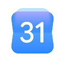 | [Google Calendar](apps/android/google-llc/google-calendar/README.md) | [Google LLC](companies/google-llc.md) | 2026.21.0-924344952-release | 16 |
|  | [Google Chat](apps/android/google-llc/google-chat/README.md) | [Google LLC](companies/google-llc.md) | 2026.05.25.920828381.Release | 14 |
|  | [Google Chrome](apps/android/google-llc/google-chrome/README.md) | [Google LLC](companies/google-llc.md) | 148.0.7778.217 | 9 |
|  | [Google Docs](apps/android/google-llc/google-docs/README.md) | [Google LLC](companies/google-llc.md) | 1.26.431.04.90 | 19 |
|  | [Google Drive](apps/android/google-llc/google-drive/README.md) | [Google LLC](companies/google-llc.md) | 2.26.437.0.all.alldpi | 21 |
|  | [Google Gemini](apps/android/google-llc/gemini/README.md) | [Google LLC](companies/google-llc.md) | 1.0.995038376 | 5 |
|  | [Google Keep - Notes and lists](apps/android/google-llc/google-keep/README.md) | [Google LLC](companies/google-llc.md) | 5.26.431.02.90 | 13 |
|  | [Google Lens](apps/android/google-llc/google-lens/README.md) | [Google LLC](companies/google-llc.md) | 1.18.250731009 | 8 |
| 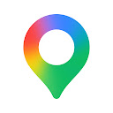 | [Google Maps](apps/android/google-llc/google-maps/README.md) | [Google LLC](companies/google-llc.md) | 26.22.04.920688788 | 22 |
|  | [Google Meet](apps/android/google-llc/google-meet/README.md) | [Google LLC](companies/google-llc.md) | 362.0.924540007.duo.android_20260601.01_p0 | 17 |
|  | [Google News - Daily Headlines](apps/android/google-llc/google-news/README.md) | [Google LLC](companies/google-llc.md) | 5.159.0.914722252 | 21 |
|  | [Google Photos](apps/android/google-llc/google-photos/README.md) | [Google LLC](companies/google-llc.md) | 7.99.0.1007655401 | 24 |
|  | [Google Sheets](apps/android/google-llc/google-sheets/README.md) | [Google LLC](companies/google-llc.md) | 1.26.222.02.90 | 22 |
|  | [Google Slides](apps/android/google-llc/google-slides/README.md) | [Google LLC](companies/google-llc.md) | 1.26.431.03.90 | 21 |
|  | [Google Translate](apps/android/google-llc/google-translate/README.md) | [Google LLC](companies/google-llc.md) | 10.20.41.923213375.5-release | 13 |
|  | [Google TV Home](apps/android/google-llc/google-tv-home/README.md) | [Google LLC](companies/google-llc.md) | 1.0.775915464 | 15 |
|  | [Gopuff - Grocery Delivery](apps/android/gopuff/gopuff/README.md) | [Gopuff](companies/gopuff.md) | 12.12.0 | 46 |
|  | [Grab - Taxi & Food Delivery](apps/android/grab-holdings/grab/README.md) | [Grab Holdings](companies/grab-holdings.md) | 5.430.0 | 47 |
|  | [Grok - AI Chat & Video](apps/android/spacex-super-intelligence/grok/README.md) | [SpaceX Super Intelligence](companies/spacex-super-intelligence.md) | 1.2.53-release.00 | 36 |
|  | [Grok Bot](apps/android/spacex-super-intelligence/grok-bot/README.md) | [SpaceX Super Intelligence](companies/spacex-super-intelligence.md) | 1.19.1 | 27 |
|  | [Grubhub: Food Delivery](apps/android/grubhub/grubhub/README.md) | [Grubhub](companies/grubhub.md) | 2026.43.1 | 44 |
|  | [Hilton Honors: Book Hotels](apps/android/hilton/hilton-honors/README.md) | [Hilton](companies/hilton.md) | 2026.10.20 | 29 |
|  | [Hopper: Hotels, Flights & Cars](apps/android/hopper-inc/hopper/README.md) | [Hopper Inc.](companies/hopper-inc.md) | 5.107.0 | 36 |
|  | [Hotels.com: Travel Booking](apps/android/hotels-com-lp/hotels-com/README.md) | [Hotels.com LP](companies/hotels-com-lp.md) | 2026.43.0 | 43 |
|  | [Hulu: Stream TV shows & movies](apps/android/disney/hulu/README.md) | [Disney](companies/disney.md) | 6.34.0+18552420-google | 33 |
|  | [iHeart: Music, Radio, Podcasts](apps/android/iheartmedia-inc/iheart/README.md) | [iHeartMedia, Inc.](companies/iheartmedia-inc.md) | 10.64.1 | 41 |
|  | [iHeartRadio for Google TV](apps/android/iheartmedia-inc/iheartradio-for-google-tv/README.md) | [iHeartMedia, Inc.](companies/iheartmedia-inc.md) | 4.12.0 | 17 |
|  | [IKEA Home smart](apps/android/inter-ikea-systems-b-v/ikea-home-smart/README.md) | [Inter IKEA Systems B.V](companies/inter-ikea-systems-b-v.md) | 1.73.0 | 18 |
|  | [Instacart: Get Food Delivery](apps/android/instacart/instacart/README.md) | [Instacart](companies/instacart.md) | 9.39.2 | 47 |
|  | [KARMA Secure Messenger](apps/android/karmalab-inc/karma-secure-messenger/README.md) | [Karmalab Inc.](companies/karmalab-inc.md) | 0.9.8.0 | 26 |
|  | [KFC India online ordering app](apps/android/yum-brands-inc-kfc-india-division/kfc-india-online-ordering-app/README.md) | [Yum Brands Inc - KFC India Division](companies/yum-brands-inc-kfc-india-division.md) | 2605.0.0 | 45 |
|  | [Kimi](apps/android/moonshot-ai/kimi/README.md) | [Moonshot AI](companies/moonshot-ai.md) | 3.1.6 | 26 |
|  | [Kohl Wholesale](apps/android/pomegranate-technologies/kohl-wholesale/README.md) | [Pomegranate Technologies](companies/pomegranate-technologies.md) | 1.21.33 | 40 |
|  | [Kohl's - Shopping & More](apps/android/kohls/kohl-s/README.md) | [Kohls](companies/kohls.md) | 26.10.5 | 40 |
|  | [Le Chat by Mistral AI](apps/android/mistral-ai/le-chat/README.md) | [Mistral AI](companies/mistral-ai.md) | 2.16.0 | 34 |
|  | [Lowe's](apps/android/lowe-s-companies-inc/lowe-s/README.md) | [Lowe's Companies, Inc.](companies/lowe-s-companies-inc.md) | 25.4.4 | 38 |
|  | [Lowe's Provider](apps/android/lowe-s-companies-inc/lowe-s-provider/README.md) | [Lowe's Companies, Inc.](companies/lowe-s-companies-inc.md) | 1.41.3 | 15 |
|  | [Lyft](apps/android/lyft-inc/lyft/README.md) | [Lyft, Inc.](companies/lyft-inc.md) | 2026.21.3.1780471452 | 30 |
|  | [Manus AI](apps/android/butterfly-effect-pte-ltd/manus-ai/README.md) | [BUTTERFLY EFFECT PTE. LTD.](companies/butterfly-effect-pte-ltd.md) | 26.19.2 | 32 |
|  | [Marriott Bonvoy: Book Hotels](apps/android/marriott-international/marriott-bonvoy/README.md) | [Marriott International](companies/marriott-international.md) | 10.68.0 | 25 |
|  | [McDonald's](apps/android/mcdonalds-usa-llc/mcdonald-s/README.md) | [McDonalds USA, LLC](companies/mcdonalds-usa-llc.md) | 26.72.5 | 42 |
|  | [Mercari Japan: Anime Shopping](apps/android/mercari-inc/mercari-japan/README.md) | [Mercari, Inc](companies/mercari-inc.md) | 1.49.0 | 22 |
|  | [Mercari: Buy and Sell App](apps/android/mercari-inc/mercari/README.md) | [Mercari, Inc](companies/mercari-inc.md) | 9.46.2 | 55 |
|  | [Meta AI](apps/android/meta-platforms-inc/meta-ai/README.md) | [Meta Platforms, Inc.](companies/meta-platforms-inc.md) | 295.0.0.37.164 | 32 |
|  | [Microsoft Authenticator](apps/android/microsoft-corporation/microsoft-authenticator/README.md) | [Microsoft Corporation](companies/microsoft-corporation.md) | 6.2605.3042 | 25 |
|  | [Microsoft Bing Webmaster Tools](apps/android/microsoft-corporation/microsoft-bing-webmaster-tools/README.md) | [Microsoft Corporation](companies/microsoft-corporation.md) | 1.0.3 | 0 |
|  | [Microsoft Edge](apps/android/microsoft-corporation/microsoft-edge/README.md) | [Microsoft Corporation](companies/microsoft-corporation.md) | 148.0.3967.97 | 33 |
|  | [Microsoft Excel: Spreadsheets](apps/android/microsoft-corporation/microsoft-excel/README.md) | [Microsoft Corporation](companies/microsoft-corporation.md) | 16.0.19822.20104 | 27 |
| 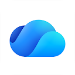 | [Microsoft OneDrive](apps/android/microsoft-corporation/microsoft-onedrive/README.md) | [Microsoft Corporation](companies/microsoft-corporation.md) | 7.56 | 28 |
| 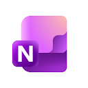 | [Microsoft OneNote: Save Notes](apps/android/microsoft-corporation/microsoft-onenote/README.md) | [Microsoft Corporation](companies/microsoft-corporation.md) | 16.0.19127.20320 | 19 |
|  | [Microsoft Outlook](apps/android/microsoft-corporation/microsoft-outlook/README.md) | [Microsoft Corporation](companies/microsoft-corporation.md) | 5.2606.0 | 36 |
| 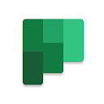 | [Microsoft Planner](apps/android/microsoft-corporation/microsoft-planner/README.md) | [Microsoft Corporation](companies/microsoft-corporation.md) | 1.18.40 | 16 |
|  | [Microsoft PowerPoint](apps/android/microsoft-corporation/microsoft-powerpoint/README.md) | [Microsoft Corporation](companies/microsoft-corporation.md) | 16.0.19822.20104 | 28 |
|  | [Microsoft Teams](apps/android/microsoft-corporation/microsoft-teams/README.md) | [Microsoft Corporation](companies/microsoft-corporation.md) | 1416/1.0.0.2026202302 | 35 |
|  | [Microsoft Word: Edit Documents](apps/android/microsoft-corporation/microsoft-word/README.md) | [Microsoft Corporation](companies/microsoft-corporation.md) | 16.0.19822.20104 | 28 |
|  | [MSN](apps/android/microsoft-corporation/msn/README.md) | [Microsoft Corporation](companies/microsoft-corporation.md) | 33.3.440518006 | 25 |
|  | [Muse from Meta](apps/android/meta-platforms-inc/muse-from-meta/README.md) | [Meta Platforms, Inc.](companies/meta-platforms-inc.md) | 14.0.0.4.149 | 23 |
|  | [MyCostco Employee Portal](apps/android/costco-wholesale/mycostco-employee-portal/README.md) | [Costco Wholesale](companies/costco-wholesale.md) | 19.2.0 | 32 |
|  | [Netflix](apps/android/netflix-inc/netflix/README.md) | [Netflix, Inc.](companies/netflix-inc.md) | 9.65.0 build 9 64253 | 29 |
|  | [Pandora - Music & Podcasts](apps/android/pandora/pandora/README.md) | [Pandora](companies/pandora.md) | 2606.1 | 34 |
|  | [Pandora Music for TV](apps/android/pandora/pandora-music-for-tv/README.md) | [Pandora](companies/pandora.md) | 4.3.1 | 12 |
|  | [Panera Bread](apps/android/panera-bread/panera-bread/README.md) | [Panera Bread](companies/panera-bread.md) | 6.6.1 | 33 |
|  | [Paramount+](apps/android/cbs-interactive-inc/paramount/README.md) | [CBS Interactive, Inc.](companies/cbs-interactive-inc.md) | 16.13.0 | 25 |
|  | [Paramount+](apps/android/cbs-interactive-inc/paramount-com-cbs-ott/README.md) | [CBS Interactive, Inc.](companies/cbs-interactive-inc.md) | 16.12.0 | 24 |
|  | [PayPal - Pay, Send, Save](apps/android/paypal-mobile/paypal/README.md) | [PayPal Mobile](companies/paypal-mobile.md) | 9.1.0 | 41 |
|  | [Perplexity - AI Search & Chat](apps/android/perplexityai/perplexity/README.md) | [PerplexityAI](companies/perplexityai.md) | 2.101.0 | 37 |
|  | [Phone by Google](apps/android/google-llc/phone-by-google/README.md) | [Google LLC](companies/google-llc.md) | 224.0.924927661-go | 15 |
|  | [Photoroom: AI Photo Editor](apps/android/photoroom-ai-photo-editor/photoroom/README.md) | [Photoroom AI Photo Editor](companies/photoroom-ai-photo-editor.md) | 2026.43.04 | 37 |
|  | [Pinterest](apps/android/pinterest/pinterest/README.md) | [Pinterest](companies/pinterest.md) | 14.21.0 | 35 |
|  | [Pizza Hut - Delivery & Takeout](apps/android/pizza-hut-inc/pizza-hut/README.md) | [Pizza Hut Inc](companies/pizza-hut-inc.md) | 6.1.10 | 45 |
|  | [PlutoTV: Stream Free Movies/TV](apps/android/pluto-inc/plutotv/README.md) | [Pluto, Inc.](companies/pluto-inc.md) | 5.66.0-leanback | 33 |
|  | [Poshmark Bot: Poshwatch](apps/android/cosmic-kettle-software-ou/poshmark-bot/README.md) | [Cosmic Kettle Software OÜ](companies/cosmic-kettle-software-ou.md) | 2.7.1 | 19 |
|  | [Prime Video](apps/android/amazon-mobile-llc/prime-video/README.md) | [Amazon Mobile LLC](companies/amazon-mobile-llc.md) | 3.0.456.747 | 29 |
|  | [Qobuz: Music & Editorial](apps/android/qobuz/qobuz/README.md) | [Qobuz](companies/qobuz.md) | 9.10.0.1 | 24 |
|  | [Rakuten Travel: Hotel Booking](apps/android/rakuten-group-inc/rakuten-travel/README.md) | [Rakuten Group, Inc.](companies/rakuten-group-inc.md) | 5.12.10 | 34 |
|  | [Reddit](apps/android/reddit-inc/reddit/README.md) | [reddit Inc.](companies/reddit-inc.md) | 2026.22.0 | 34 |
|  | [rednote](apps/android/xingin-information-technology-shanghai-co-ltd/rednote/README.md) | [行吟信息科技(上海)有限公司](companies/xingin-information-technology-shanghai-co-ltd.md) | 9.51.0 | 35 |
|  | [Sam's Club: Shopping & Savings](apps/android/sam-s-club/sam-s-club/README.md) | [Sam's Club](companies/sam-s-club.md) | 26.6.20 | 37 |
|  | [Saracroche : bloqueur d'appels](apps/android/camille-bouvat/saracroche/README.md) | [Camille Bouvat](companies/camille-bouvat.md) | 5.5.4 | 3 |
|  | [Settings Home](apps/android/utility-apps-home/settings-home/README.md) | [Utility Apps Home](companies/utility-apps-home.md) | 1.6.4 | 43 |
|  | [SHEIN-Shopping Online](apps/android/roadget-business-pte-ltd/shein-shopping-online/README.md) | [Roadget Business PTE. LTD.](companies/roadget-business-pte-ltd.md) | 15.5.0 | 28 |
|  | [Signal Private Messenger](apps/android/signal-foundation/signal-private-messenger/README.md) | [Signal Foundation](companies/signal-foundation.md) | 8.32.3 | 22 |
|  | [Skyscanner Flights Hotels Cars](apps/android/skyscanner-ltd/skyscanner-flights-hotels-cars/README.md) | [Skyscanner Ltd](companies/skyscanner-ltd.md) | 7.197 | 34 |
|  | [SLING: Live TV, Shows & Movies](apps/android/sling-tv/sling/README.md) | [Sling TV](companies/sling-tv.md) | 9.4.29 | 27 |
|  | [Snapchat](apps/android/snap-inc/snapchat/README.md) | [Snap Inc](companies/snap-inc.md) | 14.29.0.50 | 29 |
|  | [SoundCloud: The Music You Love](apps/android/soundcloud/soundcloud/README.md) | [SoundCloud](companies/soundcloud.md) | 2026.05.29-release | 43 |
|  | [Southwest Airlines: Travel App](apps/android/southwest-airlines/southwest-airlines/README.md) | [Southwest Airlines](companies/southwest-airlines.md) | 13.12.0 | 35 |
|  | [Spotify: Music and Podcasts](apps/android/spotify-ab/spotify/README.md) | [Spotify AB](companies/spotify-ab.md) | 9.1.52.1394 | 35 |
|  | [Starbucks](apps/android/starbucks-coffee-company/starbucks/README.md) | [Starbucks Coffee Company](companies/starbucks-coffee-company.md) | 6.124 | 28 |
|  | [Subway®](apps/android/subway-restaurants/subway/README.md) | [SUBWAY Restaurants](companies/subway-restaurants.md) | 101.4.4 | 40 |
|  | [Suno - AI Music & Songs Maker](apps/android/suno-inc/suno/README.md) | [Suno, Inc](companies/suno-inc.md) | 1.94.0 | 37 |
| 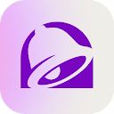 | [Taco Bell Fast Food & Delivery](apps/android/taco-bell-mobile/taco-bell-fast-food-delivery/README.md) | [Taco Bell Mobile](companies/taco-bell-mobile.md) | 8.90.0 | 44 |
|  | [Target: Shop. Style. Save.](apps/android/target-corporation/target/README.md) | [Target Corporation](companies/target-corporation.md) | 2026.21.0 | 37 |
|  | [Telegram](apps/android/telegram-fz-llc/telegram/README.md) | [Telegram FZ-LLC](companies/telegram-fz-llc.md) | 12.7.3 | 22 |
|  | [Temu: Shop Like a Billionaire](apps/android/temu/temu/README.md) | [Temu](companies/temu.md) | 4.91.0 | 21 |
|  | [The Clubhouse Gym](apps/android/the-clubhouse-gym/the-clubhouse-gym/README.md) | [The Clubhouse Gym](companies/the-clubhouse-gym.md) | 7.24.0 | 26 |
|  | [The Home Depot](apps/android/the-home-depot-inc/the-home-depot/README.md) | [The Home Depot, Inc](companies/the-home-depot-inc.md) | 7.61.2 | 39 |
|  | [TikTok - Videos, Shop & LIVE](apps/android/tiktok-pte-ltd/tiktok/README.md) | [TikTok Pte. Ltd.](companies/tiktok-pte-ltd.md) | 45.5.1 | 31 |
|  | [TikTok Lite - Faster TikTok](apps/android/tiktok-pte-ltd/tiktok-lite/README.md) | [TikTok Pte. Ltd.](companies/tiktok-pte-ltd.md) | 47.5.52 | 17 |
|  | [TikTok Pro - Events](apps/android/tiktok-pte-ltd/tiktok-pro/README.md) | [TikTok Pte. Ltd.](companies/tiktok-pte-ltd.md) | 47.4.3 | 21 |
|  | [Trip.com: Book Flights, Hotels](apps/android/trip-com/trip-com/README.md) | [Trip.com](companies/trip-com.md) | 8.59.0 | 37 |
|  | [Tripadvisor: Plan & Book Trips](apps/android/tripadvisor/tripadvisor/README.md) | [Tripadvisor](companies/tripadvisor.md) | 68.5 | 35 |
|  | [Tubi: Free Movies & Live TV](apps/android/tubi-tv/tubi/README.md) | [Tubi TV](companies/tubi-tv.md) | 10.22.1 | 42 |
|  | [Tusky for Mastodon](apps/android/tusky-team/tusky-for-mastodon/README.md) | [Tusky Team](companies/tusky-team.md) | 32.2 | 7 |
|  | [Twitch: Live Streaming](apps/android/twitch-interactive-inc/twitch/README.md) | [Twitch Interactive, Inc.](companies/twitch-interactive-inc.md) | 13.0.0.2 | 4 |
|  | [Uber - Request a ride](apps/android/uber-technologies-inc/uber/README.md) | [Uber Technologies, Inc.](companies/uber-technologies-inc.md) | 4.634.10003 | 38 |
|  | [Uber Eats: Food and Grocery](apps/android/uber-technologies-inc/uber-eats/README.md) | [Uber Technologies, Inc.](companies/uber-technologies-inc.md) | 6.326.10001 | 36 |
|  | [VEVOR](apps/android/vevor-store-llc/vevor/README.md) | [VEVOR STORE LLC](companies/vevor-store-llc.md) | v2.1.2 | 46 |
|  | [Walgreens](apps/android/walgreens-co/walgreens/README.md) | [Walgreens Co](companies/walgreens-co.md) | 113.1 | 43 |
|  | [Walgreens Clinical Trials](apps/android/curebase/walgreens-clinical-trials/README.md) | [Curebase](companies/curebase.md) | 1.0.30 | 18 |
|  | [Walmart: Shopping & Savings](apps/android/walmart/walmart/README.md) | [Walmart](companies/walmart.md) | 26.21.2 | 34 |
|  | [Wayfair - Shop All Things Home](apps/android/wayfair-llc/wayfair/README.md) | [Wayfair, LLC](companies/wayfair-llc.md) | 7.21.0 | 45 |
|  | [Wayfair Service Pro](apps/android/wayfair-llc/wayfair-service-pro/README.md) | [Wayfair, LLC](companies/wayfair-llc.md) | 1.100.0 | 26 |
|  | [Waze Navigation & Live Traffic](apps/android/waze/waze-navigation-live-traffic/README.md) | [Waze](companies/waze.md) | 5.19.90.900 | 20 |
|  | [Wendy’s](apps/android/wendy-s-int-l-llc/wendy-s/README.md) | [Wendy's Int'l., LLC](companies/wendy-s-int-l-llc.md) | 11.53.1 | 31 |
|  | [WhatsApp Messenger](apps/android/whatsapp-llc/whatsapp-messenger/README.md) | [WhatsApp LLC](companies/whatsapp-llc.md) | 2.26.41.77 | 24 |
|  | [X](apps/android/x-corp/x/README.md) | [X Corp.](companies/x-corp.md) | 12.36.1-prod.01 | 50 |
|  | [Yelp: Food, Delivery & Reviews](apps/android/yelp-inc/yelp/README.md) | [Yelp, Inc](companies/yelp-inc.md) | 26.24.0-28262402 | 32 |
|  | [YouTube](apps/android/google-llc/youtube/README.md) | [Google LLC](companies/google-llc.md) | 21.22.165 | 22 |
|  | [YouTube Music](apps/android/google-llc/youtube-music/README.md) | [Google LLC](companies/google-llc.md) | 9.22.53 | 19 |
| 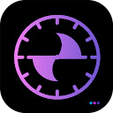 | [Zelle Track](apps/android/zelle-solutions/zelle-track/README.md) | [Zelle Solutions](companies/zelle-solutions.md) | 1.0.1 | 14 |
|  | [네이버플러스 스토어](apps/android/naver-corp/app/README.md) | [NAVER Corp.](companies/naver-corp.md) | 2.9.10 | 27 |

<!-- ts:end explore -->

Data notes, method and maintenance: see [docs/data-notes.md](docs/data-notes.md) and [docs/maintaining.md](docs/maintaining.md).

## License

The data (`apps/`, `companies/`, `data/`, `index.csv`, `sdks.csv` and the charts) is licensed under
[CC BY 4.0](./LICENSE-DATA): reuse it freely with attribution to "Tech Stack". The code in `scripts/` and
`docs/` is [MIT](./LICENSE). App names, icons and trademarks belong to their owners.

Found a wrong company, a missing app or a broken chart? See [CONTRIBUTING.md](./CONTRIBUTING.md).

<!-- ts:begin footer -->
Generated by `scripts/build_readme.py` from the JSON files. Do not edit by hand.
<!-- ts:end footer -->
