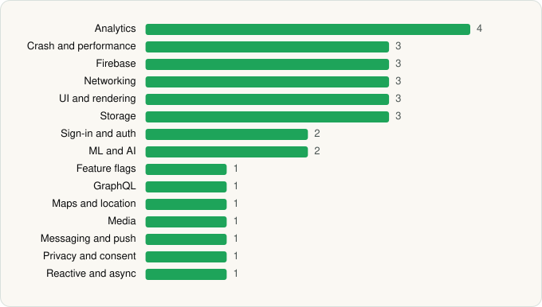

<picture><source media="(prefers-color-scheme: dark)" srcset="../../../../assets/logo/logo-dark.svg"></picture> [Tech Stack](../../../../README.md) / [Action BV](../../../../companies/action-bv.md) / Action

# Action

<picture><source media="(prefers-color-scheme: dark)" srcset="../../../../assets/badges/android-dark.svg"></picture> <picture><source media="(prefers-color-scheme: dark)" srcset="../../../../assets/badges/inactive-dark.svg"></picture>

[Google Play](https://play.google.com/store/apps/details?id=com.action.consumerapp) · [latest.json](latest.json)

| | |
|---|---|
| Company | [Action BV](../../../../companies/action-bv.md) |
| Store id | `com.action.consumerapp` |
| Bundle / package id | `com.action.consumerapp` |
| Latest version | 1.135.1 (analysed 2026-11-20) |
| Versions tracked | 1 |
| SDKs in latest version | 30 |
| Languages | C/C++ (native), Java, Kotlin |
| UI | Coil, Jetpack Compose, Material Components |
| Build | Gradle (inferred) |
| Minimum OS | API 29, targets API 36 |
| Devices / ABIs | Android |
| Capabilities | 4 |
| Declares tracking | Yes |
| Tracked | No. Kept for history. |

## SDKs by category

<picture><source media="(prefers-color-scheme: dark)" srcset="../../../../assets/charts/apps/android/action-bv/action-dark.svg"></picture>

- **Analytics** (4): Facebook SDK, Firebase Analytics, Google App Measurement, Medallia
- **Crash and performance** (3): Firebase Crashlytics, Firebase Performance, Sentry
- **Firebase** (3): Firebase, Google DataTransport, Google Play services
- **Networking** (3): Ktor, OkHttp, Retrofit
- **UI and rendering** (3): Coil, Jetpack Compose, Material Components
- **Storage** (3): DataStore, Okio, Room
- **Sign-in and auth** (2): AppAuth, Google Sign-In / Auth
- **ML and AI** (2): ML Kit, ML Kit (barcode/vision)
- **Feature flags** (1): Firebase Remote Config
- **GraphQL** (1): Apollo GraphQL
- **Maps and location** (1): Google Location
- **Media** (1): Media3 (ExoPlayer)
- **Messaging and push** (1): Firebase Messaging
- **Privacy and consent** (1): Usercentrics
- **Reactive and async** (1): Kotlin Coroutines

Capabilities (4)

Advertising ID, Camera, Foreground service, Notifications

## Version history

| Version | Analysed | Store update | SDKs | Change | SDK list is a floor | Binary encrypted | File |
|---|---|---|---|---|---|---|---|
| 1.135.1 | 2026-11-20 |  | 30 |  | No | No | [1.135.1.json](1.135.1.json) |

---

Generated by `scripts/build_readme.py` from the JSON files. Do not edit by hand.
