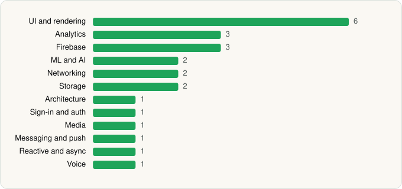

<picture><source media="(prefers-color-scheme: dark)" srcset="../../../../assets/logo/logo-dark.svg"></picture> [Tech Stack](../../../../README.md) / [Advita Ortho, LLC](../../../../companies/advita-ortho-llc.md) / Chime

# Chime

<picture><source media="(prefers-color-scheme: dark)" srcset="../../../../assets/badges/android-dark.svg"></picture> <picture><source media="(prefers-color-scheme: dark)" srcset="../../../../assets/badges/inactive-dark.svg"></picture>

[Google Play](https://play.google.com/store/apps/details?id=com.advitaortho.chime) · [latest.json](latest.json)

| | |
|---|---|
| Company | [Advita Ortho, LLC](../../../../companies/advita-ortho-llc.md) |
| Store id | `com.advitaortho.chime` |
| Bundle / package id | `com.advitaortho.chime` |
| Latest version | 1.0.810 (analysed 2026-06-23) |
| Versions tracked | 1 |
| SDKs in latest version | 24 |
| Languages | C/C++ (native), Java, Kotlin, React Native / JavaScript |
| UI | Fresco, Glide, Lottie, Material Components |
| Build | Gradle (inferred) |
| Minimum OS | API 24, targets API 35 |
| Devices / ABIs | Android |
| Capabilities | 11 |
| Declares tracking | Yes |
| Tracked | No. Kept for history. |

## SDKs by category

<picture><source media="(prefers-color-scheme: dark)" srcset="../../../../assets/charts/apps/android/advita-ortho-llc/chime-dark.svg"></picture>

- **UI and rendering** (6): Fresco, Glide, Lottie, Material Components, React Native Reanimated, react-native-svg
- **Analytics** (3): Amplitude, Branch, Firebase Analytics
- **Firebase** (3): Firebase, Google DataTransport, Google Play services
- **ML and AI** (2): ML Kit, ML Kit (barcode/vision)
- **Networking** (2): OkHttp, TanStack Query
- **Storage** (2): DataStore, Okio
- **Architecture** (1): Redux
- **Sign-in and auth** (1): Google Sign-In / Auth
- **Media** (1): ExoPlayer
- **Messaging and push** (1): Firebase Messaging
- **Reactive and async** (1): Kotlin Coroutines
- **Voice** (1): WebRTC

Capabilities (11)

Biometric auth, Camera, Draw over other apps, Fingerprint auth, Media: audio, Media: images, Media: video, Microphone, Notifications, Storage (read), Storage (write)

## Version history

| Version | Analysed | Store update | SDKs | Change | SDK list is a floor | Binary encrypted | File |
|---|---|---|---|---|---|---|---|
| 1.0.810 | 2026-06-23 |  | 24 |  | No | No | [1.0.810.json](1.0.810.json) |

## Model-written summary

> React Native Android app with Hermes, 32 native libs including WebRTC and ML Kit, three TFLite models, Firebase, and biometric security

Written by a language model from the detected signals (`inferred[]`). It is commentary, not measurement.

---

Generated by `scripts/build_readme.py` from the JSON files. Do not edit by hand.
