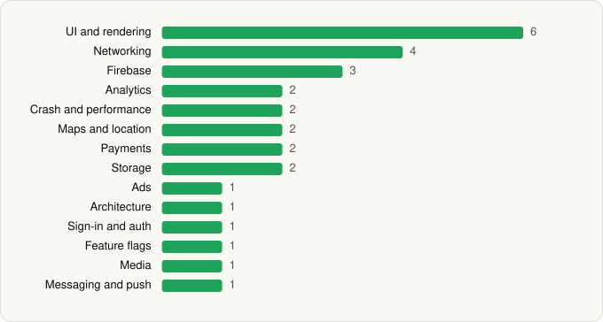

<picture><source media="(prefers-color-scheme: dark)" srcset="../../../../assets/logo/logo-dark.svg"></picture> [Tech Stack](../../../../README.md) / [Affirm, Inc](../../../../companies/affirm-inc.md) / Affirm

# Affirm: Buy now, pay over time

<picture><source media="(prefers-color-scheme: dark)" srcset="../../../../assets/badges/android-dark.svg"></picture> <picture><source media="(prefers-color-scheme: dark)" srcset="../../../../assets/badges/inactive-dark.svg"></picture> <picture><source media="(prefers-color-scheme: dark)" srcset="../../../../assets/badges/floor-dark.svg"></picture>

[Google Play](https://play.google.com/store/apps/details?id=com.affirm.central) · [latest.json](latest.json)

| | |
|---|---|
| Company | [Affirm, Inc](../../../../companies/affirm-inc.md) |
| Store id | `com.affirm.central` |
| Bundle / package id | `com.affirm.central` |
| Latest version | 4.70.2 (analysed 2026-06-23) |
| Versions tracked | 1 |
| SDKs in latest version | 29 |
| Languages | C/C++ (native), Java, Kotlin, React Native / JavaScript |
| UI | Fresco, Glide, Material Components |
| Build | Gradle (inferred), R8 / ProGuard (name obfuscation detected) |
| Minimum OS | API 29, targets API 35 |
| Devices / ABIs | Android |
| Capabilities | 8 |
| Declares tracking | Yes |
| Tracked | No. Kept for history. |

## SDKs by category

<picture><source media="(prefers-color-scheme: dark)" srcset="../../../../assets/charts/apps/android/affirm-inc/affirm-dark.svg"></picture>

- **UI and rendering** (6): FlashList, Fresco, Glide, Material Components, React Native Reanimated, react-native-svg
- **Networking** (4): axios, Ktor, OkHttp, Retrofit
- **Firebase** (3): Firebase, Google DataTransport, Google Play services
- **Analytics** (2): Amplitude, Branch
- **Crash and performance** (2): Sentry, Sentry (native)
- **Maps and location** (2): Google Location, Google Maps
- **Payments** (2): Plaid, Stripe
- **Storage** (2): DataStore, Room
- **Ads** (1): Google Mobile Ads (AdMob)
- **Architecture** (1): Redux
- **Sign-in and auth** (1): Google Sign-In / Auth
- **Feature flags** (1): Statsig
- **Media** (1): Media3 (ExoPlayer)
- **Messaging and push** (1): Firebase Messaging

Capabilities (8)

Advertising ID, Biometric auth, Camera, Fingerprint auth, Foreground service, Notifications, Storage (read), Storage (write)

## Version history

| Version | Analysed | Store update | SDKs | Change | SDK list is a floor | Binary encrypted | File |
|---|---|---|---|---|---|---|---|
| 4.70.2 | 2026-06-23 |  | 29 |  | Yes | No | [4.70.2.json](4.70.2.json) |

---

Generated by `scripts/build_readme.py` from the JSON files. Do not edit by hand.
