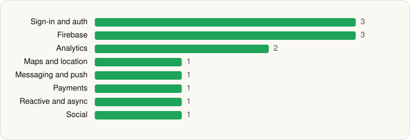

<picture><source media="(prefers-color-scheme: dark)" srcset="../../../../assets/logo/logo-dark.svg"></picture> [Tech Stack](../../../../README.md) / [Affirm Quest](../../../../companies/affirm-quest.md) / Affirm Quest

# Affirm Quest

<picture><source media="(prefers-color-scheme: dark)" srcset="../../../../assets/badges/android-dark.svg"></picture> <picture><source media="(prefers-color-scheme: dark)" srcset="../../../../assets/badges/inactive-dark.svg"></picture>

[Google Play](https://play.google.com/store/apps/details?id=io.affirmquest.app) · [latest.json](latest.json)

| | |
|---|---|
| Company | [Affirm Quest](../../../../companies/affirm-quest.md) |
| Store id | `io.affirmquest.app` |
| Bundle / package id | `io.affirmquest.app` |
| Latest version | 1.2.7 (analysed 2026-06-19) |
| Versions tracked | 1 |
| SDKs in latest version | 13 |
| Languages | Capacitor (web), Cordova (web), Java, Kotlin |
| UI | Android Views (inferred) |
| Build | Gradle (inferred) |
| Minimum OS | API 24, targets API 35 |
| Devices / ABIs | Android |
| Capabilities | 2 |
| Declares tracking | Yes |
| Tracked | No. Kept for history. |

## SDKs by category

<picture><source media="(prefers-color-scheme: dark)" srcset="../../../../assets/charts/apps/android/affirm-quest/affirm-quest-dark.svg"></picture>

- **Sign-in and auth** (3): Credential Manager, Facebook Login, Google Sign-In / Auth
- **Firebase** (3): Firebase, Google DataTransport, Google Play services
- **Analytics** (2): Facebook SDK, Firebase Analytics
- **Maps and location** (1): Google Location
- **Messaging and push** (1): Firebase Messaging
- **Payments** (1): Google Play Billing
- **Reactive and async** (1): Kotlin Coroutines
- **Social** (1): Facebook Share

Capabilities (2)

Advertising ID, Notifications

## Version history

| Version | Analysed | Store update | SDKs | Change | SDK list is a floor | Binary encrypted | File |
|---|---|---|---|---|---|---|---|
| 1.2.7 | 2026-06-19 |  | 13 |  | No | No | [1.2.7.json](1.2.7.json) |

---

Generated by `scripts/build_readme.py` from the JSON files. Do not edit by hand.
