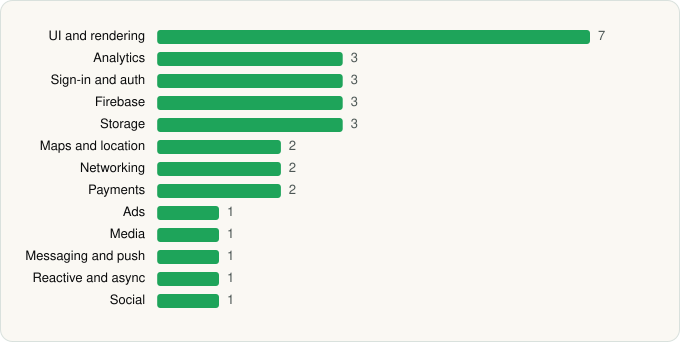

<picture><source media="(prefers-color-scheme: dark)" srcset="../../../../assets/logo/logo-dark.svg"></picture> [Tech Stack](../../../../README.md) / [Alibaba Mobile](../../../../companies/alibaba-mobile.md) / Alibaba.com

# Alibaba.com - B2B marketplace

<picture><source media="(prefers-color-scheme: dark)" srcset="../../../../assets/badges/android-dark.svg"></picture> <picture><source media="(prefers-color-scheme: dark)" srcset="../../../../assets/badges/active-dark.svg"></picture>

[Google Play](https://play.google.com/store/apps/details?id=com.alibaba.intl.android.apps.poseidon) · [latest.json](latest.json)

| | |
|---|---|
| Company | [Alibaba Mobile](../../../../companies/alibaba-mobile.md) |
| Store id | `com.alibaba.intl.android.apps.poseidon` |
| Bundle / package id | `com.alibaba.intl.android.apps.poseidon` |
| Latest version | 26.19.0 (analysed 2026-06-19) |
| Versions tracked | 1 |
| SDKs in latest version | 29 |
| Languages | C/C++ (native), Flutter / Dart, Java, Kotlin |
| UI | Glide, Jetpack Compose, Lottie, Material Components |
| Build | Gradle (inferred) |
| Minimum OS | API 21, targets API 35 |
| Devices / ABIs | Android |
| Capabilities | 16 |
| Declares tracking | Yes |
| Tracked | Yes |

## SDKs by category

<picture><source media="(prefers-color-scheme: dark)" srcset="../../../../assets/charts/apps/android/alibaba-mobile/alibaba-com-dark.svg"></picture>

- **UI and rendering** (4): Glide, Jetpack Compose, Lottie, Material Components
- **Analytics** (3): Facebook SDK, Firebase Analytics, Google App Measurement
- **Sign-in and auth** (3): Credential Manager, Facebook Login, Google Sign-In / Auth
- **Firebase** (3): Firebase, Google DataTransport, Google Play services
- **Storage** (3): greenDAO, Okio, Room
- **Maps and location** (2): Google Location, Google Maps
- **ML and AI** (2): ML Kit, TensorFlow
- **Networking** (2): OkHttp, Retrofit
- **Ads** (1): Google Mobile Ads (AdMob)
- **Media** (1): ijkplayer
- **Messaging and push** (1): Firebase Messaging
- **Payments** (1): Braintree
- **Reactive and async** (1): Kotlin Coroutines
- **Social** (1): Facebook Share
- **Voice** (1): WebRTC

Capabilities (16)

Advertising ID, Approximate location, Bluetooth, Bluetooth (connect), Camera, Draw over other apps, Foreground service, Media: audio, Media: images, Media: video, Microphone, Notifications, Phone / carrier info, Precise location, Storage (read), Storage (write)

## Version history

| Version | Analysed | Store update | SDKs | Change | SDK list is a floor | Binary encrypted | File |
|---|---|---|---|---|---|---|---|
| 26.19.0 | 2026-06-19 |  | 29 |  | No | No | [26.19.0.json](26.19.0.json) |

## Model-written summary

> Hybrid Flutter Android B2B app with MNN/TFLite ML, root detection, Jetpack Compose, and Alibaba AI backends

Written by a language model from the detected signals (`inferred[]`). It is commentary, not measurement.

---

Generated by `scripts/build_readme.py` from the JSON files. Do not edit by hand.
