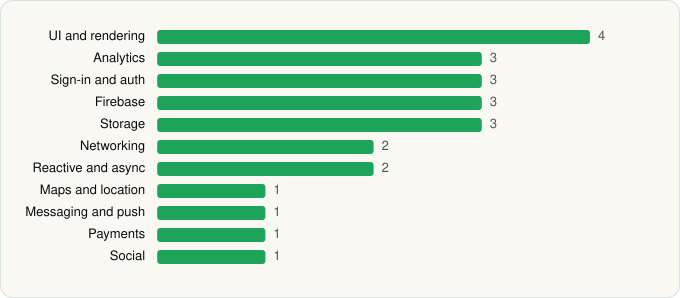

<picture><source media="(prefers-color-scheme: dark)" srcset="../../../../assets/logo/logo-dark.svg"></picture> [Tech Stack](../../../../README.md) / [Alibaba Mobile](../../../../companies/alibaba-mobile.md) / AliExpress

# AliExpress - Shopping App

<picture><source media="(prefers-color-scheme: dark)" srcset="../../../../assets/badges/android-dark.svg"></picture> <picture><source media="(prefers-color-scheme: dark)" srcset="../../../../assets/badges/active-dark.svg"></picture>

[Google Play](https://play.google.com/store/apps/details?id=com.alibaba.aliexpresshd) · [latest.json](latest.json)

| | |
|---|---|
| Company | [Alibaba Mobile](../../../../companies/alibaba-mobile.md) |
| Store id | `com.alibaba.aliexpresshd` |
| Bundle / package id | `com.alibaba.aliexpresshd` |
| Latest version | 8.180.1 (analysed 2026-11-01) |
| Versions tracked | 2 |
| SDKs in latest version | 24 |
| Languages | C/C++ (native), Java, Kotlin |
| UI | Glide, Lottie, Material Components, Picasso |
| Build | Gradle (inferred) |
| Minimum OS | API 21, targets API 36 |
| Devices / ABIs | Android |
| Capabilities | 15 |
| Declares tracking | Yes |
| Tracked | Yes |

## SDKs by category

<picture><source media="(prefers-color-scheme: dark)" srcset="../../../../assets/charts/apps/android/alibaba-mobile/aliexpress-dark.svg"></picture>

- **UI and rendering** (4): Glide, Lottie, Material Components, Picasso
- **Analytics** (3): Facebook SDK, Firebase Analytics, Google App Measurement
- **Sign-in and auth** (3): Credential Manager, Facebook Login, Google Sign-In / Auth
- **Firebase** (3): Firebase, Google DataTransport, Google Play services
- **Storage** (3): greenDAO, Okio, Room
- **Networking** (2): OkHttp, Retrofit
- **Reactive and async** (2): Kotlin Coroutines, RxJava
- **Maps and location** (1): Google Maps
- **Messaging and push** (1): Firebase Messaging
- **Payments** (1): Braintree
- **Social** (1): Facebook Share

Capabilities (15)

Advertising ID, Approximate location, Calendar (write), Camera, Draw over other apps, Foreground service, Media: audio, Media: images, Media: video, Microphone, Notifications, Phone / carrier info, Precise location, Storage (read), Storage (write)

## Version history

| Version | Analysed | Store update | SDKs | Change | SDK list is a floor | Binary encrypted | File |
|---|---|---|---|---|---|---|---|
| 8.180.1 | 2026-11-01 | 2026-10-25 | 24 | +0 / −0 | No | No | [8.180.1.json](8.180.1.json) |
| 8.163.1 | 2026-06-19 |  | 24 |  | No | No | [8.163.1.json](8.163.1.json) |

---

Generated by `scripts/build_readme.py` from the JSON files. Do not edit by hand.
