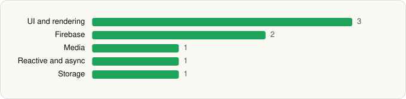

<picture><source media="(prefers-color-scheme: dark)" srcset="../../../../assets/logo/logo-dark.svg"></picture> [Tech Stack](../../../../README.md) / [Alipay (Hangzhou) Technology Co. Ltd](../../../../companies/alipay-hangzhou-technology-co-ltd.md) / Alipay

# Alipay

<picture><source media="(prefers-color-scheme: dark)" srcset="../../../../assets/badges/android-dark.svg"></picture> <picture><source media="(prefers-color-scheme: dark)" srcset="../../../../assets/badges/inactive-dark.svg"></picture>

[Google Play](https://play.google.com/store/apps/details?id=com.eg.android.AlipayGphone) · [latest.json](latest.json)

| | |
|---|---|
| Company | [Alipay (Hangzhou) Technology Co. Ltd](../../../../companies/alipay-hangzhou-technology-co-ltd.md) |
| Store id | `com.eg.android.AlipayGphone` |
| Bundle / package id | `com.eg.android.AlipayGphone` |
| Latest version | 12.12.16.7200 (analysed 2026-10-24) |
| Versions tracked | 1 |
| SDKs in latest version | 8 |
| Languages | C/C++ (native), Java, Kotlin |
| UI | Jetpack Compose |
| Build | Gradle (inferred) |
| Minimum OS | API 24, targets API 35 |
| Devices / ABIs | Android |
| Capabilities | 28 |
| Declares tracking | No |
| Tracked | No. Kept for history. |

## SDKs by category

<picture><source media="(prefers-color-scheme: dark)" srcset="../../../../assets/charts/apps/android/alipay-hangzhou-technology-co-ltd/alipay-dark.svg"></picture>

- **UI and rendering** (3): Jetpack Compose, jLaTeXMath, Markwon
- **Firebase** (2): Firebase, Google Play services
- **Media** (1): ijkplayer
- **Reactive and async** (1): Kotlin Coroutines
- **Storage** (1): Okio

Capabilities (28)

Activity / fitness recognition, Approximate location, Biometric auth, Bluetooth, Bluetooth (connect), Bluetooth (scan), Calendar (read), Calendar (write), Camera, Contacts (read), Draw over other apps, Fingerprint auth, Foreground service, Foreground service: camera, Foreground service: location, Foreground service: media playback, Foreground service: microphone, Media: audio, Media: images, Media: video, Microphone, NFC, Notifications, Phone / carrier info, Precise location, Query all installed apps, Storage (read), Storage (write)

## Version history

| Version | Analysed | Store update | SDKs | Change | SDK list is a floor | Binary encrypted | File |
|---|---|---|---|---|---|---|---|
| 12.12.16.7200 | 2026-10-24 | 2026-09-11 | 8 |  | No | No | [12.12.16.7200.json](12.12.16.7200.json) |

---

Generated by `scripts/build_readme.py` from the JSON files. Do not edit by hand.
