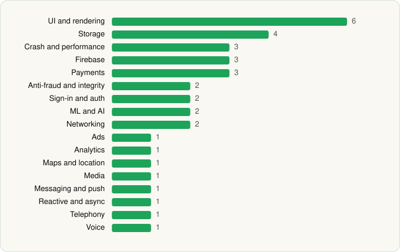

<picture><source media="(prefers-color-scheme: dark)" srcset="../../../../assets/logo/logo-dark.svg"></picture> [Tech Stack](../../../../README.md) / [Alpha Exploration Co.](../../../../companies/alpha-exploration-co.md) / Clubhouse

# Clubhouse

<picture><source media="(prefers-color-scheme: dark)" srcset="../../../../assets/badges/android-dark.svg"></picture> <picture><source media="(prefers-color-scheme: dark)" srcset="../../../../assets/badges/inactive-dark.svg"></picture> <picture><source media="(prefers-color-scheme: dark)" srcset="../../../../assets/badges/floor-dark.svg"></picture>

[Google Play](https://play.google.com/store/apps/details?id=com.clubhouse.app) · [latest.json](latest.json)

| | |
|---|---|
| Company | [Alpha Exploration Co.](../../../../companies/alpha-exploration-co.md) |
| Store id | `com.clubhouse.app` |
| Bundle / package id | `com.clubhouse.app` |
| Latest version | 26.06.04 (analysed 2026-06-19) |
| Versions tracked | 1 |
| SDKs in latest version | 35 |
| Languages | C/C++ (native), Java, Kotlin, React Native / JavaScript |
| UI | Coil, Fresco, Jetpack Compose, Lottie, Material Components, Picasso |
| Build | Gradle (inferred), R8 / ProGuard (name obfuscation detected) |
| Minimum OS | API 26, targets API 35 |
| Devices / ABIs | Android |
| Capabilities | 15 |
| Declares tracking | Yes |
| Tracked | No. Kept for history. |

## SDKs by category

<picture><source media="(prefers-color-scheme: dark)" srcset="../../../../assets/charts/apps/android/alpha-exploration-co/clubhouse-dark.svg"></picture>

- **UI and rendering** (6): Coil, Fresco, Jetpack Compose, Lottie, Material Components, Picasso
- **Storage** (4): Okio, Realm, Room, SQLDelight
- **Crash and performance** (3): Instabug, Sentry, Sentry (native)
- **Firebase** (3): Firebase, Google DataTransport, Google Play services
- **Payments** (3): Google Play Billing, RevenueCat, Stripe
- **Anti-fraud and integrity** (2): Play Integrity, reCAPTCHA
- **Sign-in and auth** (2): AppAuth, Google Sign-In / Auth
- **ML and AI** (2): ML Kit, Mobile Vision
- **Networking** (2): OkHttp, Retrofit
- **Ads** (1): Google Mobile Ads (AdMob)
- **Analytics** (1): Branch
- **Maps and location** (1): Google Location
- **Media** (1): Media3 (ExoPlayer)
- **Messaging and push** (1): Firebase Messaging
- **Reactive and async** (1): Kotlin Coroutines
- **Telephony** (1): libphonenumber
- **Voice** (1): Agora

Capabilities (15)

Advertising ID, Bluetooth, Bluetooth (connect), Camera, Contacts (read), Foreground service, Foreground service: media playback, Foreground service: microphone, Media: images, Media: video, Microphone, Notifications, Phone / carrier info, Storage (read), Storage (write)

## Version history

| Version | Analysed | Store update | SDKs | Change | SDK list is a floor | Binary encrypted | File |
|---|---|---|---|---|---|---|---|
| 26.06.04 | 2026-06-19 |  | 35 |  | Yes | No | [26.06.04.json](26.06.04.json) |

## Model-written summary

> Hybrid Android React Native app with Agora voice AI extensions, on-device face ML models, Jetpack Compose UI, and multi-SDK analytics

Written by a language model from the detected signals (`inferred[]`). It is commentary, not measurement.

---

Generated by `scripts/build_readme.py` from the JSON files. Do not edit by hand.
