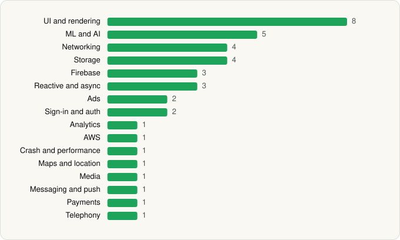

<picture><source media="(prefers-color-scheme: dark)" srcset="../../../../assets/logo/logo-dark.svg"></picture> [Tech Stack](../../../../README.md) / [Amazon Mobile LLC](../../../../companies/amazon-mobile-llc.md) / Amazon Shopping

# Amazon Shopping

<picture><source media="(prefers-color-scheme: dark)" srcset="../../../../assets/badges/android-dark.svg"></picture> <picture><source media="(prefers-color-scheme: dark)" srcset="../../../../assets/badges/active-dark.svg"></picture>

[Google Play](https://play.google.com/store/apps/details?id=com.amazon.mShop.android.shopping) · [latest.json](latest.json)

| | |
|---|---|
| Company | [Amazon Mobile LLC](../../../../companies/amazon-mobile-llc.md) |
| Store id | `com.amazon.mShop.android.shopping` |
| Bundle / package id | `com.amazon.mShop.android.shopping` |
| Latest version | 32.11.0.100 (analysed 2026-06-23) |
| Versions tracked | 1 |
| SDKs in latest version | 39 |
| Languages | C/C++ (native), Cordova (web), Java, Kotlin, React Native / JavaScript |
| UI | Coil, Fresco, Glide, Jetpack Compose, Lottie, Material Components, Picasso |
| Build | Gradle (inferred) |
| Minimum OS | API 28, targets API 36 |
| Devices / ABIs | Android |
| Capabilities | 20 |
| Declares tracking | Yes |
| Tracked | Yes |

## SDKs by category

<picture><source media="(prefers-color-scheme: dark)" srcset="../../../../assets/charts/apps/android/amazon-mobile-llc/amazon-shopping-dark.svg"></picture>

- **UI and rendering** (8): AndroidSVG, Coil, Fresco, Glide, Jetpack Compose, Lottie, Material Components, Picasso
- **ML and AI** (5): ML Kit, ML Kit (barcode/vision), Mobile Vision, TensorFlow, TensorFlow Lite
- **Networking** (4): Ktor, OkHttp, Retrofit, Volley
- **Storage** (4): DataStore, MMKV, Okio, Room
- **Firebase** (3): Firebase, Google DataTransport, Google Play services
- **Reactive and async** (3): Kotlin Coroutines, RxJava, RxJava 3
- **Ads** (2): Google Ad Manager, Google Mobile Ads (AdMob)
- **Sign-in and auth** (2): Credential Manager, Google Sign-In / Auth
- **Analytics** (1): Firebase Analytics
- **AWS** (1): AWS SDK
- **Crash and performance** (1): Bugsnag
- **Maps and location** (1): Google Location
- **Media** (1): Media3 (ExoPlayer)
- **Messaging and push** (1): Firebase Messaging
- **Payments** (1): Google Play Billing
- **Telephony** (1): libphonenumber

Capabilities (20)

Advertising ID, Approximate location, Background location, Biometric auth, Bluetooth, Bluetooth (connect), Bluetooth (scan), Camera, Contacts (read), Fingerprint auth, Foreground service, Foreground service: location, Foreground service: media playback, Microphone, NFC, Notifications, Phone / carrier info, Precise location, Storage (read), Storage (write)

## Version history

| Version | Analysed | Store update | SDKs | Change | SDK list is a floor | Binary encrypted | File |
|---|---|---|---|---|---|---|---|
| 32.11.0.100 | 2026-06-23 |  | 39 |  | No | No | [32.11.0.100.json](32.11.0.100.json) |

## Model-written summary

> React Native Android app with Hermes, 36 native C++ libraries including ARCore, on-device TFLite ML models, and verified Amazon affiliate deep links

Written by a language model from the detected signals (`inferred[]`). It is commentary, not measurement.

---

Generated by `scripts/build_readme.py` from the JSON files. Do not edit by hand.
