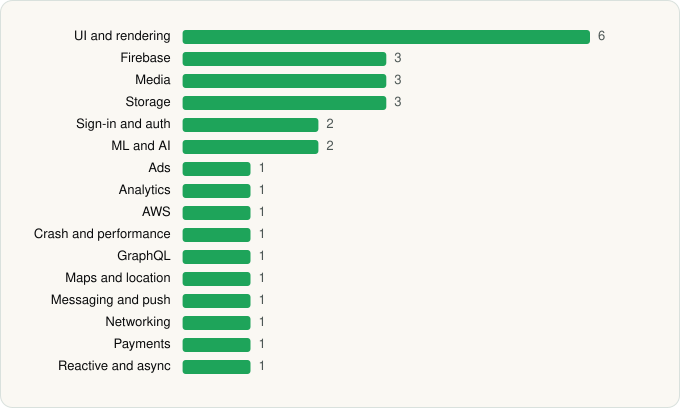

<picture><source media="(prefers-color-scheme: dark)" srcset="../../../../assets/logo/logo-dark.svg"></picture> [Tech Stack](../../../../README.md) / [Amazon Mobile LLC](../../../../companies/amazon-mobile-llc.md) / Prime Video

# Prime Video

<picture><source media="(prefers-color-scheme: dark)" srcset="../../../../assets/badges/android-dark.svg"></picture> <picture><source media="(prefers-color-scheme: dark)" srcset="../../../../assets/badges/active-dark.svg"></picture>

[Google Play](https://play.google.com/store/apps/details?id=com.amazon.avod.thirdpartyclient) · [latest.json](latest.json)

| | |
|---|---|
| Company | [Amazon Mobile LLC](../../../../companies/amazon-mobile-llc.md) |
| Store id | `com.amazon.avod.thirdpartyclient` |
| Bundle / package id | `com.amazon.avod.thirdpartyclient` |
| Latest version | 3.0.456.747 (analysed 2026-06-23) |
| Versions tracked | 1 |
| SDKs in latest version | 29 |
| Languages | C/C++ (native), Java, Kotlin |
| UI | Coil, Glide, Jetpack Compose, Lottie, Material Components |
| Build | Gradle (inferred) |
| Minimum OS | API 28, targets API 35 |
| Devices / ABIs | Android |
| Capabilities | 11 |
| Declares tracking | Yes |
| Tracked | Yes |

## SDKs by category

<picture><source media="(prefers-color-scheme: dark)" srcset="../../../../assets/charts/apps/android/amazon-mobile-llc/prime-video-dark.svg"></picture>

- **UI and rendering** (6): Coil, Glide, Jetpack Compose, Lottie, Markwon, Material Components
- **Firebase** (3): Firebase, Google DataTransport, Google Play services
- **Media** (3): ExoPlayer, Google Cast, Media3 (ExoPlayer)
- **Storage** (3): DataStore, Okio, Room
- **Sign-in and auth** (2): Credential Manager, Google Sign-In / Auth
- **ML and AI** (2): TensorFlow, TensorFlow Lite
- **Ads** (1): Google Mobile Ads (AdMob)
- **Analytics** (1): Firebase Analytics
- **AWS** (1): AWS SDK
- **Crash and performance** (1): Bugsnag
- **GraphQL** (1): Apollo GraphQL
- **Maps and location** (1): Google Location
- **Messaging and push** (1): Firebase Messaging
- **Networking** (1): OkHttp
- **Payments** (1): Google Play Billing
- **Reactive and async** (1): Kotlin Coroutines

Capabilities (11)

Advertising ID, Approximate location, Bluetooth, Foreground service, Foreground service: media playback, Microphone, Notifications, Phone / carrier info, Precise location, Storage (read), Storage (write)

## Version history

| Version | Analysed | Store update | SDKs | Change | SDK list is a floor | Binary encrypted | File |
|---|---|---|---|---|---|---|---|
| 3.0.456.747 | 2026-06-23 |  | 29 |  | No | No | [3.0.456.747.json](3.0.456.747.json) |

---

Generated by `scripts/build_readme.py` from the JSON files. Do not edit by hand.
