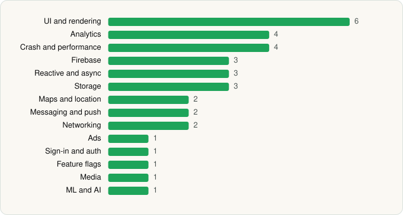

<picture><source media="(prefers-color-scheme: dark)" srcset="../../../../assets/logo/logo-dark.svg"></picture> [Tech Stack](../../../../README.md) / [American Airlines, Inc.](../../../../companies/american-airlines-inc.md) / American Airlines

# American Airlines

<picture><source media="(prefers-color-scheme: dark)" srcset="../../../../assets/badges/android-dark.svg"></picture> <picture><source media="(prefers-color-scheme: dark)" srcset="../../../../assets/badges/active-dark.svg"></picture> <picture><source media="(prefers-color-scheme: dark)" srcset="../../../../assets/badges/floor-dark.svg"></picture>

[Google Play](https://play.google.com/store/apps/details?id=com.aa.android) · [latest.json](latest.json)

| | |
|---|---|
| Company | [American Airlines, Inc.](../../../../companies/american-airlines-inc.md) |
| Store id | `com.aa.android` |
| Bundle / package id | `com.aa.android` |
| Latest version | 2026.18 (analysed 2026-06-25) |
| Versions tracked | 1 |
| SDKs in latest version | 32 |
| Languages | C/C++ (native), Java, Kotlin |
| UI | Coil, Glide, Jetpack Compose, Material Components, Picasso |
| Build | Gradle (inferred), Packer/hardening: Google Play (pairip) anti-tamper |
| Minimum OS | API 26, targets API 36 |
| Devices / ABIs | Android |
| Capabilities | 10 |
| Declares tracking | Yes |
| Tracked | Yes |

## SDKs by category

<picture><source media="(prefers-color-scheme: dark)" srcset="../../../../assets/charts/apps/android/american-airlines-inc/american-airlines-dark.svg"></picture>

- **UI and rendering** (6): AndroidSVG, Coil, Glide, Jetpack Compose, Material Components, Picasso
- **Analytics** (4): Adobe Experience Platform, Firebase Analytics, Google App Measurement, Qualtrics
- **Firebase** (3): Firebase, Google DataTransport, Google Play services
- **Reactive and async** (3): Kotlin Coroutines, RxJava, RxJava 3
- **Storage** (3): DataStore, Okio, Room
- **Crash and performance** (2): Firebase Crashlytics, Firebase Performance
- **Maps and location** (2): Google Location, Google Maps
- **Messaging and push** (2): Airship, Firebase Messaging
- **Networking** (2): OkHttp, Retrofit
- **Ads** (1): Google Mobile Ads (AdMob)
- **Sign-in and auth** (1): Google Sign-In / Auth
- **Feature flags** (1): Firebase Remote Config
- **Media** (1): Media3 (ExoPlayer)
- **ML and AI** (1): ML Kit

Capabilities (10)

Advertising ID, Approximate location, Bluetooth, Camera, Foreground service, NFC, Notifications, Precise location, Storage (read), Storage (write)

## Version history

| Version | Analysed | Store update | SDKs | Change | SDK list is a floor | Binary encrypted | File |
|---|---|---|---|---|---|---|---|
| 2026.18 | 2026-06-25 |  | 32 |  | Yes | No | [2026.18.json](2026.18.json) |

## Model-written summary

> Android app with Jetpack Compose UI, MapLibre native maps, Firebase/Airship stack, Retrofit networking, and pairip anti-tamper

Written by a language model from the detected signals (`inferred[]`). It is commentary, not measurement.

---

Generated by `scripts/build_readme.py` from the JSON files. Do not edit by hand.
