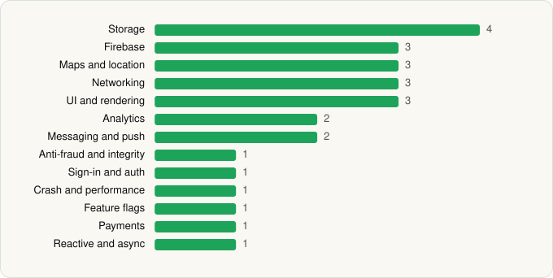

<picture><source media="(prefers-color-scheme: dark)" srcset="../../../../assets/logo/logo-dark.svg"></picture> [Tech Stack](../../../../README.md) / [APCOA GmbH](../../../../companies/apcoa-gmbh.md) / APCOA FLOW

# APCOA FLOW: Mobile Parking App

<picture><source media="(prefers-color-scheme: dark)" srcset="../../../../assets/badges/android-dark.svg"></picture> <picture><source media="(prefers-color-scheme: dark)" srcset="../../../../assets/badges/inactive-dark.svg"></picture>

[Google Play](https://play.google.com/store/apps/details?id=com.europark.mobilparkering) · [latest.json](latest.json)

| | |
|---|---|
| Company | [APCOA GmbH](../../../../companies/apcoa-gmbh.md) |
| Store id | `com.europark.mobilparkering` |
| Bundle / package id | `com.europark.mobilparkering` |
| Latest version | 26.11.8 (analysed 2026-11-10) |
| Versions tracked | 1 |
| SDKs in latest version | 26 |
| Languages | C/C++ (native), Flutter / Dart, Java, Kotlin, React Native / JavaScript |
| UI | Fresco, Jetpack Compose, Material Components |
| Build | Gradle (inferred) |
| Minimum OS | API 28, targets API 36 |
| Devices / ABIs | Android |
| Capabilities | 9 |
| Declares tracking | Yes |
| Tracked | No. Kept for history. |

## SDKs by category

<picture><source media="(prefers-color-scheme: dark)" srcset="../../../../assets/charts/apps/android/apcoa-gmbh/apcoa-flow-dark.svg"></picture>

- **Storage** (4): DataStore, Okio, Room, SQLCipher
- **Firebase** (3): Firebase, Google DataTransport, Google Play services
- **Maps and location** (3): Google Location, Google Maps, Mapbox
- **Networking** (3): Cronet, Cronet (Google), OkHttp
- **UI and rendering** (3): Fresco, Jetpack Compose, Material Components
- **Analytics** (2): Firebase Analytics, Mixpanel
- **Messaging and push** (2): CleverTap, Firebase Messaging
- **Anti-fraud and integrity** (1): Play Integrity
- **Sign-in and auth** (1): Google Sign-In / Auth
- **Crash and performance** (1): Firebase Crashlytics
- **Feature flags** (1): Firebase Remote Config
- **Payments** (1): Stripe
- **Reactive and async** (1): Kotlin Coroutines

Capabilities (9)

Activity / fitness recognition, Approximate location, Background location, Draw over other apps, Foreground service, Foreground service: location, Notifications, Phone / carrier info, Precise location

## Version history

| Version | Analysed | Store update | SDKs | Change | SDK list is a floor | Binary encrypted | File |
|---|---|---|---|---|---|---|---|
| 26.11.8 | 2026-11-10 |  | 26 |  | No | No | [26.11.8.json](26.11.8.json) |

---

Generated by `scripts/build_readme.py` from the JSON files. Do not edit by hand.
