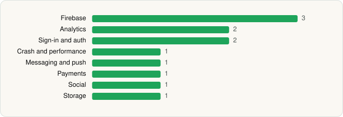

<picture><source media="(prefers-color-scheme: dark)" srcset="../../../../assets/logo/logo-dark.svg"></picture> [Tech Stack](../../../../README.md) / [Astra AI](../../../../companies/astra-ai.md) / Astra AI

# Astra AI: Study & Exam Prep

<picture><source media="(prefers-color-scheme: dark)" srcset="../../../../assets/badges/android-dark.svg"></picture> <picture><source media="(prefers-color-scheme: dark)" srcset="../../../../assets/badges/active-dark.svg"></picture> <picture><source media="(prefers-color-scheme: dark)" srcset="../../../../assets/badges/floor-dark.svg"></picture>

[Google Play](https://play.google.com/store/apps/details?id=co.astra_ai.app.twa) · [latest.json](latest.json)

| | |
|---|---|
| Company | [Astra AI](../../../../companies/astra-ai.md) |
| Store id | `co.astra_ai.app.twa` |
| Bundle / package id | `co.astra_ai.app.twa` |
| Latest version | 3.7.436 (analysed 2026-11-04) |
| Versions tracked | 1 |
| SDKs in latest version | 12 |
| Languages | C/C++ (native), Java |
| UI | Android Views (inferred) |
| Build | Gradle (inferred), Packer/hardening: Google Play (pairip) anti-tamper, R8 / ProGuard (name obfuscation detected) |
| Minimum OS | API 24, targets API 36 |
| Devices / ABIs | Android |
| Capabilities | 2 |
| Declares tracking | Yes |
| Tracked | Yes |

## SDKs by category

<picture><source media="(prefers-color-scheme: dark)" srcset="../../../../assets/charts/apps/android/astra-ai/astra-ai-dark.svg"></picture>

- **Firebase** (3): Firebase, Google DataTransport, Google Play services
- **Analytics** (2): Facebook SDK, Singular
- **Sign-in and auth** (2): Facebook Login, Google Sign-In / Auth
- **Crash and performance** (1): Firebase Crashlytics
- **Messaging and push** (1): Firebase Messaging
- **Payments** (1): Google Play Billing
- **Social** (1): Facebook Share
- **Storage** (1): DataStore

Capabilities (2)

Advertising ID, Notifications

## Version history

| Version | Analysed | Store update | SDKs | Change | SDK list is a floor | Binary encrypted | File |
|---|---|---|---|---|---|---|---|
| 3.7.436 | 2026-11-04 | 2026-11-02 | 12 |  | Yes | No | [3.7.436.json](3.7.436.json) |

---

Generated by `scripts/build_readme.py` from the JSON files. Do not edit by hand.
