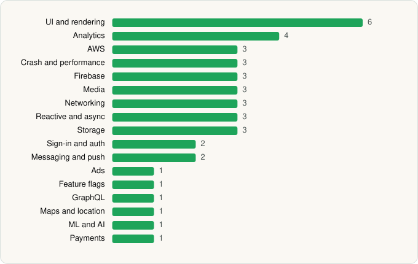

<picture><source media="(prefers-color-scheme: dark)" srcset="../../../../assets/logo/logo-dark.svg"></picture> [Tech Stack](../../../../README.md) / [Audible, Inc.](../../../../companies/audible-inc.md) / Audible

# Audible: Audiobooks & Podcasts

<picture><source media="(prefers-color-scheme: dark)" srcset="../../../../assets/badges/android-dark.svg"></picture> <picture><source media="(prefers-color-scheme: dark)" srcset="../../../../assets/badges/inactive-dark.svg"></picture>

[Google Play](https://play.google.com/store/apps/details?id=com.audible.application) · [latest.json](latest.json)

| | |
|---|---|
| Company | [Audible, Inc.](../../../../companies/audible-inc.md) |
| Store id | `com.audible.application` |
| Bundle / package id | `com.audible.application` |
| Latest version | 26.23.01 (analysed 2026-06-23) |
| Versions tracked | 1 |
| SDKs in latest version | 41 |
| Languages | C/C++ (native), Java, Kotlin |
| UI | Coil, Glide, Jetpack Compose, Lottie, Material Components |
| Build | Gradle (inferred) |
| Minimum OS | API 28, targets API 36 |
| Devices / ABIs | Android |
| Capabilities | 13 |
| Declares tracking | Yes |
| Tracked | No. Kept for history. |

## SDKs by category

<picture><source media="(prefers-color-scheme: dark)" srcset="../../../../assets/charts/apps/android/audible-inc/audible-dark.svg"></picture>

- **UI and rendering** (6): Coil, Glide, Jetpack Compose, Lottie, Markwon, Material Components
- **Analytics** (4): Adobe Experience Platform, Firebase Analytics, Google Analytics (legacy), Kochava
- **AWS** (3): AWS Amplify, AWS SDK, AWS SDK (Kotlin)
- **Crash and performance** (3): Bugsnag, Firebase Crashlytics, Firebase Performance
- **Firebase** (3): Firebase, Google DataTransport, Google Play services
- **Media** (3): ExoPlayer, Google Cast, Media3 (ExoPlayer)
- **Networking** (3): Ktor, OkHttp, Retrofit
- **Reactive and async** (3): Kotlin Coroutines, RxJava, RxJava 3
- **Storage** (3): DataStore, Okio, Room
- **Sign-in and auth** (2): Credential Manager, Google Sign-In / Auth
- **Messaging and push** (2): Braze, Firebase Messaging
- **Ads** (1): Google Mobile Ads (AdMob)
- **Feature flags** (1): Firebase Remote Config
- **GraphQL** (1): Apollo GraphQL
- **Maps and location** (1): Google Location
- **ML and AI** (1): ML Kit
- **Payments** (1): Google Play Billing

Capabilities (13)

Advertising ID, Background location, Bluetooth, Bluetooth (connect), Bluetooth (scan), Camera, Foreground service, Foreground service: media playback, Microphone, Notifications, Phone / carrier info, Storage (read), Storage (write)

## Version history

| Version | Analysed | Store update | SDKs | Change | SDK list is a floor | Binary encrypted | File |
|---|---|---|---|---|---|---|---|
| 26.23.01 | 2026-06-23 |  | 41 |  | No | No | [26.23.01.json](26.23.01.json) |

## Model-written summary

> Android audiobook app using Jetpack Compose, native AAX/Widevine DRM, AWS SDKs, ExoPlayer, and multi-analytics from Firebase, Kochava and Braze.

Written by a language model from the detected signals (`inferred[]`). It is commentary, not measurement.

---

Generated by `scripts/build_readme.py` from the JSON files. Do not edit by hand.
