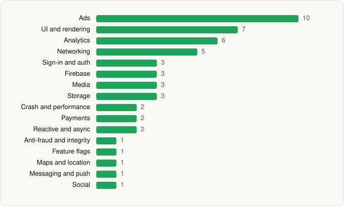

<picture><source media="(prefers-color-scheme: dark)" srcset="../../../../assets/logo/logo-dark.svg"></picture> [Tech Stack](../../../../README.md) / [Audiomack Music Apps](../../../../companies/audiomack-music-apps.md) / Audiomack

# Audiomack: Music Downloader

<picture><source media="(prefers-color-scheme: dark)" srcset="../../../../assets/badges/android-dark.svg"></picture> <picture><source media="(prefers-color-scheme: dark)" srcset="../../../../assets/badges/inactive-dark.svg"></picture>

[Google Play](https://play.google.com/store/apps/details?id=com.audiomack) · [latest.json](latest.json)

| | |
|---|---|
| Company | [Audiomack Music Apps](../../../../companies/audiomack-music-apps.md) |
| Store id | `com.audiomack` |
| Bundle / package id | `com.audiomack` |
| Latest version | 8.4.0 (analysed 2026-06-23) |
| Versions tracked | 1 |
| SDKs in latest version | 51 |
| Languages | C/C++ (native), Java, Kotlin, Unity (C# / IL2CPP) |
| UI | Coil, Glide, Jetpack Compose, Lottie, Material Components, Picasso |
| Build | Gradle (inferred) |
| Minimum OS | API 24, targets API 35 |
| Devices / ABIs | Android |
| Capabilities | 8 |
| Declares tracking | Yes |
| Tracked | No. Kept for history. |

## SDKs by category

<picture><source media="(prefers-color-scheme: dark)" srcset="../../../../assets/charts/apps/android/audiomack-music-apps/audiomack-dark.svg"></picture>

- **Ads** (10): AppLovin, Fyber, Google Ad Manager, Google Mobile Ads (AdMob), ironSource, Meta Audience Network, Mintegral, Pangle, Unity Ads, Vungle
- **UI and rendering** (7): AndroidSVG, Coil, Glide, Jetpack Compose, Lottie, Material Components, Picasso
- **Analytics** (6): AppsFlyer, comScore, Facebook SDK, Firebase Analytics, Google Analytics (legacy), Google App Measurement
- **Networking** (5): Cronet, Cronet (Google), Ktor, OkHttp, Retrofit
- **Sign-in and auth** (3): Credential Manager, Facebook Login, Google Sign-In / Auth
- **Firebase** (3): Firebase, Google DataTransport, Google Play services
- **Media** (3): ExoPlayer, Google Cast, Media3 (ExoPlayer)
- **Storage** (3): DataStore, Okio, Room
- **Crash and performance** (2): Crashlytics, Firebase Crashlytics
- **Payments** (2): Google Play Billing, RevenueCat
- **Reactive and async** (2): Kotlin Coroutines, RxJava
- **Anti-fraud and integrity** (1): Play Integrity
- **Feature flags** (1): Firebase Remote Config
- **Maps and location** (1): Google Location
- **Messaging and push** (1): Firebase Messaging
- **Social** (1): Facebook Share

Capabilities (8)

Advertising ID, Biometric auth, Fingerprint auth, Foreground service, Foreground service: media playback, Media: audio, Notifications, Storage (write)

## Version history

| Version | Analysed | Store update | SDKs | Change | SDK list is a floor | Binary encrypted | File |
|---|---|---|---|---|---|---|---|
| 8.4.0 | 2026-06-23 |  | 51 |  | No | No | [8.4.0.json](8.4.0.json) |

## Model-written summary

> Android music app with Unity (IL2CPP), Jetpack Compose UI, 10 ad SDKs, Retrofit, and root detection

Written by a language model from the detected signals (`inferred[]`). It is commentary, not measurement.

---

Generated by `scripts/build_readme.py` from the JSON files. Do not edit by hand.
