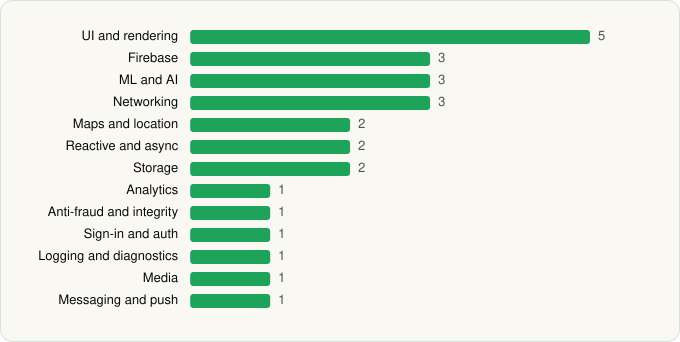

<picture><source media="(prefers-color-scheme: dark)" srcset="../../../../assets/logo/logo-dark.svg"></picture> [Tech Stack](../../../../README.md) / [Bank of America](../../../../companies/bank-of-america.md) / Bank of America Private Bank

# Bank of America Private Bank

<picture><source media="(prefers-color-scheme: dark)" srcset="../../../../assets/badges/android-dark.svg"></picture> <picture><source media="(prefers-color-scheme: dark)" srcset="../../../../assets/badges/inactive-dark.svg"></picture>

[Google Play](https://play.google.com/store/apps/details?id=com.ustrust.mobileapps.accountaccessandroid) · [latest.json](latest.json)

| | |
|---|---|
| Company | [Bank of America](../../../../companies/bank-of-america.md) |
| Store id | `com.ustrust.mobileapps.accountaccessandroid` |
| Bundle / package id | `com.ustrust.mobileapps.accountaccessandroid` |
| Latest version | 25.10.02 (analysed 2026-06-19) |
| Versions tracked | 1 |
| SDKs in latest version | 26 |
| Languages | C/C++ (native), Java, Kotlin |
| UI | Glide, Lottie, Material Components, Picasso |
| Build | Gradle (inferred) |
| Minimum OS | API 29, targets API 35 |
| Devices / ABIs | Android |
| Capabilities | 15 |
| Declares tracking | Yes |
| Tracked | No. Kept for history. |

## SDKs by category

<picture><source media="(prefers-color-scheme: dark)" srcset="../../../../assets/charts/apps/android/bank-of-america/bank-of-america-private-bank-dark.svg"></picture>

- **UI and rendering** (5): AndroidSVG, Glide, Lottie, Material Components, Picasso
- **Firebase** (3): Firebase, Google DataTransport, Google Play services
- **ML and AI** (3): ML Kit, ML Kit (barcode/vision), Mobile Vision
- **Networking** (3): Ktor, OkHttp, Retrofit
- **Maps and location** (2): Google Location, Google Maps
- **Reactive and async** (2): Kotlin Coroutines, RxJava
- **Storage** (2): Okio, Room
- **Analytics** (1): Firebase Analytics
- **Anti-fraud and integrity** (1): Play Integrity
- **Sign-in and auth** (1): Google Sign-In / Auth
- **Logging and diagnostics** (1): Stetho
- **Media** (1): ExoPlayer
- **Messaging and push** (1): Firebase Messaging

Capabilities (15)

Approximate location, Biometric auth, Bluetooth, Bluetooth (connect), Calendar (write), Camera, Contacts (read), Fingerprint auth, Foreground service, Microphone, Notifications, Phone / carrier info, Precise location, Storage (read), Storage (write)

## Version history

| Version | Analysed | Store update | SDKs | Change | SDK list is a floor | Binary encrypted | File |
|---|---|---|---|---|---|---|---|
| 25.10.02 | 2026-06-19 |  | 26 |  | No | No | [25.10.02.json](25.10.02.json) |

---

Generated by `scripts/build_readme.py` from the JSON files. Do not edit by hand.
