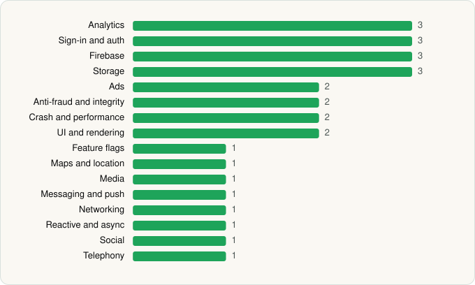

<picture><source media="(prefers-color-scheme: dark)" srcset="../../../../assets/logo/logo-dark.svg"></picture> [Tech Stack](../../../../README.md) / [Beloud.com](../../../../companies/beloud-com.md) / Breaking News

# Breaking News: Local & Alerts

<picture><source media="(prefers-color-scheme: dark)" srcset="../../../../assets/badges/android-dark.svg"></picture> <picture><source media="(prefers-color-scheme: dark)" srcset="../../../../assets/badges/active-dark.svg"></picture>

[Google Play](https://play.google.com/store/apps/details?id=ma.safe.bn) · [latest.json](latest.json)

| | |
|---|---|
| Company | [Beloud.com](../../../../companies/beloud-com.md) |
| Store id | `ma.safe.bn` |
| Bundle / package id | `ma.safe.bn` |
| Latest version | 11.1.22 (analysed 2026-11-05) |
| Versions tracked | 1 |
| SDKs in latest version | 28 |
| Languages | Java, Kotlin |
| UI | Glide, Material Components |
| Build | Gradle (inferred) |
| Minimum OS | API 23, targets API 35 |
| Devices / ABIs | Android |
| Capabilities | 10 |
| Declares tracking | Yes |
| Tracked | Yes |

## SDKs by category

<picture><source media="(prefers-color-scheme: dark)" srcset="../../../../assets/charts/apps/android/beloud-com/breaking-news-dark.svg"></picture>

- **Analytics** (3): Facebook SDK, Firebase Analytics, Google App Measurement
- **Sign-in and auth** (3): Facebook Login, Firebase Auth, Google Sign-In / Auth
- **Firebase** (3): Firebase, Google DataTransport, Google Play services
- **Storage** (3): DataStore, Okio, Room
- **Ads** (2): Google Mobile Ads (AdMob), Meta Audience Network
- **Anti-fraud and integrity** (2): Play Integrity, reCAPTCHA
- **Crash and performance** (2): Firebase Crashlytics, Firebase Performance
- **UI and rendering** (2): Glide, Material Components
- **Feature flags** (1): Firebase Remote Config
- **Maps and location** (1): Google Location
- **Media** (1): Media3 (ExoPlayer)
- **Messaging and push** (1): Firebase Messaging
- **Networking** (1): OkHttp
- **Reactive and async** (1): Kotlin Coroutines
- **Social** (1): Facebook Share
- **Telephony** (1): libphonenumber

Capabilities (10)

Advertising ID, Approximate location, Camera, Foreground service, Media: images, Media: video, Notifications, Precise location, Storage (read), Storage (write)

## Version history

| Version | Analysed | Store update | SDKs | Change | SDK list is a floor | Binary encrypted | File |
|---|---|---|---|---|---|---|---|
| 11.1.22 | 2026-11-05 |  | 28 |  | No | No | [11.1.22.json](11.1.22.json) |

---

Generated by `scripts/build_readme.py` from the JSON files. Do not edit by hand.
