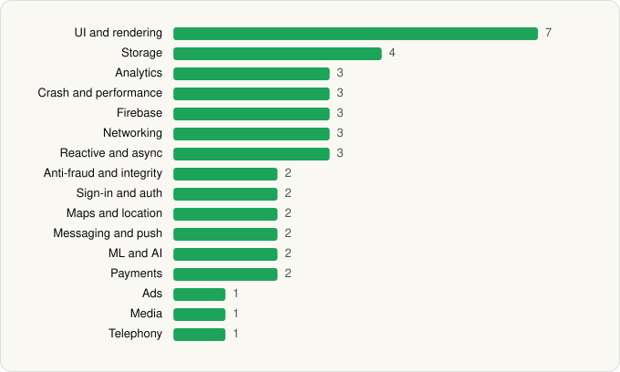

<picture><source media="(prefers-color-scheme: dark)" srcset="../../../../assets/logo/logo-dark.svg"></picture> [Tech Stack](../../../../README.md) / [Block, Inc.](../../../../companies/block-inc.md) / Cash App

# Cash App

<picture><source media="(prefers-color-scheme: dark)" srcset="../../../../assets/badges/android-dark.svg"></picture> <picture><source media="(prefers-color-scheme: dark)" srcset="../../../../assets/badges/inactive-dark.svg"></picture>

[Google Play](https://play.google.com/store/apps/details?id=com.squareup.cash) · [latest.json](latest.json)

| | |
|---|---|
| Company | [Block, Inc.](../../../../companies/block-inc.md) |
| Store id | `com.squareup.cash` |
| Bundle / package id | `com.squareup.cash` |
| Latest version | 5.53.0 (analysed 2026-06-19) |
| Versions tracked | 1 |
| SDKs in latest version | 41 |
| Languages | C/C++ (native), Java, Kotlin |
| UI | Coil, Glide, Jetpack Compose, Lottie, Material Components |
| Build | Gradle (inferred) |
| Minimum OS | API 29, targets API 35 |
| Devices / ABIs | Android |
| Capabilities | 17 |
| Declares tracking | Yes |
| Tracked | No. Kept for history. |

## SDKs by category

<picture><source media="(prefers-color-scheme: dark)" srcset="../../../../assets/charts/apps/android/block-inc/cash-app-dark.svg"></picture>

- **UI and rendering** (7): AndroidSVG, Coil, Glide, Jetpack Compose, Lottie, Markwon, Material Components
- **Storage** (4): DataStore, Okio, Room, SQLDelight
- **Analytics** (3): AppsFlyer, Firebase Analytics, Google App Measurement
- **Crash and performance** (3): Bugsnag, Datadog, OpenTelemetry
- **Firebase** (3): Firebase, Google DataTransport, Google Play services
- **Networking** (3): OkHttp, Retrofit, Volley
- **Reactive and async** (3): Kotlin Coroutines, RxJava, RxJava 3
- **Anti-fraud and integrity** (2): Persona, Play Integrity
- **Sign-in and auth** (2): Credential Manager, Google Sign-In / Auth
- **Maps and location** (2): Google Location, Google Maps
- **Messaging and push** (2): Braze, Firebase Messaging
- **ML and AI** (2): ML Kit, ML Kit (barcode/vision)
- **Payments** (2): Plaid, Stripe
- **Ads** (1): Google Mobile Ads (AdMob)
- **Media** (1): Media3 (ExoPlayer)
- **Telephony** (1): libphonenumber

Capabilities (17)

Advertising ID, Approximate location, Background location, Biometric auth, Bluetooth, Bluetooth (connect), Bluetooth (scan), Camera, Contacts (read), Fingerprint auth, Foreground service, NFC, Notifications, Phone / carrier info, Precise location, Storage (read), Storage (write)

## Version history

| Version | Analysed | Store update | SDKs | Change | SDK list is a floor | Binary encrypted | File |
|---|---|---|---|---|---|---|---|
| 5.53.0 | 2026-06-19 |  | 41 |  | No | No | [5.53.0.json](5.53.0.json) |

## Model-written summary

> Kotlin Android payments app with Jetpack Compose, native face/document scanning libs, TFLite barcode models, Square backend, root detection, and multi-SDK analytics

Written by a language model from the detected signals (`inferred[]`). It is commentary, not measurement.

---

Generated by `scripts/build_readme.py` from the JSON files. Do not edit by hand.
