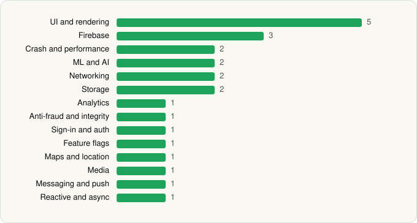

<picture><source media="(prefers-color-scheme: dark)" srcset="../../../../assets/logo/logo-dark.svg"></picture> [Tech Stack](../../../../README.md) / [Bluesky PBLLC](../../../../companies/bluesky-pbllc.md) / Bluesky

# Bluesky

<picture><source media="(prefers-color-scheme: dark)" srcset="../../../../assets/badges/android-dark.svg"></picture> <picture><source media="(prefers-color-scheme: dark)" srcset="../../../../assets/badges/inactive-dark.svg"></picture> <picture><source media="(prefers-color-scheme: dark)" srcset="../../../../assets/badges/floor-dark.svg"></picture>

[Google Play](https://play.google.com/store/apps/details?id=xyz.blueskyweb.app) · [latest.json](latest.json)

| | |
|---|---|
| Company | [Bluesky PBLLC](../../../../companies/bluesky-pbllc.md) |
| Store id | `xyz.blueskyweb.app` |
| Bundle / package id | `xyz.blueskyweb.app` |
| Latest version | 1.136.0 (analysed 2026-10-23) |
| Versions tracked | 2 |
| SDKs in latest version | 24 |
| Languages | C/C++ (native), Java, Kotlin, React Native / JavaScript |
| UI | Fresco, Glide, Jetpack Compose, Material Components |
| Build | Gradle (inferred), R8 / ProGuard (name obfuscation detected) |
| Minimum OS | API 24, targets API 36 |
| Devices / ABIs | Android |
| Capabilities | 16 |
| Declares tracking | Yes |
| Tracked | No. Kept for history. |

## SDKs by category

<picture><source media="(prefers-color-scheme: dark)" srcset="../../../../assets/charts/apps/android/bluesky-pbllc/bluesky-dark.svg"></picture>

- **UI and rendering** (5): AndroidSVG, Fresco, Glide, Jetpack Compose, Material Components
- **Firebase** (3): Firebase, Google DataTransport, Google Play services
- **Crash and performance** (2): Sentry, Sentry (native)
- **ML and AI** (2): ML Kit, ML Kit (barcode/vision)
- **Networking** (2): OkHttp, TanStack Query
- **Storage** (2): DataStore, Room
- **Analytics** (1): Amplitude
- **Anti-fraud and integrity** (1): Play Integrity
- **Sign-in and auth** (1): Google Sign-In / Auth
- **Feature flags** (1): Statsig
- **Maps and location** (1): Google Location
- **Media** (1): Media3 (ExoPlayer)
- **Messaging and push** (1): Firebase Messaging
- **Reactive and async** (1): Kotlin Coroutines

Capabilities (16)

Approximate location, Camera, Contacts (read), Contacts (write), Draw over other apps, Foreground service, Foreground service: media playback, Media: audio, Media: images, Media: video, Microphone, Notifications, Phone / carrier info, Precise location, Storage (read), Storage (write)

## Version history

| Version | Analysed | Store update | SDKs | Change | SDK list is a floor | Binary encrypted | File |
|---|---|---|---|---|---|---|---|
| 1.136.0 | 2026-10-23 | 2026-10-22 | 24 | +1 / −8 | Yes | No | [1.136.0.json](1.136.0.json) |
| 1.123.0 | 2026-06-19 |  | 31 |  | No | No | [1.123.0.json](1.123.0.json) |

### SDK changes between versions

- 1.123.0 → 1.136.0: added DataStore; removed Apollo GraphQL, Branch, Firebase Analytics, Okio, React Native Reanimated, react-native-svg, Realm, Redux

---

Generated by `scripts/build_readme.py` from the JSON files. Do not edit by hand.
