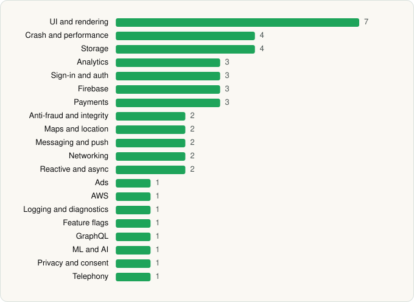

<picture><source media="(prefers-color-scheme: dark)" srcset="../../../../assets/logo/logo-dark.svg"></picture> [Tech Stack](../../../../README.md) / [Booking.com Hotels & Vacation Rentals](../../../../companies/booking-com-hotels-vacation-rentals.md) / Booking.com

# Booking.com: Hotels & Travel

<picture><source media="(prefers-color-scheme: dark)" srcset="../../../../assets/badges/android-dark.svg"></picture> <picture><source media="(prefers-color-scheme: dark)" srcset="../../../../assets/badges/active-dark.svg"></picture>

[Google Play](https://play.google.com/store/apps/details?id=com.booking) · [latest.json](latest.json)

| | |
|---|---|
| Company | [Booking.com Hotels & Vacation Rentals](../../../../companies/booking-com-hotels-vacation-rentals.md) |
| Store id | `com.booking` |
| Bundle / package id | `com.booking` |
| Latest version | 66.6 (analysed 2026-06-23) |
| Versions tracked | 1 |
| SDKs in latest version | 45 |
| Languages | C/C++ (native), Java, Kotlin |
| UI | Coil, Glide, Jetpack Compose, Lottie, Material Components |
| Build | Gradle (inferred) |
| Minimum OS | API 29, targets API 36 |
| Devices / ABIs | Android |
| Capabilities | 16 |
| Declares tracking | Yes |
| Tracked | Yes |

## SDKs by category

<picture><source media="(prefers-color-scheme: dark)" srcset="../../../../assets/charts/apps/android/booking-com-hotels-vacation-rentals/booking-com-dark.svg"></picture>

- **UI and rendering** (7): AndroidSVG, Coil, Glide, Jetpack Compose, Lottie, Markwon, Material Components
- **Crash and performance** (4): Embrace, Firebase Crashlytics, Firebase Performance, OpenTelemetry
- **Storage** (4): DataStore, Okio, Room, SQLDelight
- **Analytics** (3): AppsFlyer, Firebase Analytics, Google App Measurement
- **Sign-in and auth** (3): AppAuth, Credential Manager, Google Sign-In / Auth
- **Firebase** (3): Firebase, Google DataTransport, Google Play services
- **Payments** (3): Adyen, Braintree, Stripe
- **Anti-fraud and integrity** (2): Fingerprint, Play Integrity
- **Maps and location** (2): Google Location, Google Maps
- **Messaging and push** (2): Firebase Messaging, Zendesk
- **Networking** (2): OkHttp, Retrofit
- **Reactive and async** (2): Kotlin Coroutines, RxJava
- **Ads** (1): Google Mobile Ads (AdMob)
- **AWS** (1): AWS SDK
- **Logging and diagnostics** (1): Flipper
- **Feature flags** (1): Firebase Remote Config
- **GraphQL** (1): Apollo GraphQL
- **ML and AI** (1): ML Kit
- **Privacy and consent** (1): OneTrust
- **Telephony** (1): libphonenumber

Capabilities (16)

Advertising ID, Approximate location, Biometric auth, Calendar (read), Calendar (write), Camera, Fingerprint auth, Foreground service, Media: images, Microphone, NFC, Notifications, Phone / carrier info, Precise location, Storage (read), Storage (write)

## Version history

| Version | Analysed | Store update | SDKs | Change | SDK list is a floor | Binary encrypted | File |
|---|---|---|---|---|---|---|---|
| 66.6 | 2026-06-23 |  | 45 |  | No | No | [66.6.json](66.6.json) |

---

Generated by `scripts/build_readme.py` from the JSON files. Do not edit by hand.
