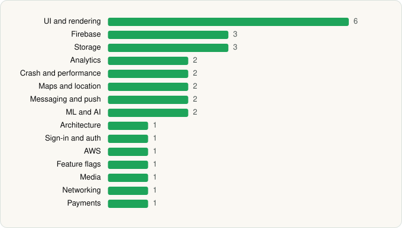

<picture><source media="(prefers-color-scheme: dark)" srcset="../../../../assets/logo/logo-dark.svg"></picture> [Tech Stack](../../../../README.md) / [Burger King, Inc.](../../../../companies/burger-king-inc.md) / BURGER KING® App

# BURGER KING® App

<picture><source media="(prefers-color-scheme: dark)" srcset="../../../../assets/badges/android-dark.svg"></picture> <picture><source media="(prefers-color-scheme: dark)" srcset="../../../../assets/badges/inactive-dark.svg"></picture> <picture><source media="(prefers-color-scheme: dark)" srcset="../../../../assets/badges/floor-dark.svg"></picture>

[Google Play](https://play.google.com/store/apps/details?id=com.emn8.mobilem8.nativeapp.bk) · [latest.json](latest.json)

| | |
|---|---|
| Company | [Burger King, Inc.](../../../../companies/burger-king-inc.md) |
| Store id | `com.emn8.mobilem8.nativeapp.bk` |
| Bundle / package id | `com.emn8.mobilem8.nativeapp.bk` |
| Latest version | 7.86.0 (analysed 2026-11-13) |
| Versions tracked | 3 |
| SDKs in latest version | 29 |
| Languages | C/C++ (native), Java, Kotlin, React Native / JavaScript |
| UI | Fresco, Glide, Lottie, Material Components |
| Build | Gradle (inferred), R8 / ProGuard (name obfuscation detected) |
| Minimum OS | API 24, targets API 36 |
| Devices / ABIs | Android |
| Capabilities | 12 |
| Declares tracking | Yes |
| Tracked | No. Kept for history. |

## SDKs by category

<picture><source media="(prefers-color-scheme: dark)" srcset="../../../../assets/charts/apps/android/burger-king-inc/burger-king-app-dark.svg"></picture>

- **UI and rendering** (6): Fresco, Glide, Lottie, Material Components, React Native Reanimated, react-native-svg
- **Firebase** (3): Firebase, Google DataTransport, Google Play services
- **Storage** (3): DataStore, MMKV, Room
- **Analytics** (2): Amplitude, Branch
- **Crash and performance** (2): Datadog, Datadog (native)
- **Maps and location** (2): Google Location, Google Maps
- **Messaging and push** (2): Braze, Firebase Messaging
- **ML and AI** (2): ML Kit, ML Kit (barcode/vision)
- **Architecture** (1): Redux
- **Sign-in and auth** (1): Google Sign-In / Auth
- **AWS** (1): AWS SDK
- **Feature flags** (1): LaunchDarkly
- **Media** (1): Media3 (ExoPlayer)
- **Networking** (1): OkHttp
- **Payments** (1): Braintree

Capabilities (12)

Advertising ID, Approximate location, Biometric auth, Camera, Draw over other apps, Fingerprint auth, Foreground service, Microphone, Notifications, Precise location, Storage (read), Storage (write)

## Version history

| Version | Analysed | Store update | SDKs | Change | SDK list is a floor | Binary encrypted | File |
|---|---|---|---|---|---|---|---|
| 7.86.0 | 2026-11-13 |  | 29 | +0 / −0 | Yes | No | [7.86.0.json](7.86.0.json) |
| 7.85.0 | 2026-11-01 | 2026-10-26 | 29 | +1 / −5 | Yes | No | [7.85.0.json](7.85.0.json) |
| 7.75.0 | 2026-06-22 |  | 33 |  | Yes | No | [7.75.0.json](7.75.0.json) |

### SDK changes between versions

- 7.75.0 → 7.85.0: added Lottie; removed Firebase Analytics, Firebase Crashlytics, Firebase Performance, Firebase Remote Config, Google App Measurement

---

Generated by `scripts/build_readme.py` from the JSON files. Do not edit by hand.
