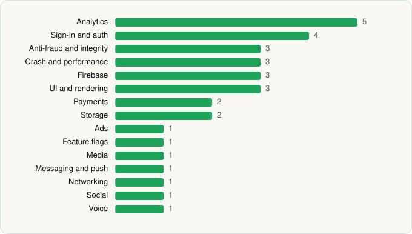

<picture><source media="(prefers-color-scheme: dark)" srcset="../../../../assets/logo/logo-dark.svg"></picture> [Tech Stack](../../../../README.md) / [BUTTERFLY EFFECT PTE. LTD.](../../../../companies/butterfly-effect-pte-ltd.md) / Manus AI

# Manus AI

<picture><source media="(prefers-color-scheme: dark)" srcset="../../../../assets/badges/android-dark.svg"></picture> <picture><source media="(prefers-color-scheme: dark)" srcset="../../../../assets/badges/active-dark.svg"></picture> <picture><source media="(prefers-color-scheme: dark)" srcset="../../../../assets/badges/floor-dark.svg"></picture>

[Google Play](https://play.google.com/store/apps/details?id=tech.butterfly.app) · [latest.json](latest.json)

| | |
|---|---|
| Company | [BUTTERFLY EFFECT PTE. LTD.](../../../../companies/butterfly-effect-pte-ltd.md) |
| Store id | `tech.butterfly.app` |
| Bundle / package id | `tech.butterfly.app` |
| Latest version | 26.19.2 (analysed 2026-10-24) |
| Versions tracked | 1 |
| SDKs in latest version | 32 |
| Languages | C/C++ (native), Flutter / Dart, Java, Kotlin |
| UI | Coil, Glide, Jetpack Compose |
| Build | Gradle (inferred), R8 / ProGuard (name obfuscation detected) |
| Minimum OS | API 24, targets API 36 |
| Devices / ABIs | Android |
| Capabilities | 14 |
| Declares tracking | Yes |
| Tracked | Yes |

## SDKs by category

<picture><source media="(prefers-color-scheme: dark)" srcset="../../../../assets/charts/apps/android/butterfly-effect-pte-ltd/manus-ai-dark.svg"></picture>

- **Analytics** (5): Adjust, Amplitude, Facebook SDK, Firebase Analytics, Google App Measurement
- **Sign-in and auth** (4): Credential Manager, Facebook Login, Firebase Auth, Google Sign-In / Auth
- **Anti-fraud and integrity** (3): Fingerprint, Play Integrity, reCAPTCHA
- **Crash and performance** (3): OpenTelemetry, Sentry, Sentry (native)
- **Firebase** (3): Firebase, Google DataTransport, Google Play services
- **UI and rendering** (3): Coil, Glide, Jetpack Compose
- **Payments** (2): Google Play Billing, RevenueCat
- **Storage** (2): DataStore, Room
- **Ads** (1): Google Mobile Ads (AdMob)
- **Feature flags** (1): Firebase Remote Config
- **Media** (1): Media3 (ExoPlayer)
- **Messaging and push** (1): Firebase Messaging
- **Networking** (1): OkHttp
- **Social** (1): Facebook Share
- **Voice** (1): WebRTC

Capabilities (14)

Advertising ID, Biometric auth, Bluetooth, Camera, Fingerprint auth, Foreground service, Foreground service: microphone, Media: images, Media: video, Microphone, NFC, Notifications, Storage (read), Storage (write)

## Version history

| Version | Analysed | Store update | SDKs | Change | SDK list is a floor | Binary encrypted | File |
|---|---|---|---|---|---|---|---|
| 26.19.2 | 2026-10-24 | 2026-10-22 | 32 |  | Yes | No | [26.19.2.json](26.19.2.json) |

---

Generated by `scripts/build_readme.py` from the JSON files. Do not edit by hand.
