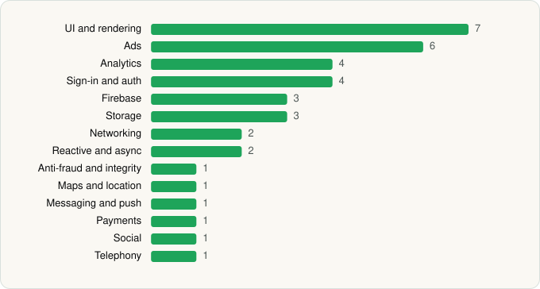

<picture><source media="(prefers-color-scheme: dark)" srcset="../../../../assets/logo/logo-dark.svg"></picture> [Tech Stack](../../../../README.md) / [Bytedance Pte. Ltd.](../../../../companies/bytedance-pte-ltd.md) / CapCut

# CapCut - Video Editor

<picture><source media="(prefers-color-scheme: dark)" srcset="../../../../assets/badges/android-dark.svg"></picture> <picture><source media="(prefers-color-scheme: dark)" srcset="../../../../assets/badges/inactive-dark.svg"></picture>

[Google Play](https://play.google.com/store/apps/details?id=com.lemon.lvoverseas) · [latest.json](latest.json)

| | |
|---|---|
| Company | [Bytedance Pte. Ltd.](../../../../companies/bytedance-pte-ltd.md) |
| Store id | `com.lemon.lvoverseas` |
| Bundle / package id | `com.lemon.lvoverseas` |
| Latest version | 19.8.0 (analysed 2026-10-24) |
| Versions tracked | 1 |
| SDKs in latest version | 37 |
| Languages | C/C++ (native), Java, Kotlin |
| UI | Coil, Fresco, Jetpack Compose, Lottie, Material Components |
| Build | Gradle (inferred) |
| Minimum OS | API 23, targets API 36 |
| Devices / ABIs | Android |
| Capabilities | 13 |
| Declares tracking | Yes |
| Tracked | No. Kept for history. |

## SDKs by category

<picture><source media="(prefers-color-scheme: dark)" srcset="../../../../assets/charts/apps/android/bytedance-pte-ltd/capcut-dark.svg"></picture>

- **UI and rendering** (7): AndroidSVG, Coil, Fresco, Jetpack Compose, Lottie, Markwon, Material Components
- **Ads** (6): AppLovin, Google Mobile Ads (AdMob), Meta Audience Network, Mintegral, Pangle, Vungle
- **Analytics** (4): AppsFlyer, Facebook SDK, Firebase Analytics, Google App Measurement
- **Sign-in and auth** (4): AppAuth, Facebook Login, Firebase Auth, Google Sign-In / Auth
- **Firebase** (3): Firebase, Google DataTransport, Google Play services
- **Storage** (3): DataStore, Okio, Room
- **Networking** (2): OkHttp, Retrofit
- **Reactive and async** (2): Kotlin Coroutines, RxJava
- **Anti-fraud and integrity** (1): Play Integrity
- **Maps and location** (1): Google Location
- **Messaging and push** (1): Firebase Messaging
- **Payments** (1): Google Play Billing
- **Social** (1): Facebook Share
- **Telephony** (1): libphonenumber

Capabilities (13)

Advertising ID, Calendar (read), Calendar (write), Camera, Draw over other apps, Foreground service, Media: audio, Media: images, Media: video, Microphone, Notifications, Storage (read), Storage (write)

## Version history

| Version | Analysed | Store update | SDKs | Change | SDK list is a floor | Binary encrypted | File |
|---|---|---|---|---|---|---|---|
| 19.8.0 | 2026-10-24 | 2026-10-23 | 37 |  | No | No | [19.8.0.json](19.8.0.json) |

---

Generated by `scripts/build_readme.py` from the JSON files. Do not edit by hand.
