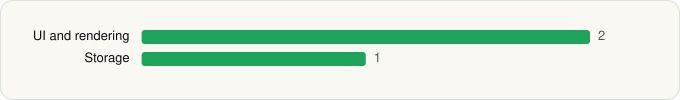

<picture><source media="(prefers-color-scheme: dark)" srcset="../../../../assets/logo/logo-dark.svg"></picture> [Tech Stack](../../../../README.md) / [Camille Bouvat](../../../../companies/camille-bouvat.md) / Saracroche

# Saracroche : bloqueur d'appels

<picture><source media="(prefers-color-scheme: dark)" srcset="../../../../assets/badges/android-dark.svg"></picture> <picture><source media="(prefers-color-scheme: dark)" srcset="../../../../assets/badges/inactive-dark.svg"></picture> <picture><source media="(prefers-color-scheme: dark)" srcset="../../../../assets/badges/floor-dark.svg"></picture>

[Google Play](https://play.google.com/store/apps/details?id=com.cbouvat.android.saracroche) · [latest.json](latest.json)

| | |
|---|---|
| Company | [Camille Bouvat](../../../../companies/camille-bouvat.md) |
| Store id | `com.cbouvat.android.saracroche` |
| Bundle / package id | `com.cbouvat.android.saracroche` |
| Latest version | 5.5.4 (analysed 2026-11-05) |
| Versions tracked | 1 |
| SDKs in latest version | 3 |
| Languages | C/C++ (native), Java |
| UI | Jetpack Compose, Material Components |
| Build | Gradle (inferred), R8 / ProGuard (name obfuscation detected) |
| Minimum OS | API 29, targets API 37 |
| Devices / ABIs | Android |
| Capabilities | 2 |
| Declares tracking | No |
| Tracked | No. Kept for history. |

## SDKs by category

<picture><source media="(prefers-color-scheme: dark)" srcset="../../../../assets/charts/apps/android/camille-bouvat/saracroche-dark.svg"></picture>

- **UI and rendering** (2): Jetpack Compose, Material Components
- **Storage** (1): Room

Capabilities (2)

Foreground service, Notifications

## Version history

| Version | Analysed | Store update | SDKs | Change | SDK list is a floor | Binary encrypted | File |
|---|---|---|---|---|---|---|---|
| 5.5.4 | 2026-11-05 | 2026-10-22 | 3 |  | Yes | No | [5.5.4.json](5.5.4.json) |

---

Generated by `scripts/build_readme.py` from the JSON files. Do not edit by hand.
