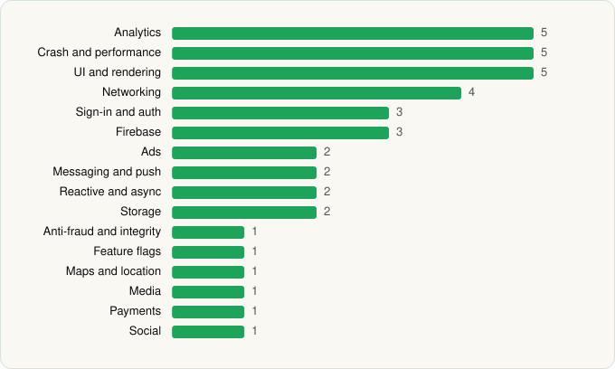

<picture><source media="(prefers-color-scheme: dark)" srcset="../../../../assets/logo/logo-dark.svg"></picture> [Tech Stack](../../../../README.md) / [Canva](../../../../companies/canva.md) / Canva

# Canva: AI Photo & Video Editor

<picture><source media="(prefers-color-scheme: dark)" srcset="../../../../assets/badges/android-dark.svg"></picture> <picture><source media="(prefers-color-scheme: dark)" srcset="../../../../assets/badges/active-dark.svg"></picture> <picture><source media="(prefers-color-scheme: dark)" srcset="../../../../assets/badges/floor-dark.svg"></picture>

[Google Play](https://play.google.com/store/apps/details?id=com.canva.editor) · [latest.json](latest.json)

| | |
|---|---|
| Company | [Canva](../../../../companies/canva.md) |
| Store id | `com.canva.editor` |
| Bundle / package id | `com.canva.editor` |
| Latest version | 2.383.0 (analysed 2026-10-24) |
| Versions tracked | 1 |
| SDKs in latest version | 39 |
| Languages | C/C++ (native), Java, Kotlin |
| UI | Glide, Lottie, Material Components, Picasso |
| Build | Gradle (inferred), R8 / ProGuard (name obfuscation detected) |
| Minimum OS | API 26, targets API 36 |
| Devices / ABIs | Android |
| Capabilities | 14 |
| Declares tracking | Yes |
| Tracked | Yes |

## SDKs by category

<picture><source media="(prefers-color-scheme: dark)" srcset="../../../../assets/charts/apps/android/canva/canva-dark.svg"></picture>

- **Analytics** (5): AppsFlyer, Facebook SDK, Firebase Analytics, Google App Measurement, Segment
- **Crash and performance** (5): Firebase Crashlytics, Firebase Performance, OpenTelemetry, Sentry, Sentry (native)
- **UI and rendering** (5): AndroidSVG, Glide, Lottie, Material Components, Picasso
- **Networking** (4): Cronet, Cronet (Google), OkHttp, Retrofit
- **Sign-in and auth** (3): Credential Manager, Facebook Login, Google Sign-In / Auth
- **Firebase** (3): Firebase, Google DataTransport, Google Play services
- **Ads** (2): Google Ad Manager, Google Mobile Ads (AdMob)
- **Messaging and push** (2): Braze, Firebase Messaging
- **Reactive and async** (2): Kotlin Coroutines, RxJava
- **Storage** (2): DataStore, Room
- **Anti-fraud and integrity** (1): Play Integrity
- **Feature flags** (1): Firebase Remote Config
- **Maps and location** (1): Google Location
- **Media** (1): FFmpeg
- **Payments** (1): Google Play Billing
- **Social** (1): Facebook Share

Capabilities (14)

Advertising ID, Biometric auth, Bluetooth (connect), Bluetooth (scan), Camera, Fingerprint auth, Foreground service, Media: audio, Media: images, Media: video, Microphone, Notifications, Storage (read), Storage (write)

## Version history

| Version | Analysed | Store update | SDKs | Change | SDK list is a floor | Binary encrypted | File |
|---|---|---|---|---|---|---|---|
| 2.383.0 | 2026-10-24 | 2026-10-21 | 39 |  | Yes | No | [2.383.0.json](2.383.0.json) |

---

Generated by `scripts/build_readme.py` from the JSON files. Do not edit by hand.
