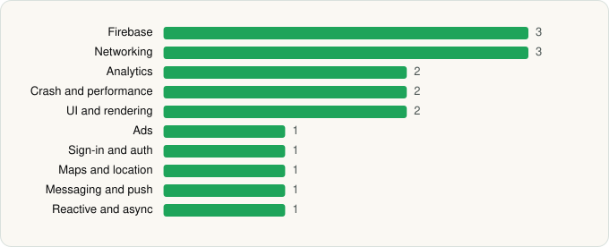

<picture><source media="(prefers-color-scheme: dark)" srcset="../../../../assets/logo/logo-dark.svg"></picture> [Tech Stack](../../../../README.md) / [Capital One Services, LLC](../../../../companies/capital-one-services-llc.md) / Capital One Intellix® Mobile

# Capital One Intellix® Mobile

<picture><source media="(prefers-color-scheme: dark)" srcset="../../../../assets/badges/android-dark.svg"></picture> <picture><source media="(prefers-color-scheme: dark)" srcset="../../../../assets/badges/inactive-dark.svg"></picture>

[Google Play](https://play.google.com/store/apps/details?id=com.capitalone.intellix.mobile.prod) · [latest.json](latest.json)

| | |
|---|---|
| Company | [Capital One Services, LLC](../../../../companies/capital-one-services-llc.md) |
| Store id | `com.capitalone.intellix.mobile.prod` |
| Bundle / package id | `com.capitalone.intellix.mobile.prod` |
| Latest version | 1.22.8 (analysed 2026-06-23) |
| Versions tracked | 1 |
| SDKs in latest version | 17 |
| Languages | C/C++ (native), Java, Kotlin |
| UI | Jetpack Compose, Material Components |
| Build | Gradle (inferred) |
| Minimum OS | API 28, targets API 35 |
| Devices / ABIs | Android |
| Capabilities | 5 |
| Declares tracking | Yes |
| Tracked | No. Kept for history. |

## SDKs by category

<picture><source media="(prefers-color-scheme: dark)" srcset="../../../../assets/charts/apps/android/capital-one-services-llc/capital-one-intellix-mobile-dark.svg"></picture>

- **Firebase** (3): Firebase, Google DataTransport, Google Play services
- **Networking** (3): OkHttp, Retrofit, Volley
- **Analytics** (2): Firebase Analytics, Google App Measurement
- **Crash and performance** (2): Firebase Crashlytics, New Relic
- **UI and rendering** (2): Jetpack Compose, Material Components
- **Ads** (1): Google Mobile Ads (AdMob)
- **Sign-in and auth** (1): Google Sign-In / Auth
- **Maps and location** (1): Google Maps
- **Messaging and push** (1): Firebase Messaging
- **Reactive and async** (1): Kotlin Coroutines

Capabilities (5)

Advertising ID, Biometric auth, Camera, Fingerprint auth, Notifications

## Version history

| Version | Analysed | Store update | SDKs | Change | SDK list is a floor | Binary encrypted | File |
|---|---|---|---|---|---|---|---|
| 1.22.8 | 2026-06-23 |  | 17 |  | No | No | [1.22.8.json](1.22.8.json) |

## Model-written summary

> Android banking app for Capital One Intellix built with Kotlin/Java, Jetpack Compose, Firebase, New Relic, and native libraries with dynamic loading

Written by a language model from the detected signals (`inferred[]`). It is commentary, not measurement.

---

Generated by `scripts/build_readme.py` from the JSON files. Do not edit by hand.
