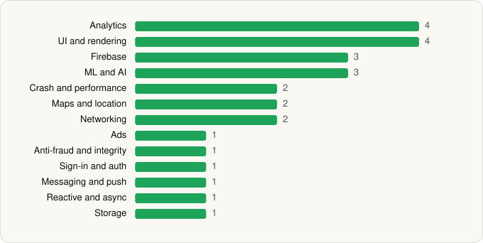

<picture><source media="(prefers-color-scheme: dark)" srcset="../../../../assets/logo/logo-dark.svg"></picture> [Tech Stack](../../../../README.md) / [Capital One Services, LLC](../../../../companies/capital-one-services-llc.md) / Capital One Mobile

# Capital One Mobile

<picture><source media="(prefers-color-scheme: dark)" srcset="../../../../assets/badges/android-dark.svg"></picture> <picture><source media="(prefers-color-scheme: dark)" srcset="../../../../assets/badges/inactive-dark.svg"></picture>

[Google Play](https://play.google.com/store/apps/details?id=com.konylabs.capitalone) · [latest.json](latest.json)

| | |
|---|---|
| Company | [Capital One Services, LLC](../../../../companies/capital-one-services-llc.md) |
| Store id | `com.konylabs.capitalone` |
| Bundle / package id | `com.konylabs.capitalone` |
| Latest version | 6.31.10 (analysed 2026-06-19) |
| Versions tracked | 1 |
| SDKs in latest version | 26 |
| Languages | C/C++ (native), Java, Kotlin |
| UI | Glide, Jetpack Compose, Lottie, Material Components |
| Build | Gradle (inferred) |
| Minimum OS | API 29, targets API 35 |
| Devices / ABIs | Android |
| Capabilities | 13 |
| Declares tracking | Yes |
| Tracked | No. Kept for history. |

## SDKs by category

<picture><source media="(prefers-color-scheme: dark)" srcset="../../../../assets/charts/apps/android/capital-one-services-llc/capital-one-mobile-dark.svg"></picture>

- **Analytics** (4): Firebase Analytics, Google App Measurement, Kochava, Medallia
- **UI and rendering** (4): Glide, Jetpack Compose, Lottie, Material Components
- **Firebase** (3): Firebase, Google DataTransport, Google Play services
- **ML and AI** (3): ML Kit, TensorFlow, TensorFlow Lite
- **Crash and performance** (2): Firebase Crashlytics, New Relic
- **Maps and location** (2): Google Location, Google Maps
- **Networking** (2): Ktor, OkHttp
- **Ads** (1): Google Mobile Ads (AdMob)
- **Anti-fraud and integrity** (1): RootBeer
- **Sign-in and auth** (1): Google Sign-In / Auth
- **Messaging and push** (1): Firebase Messaging
- **Reactive and async** (1): Kotlin Coroutines
- **Storage** (1): DataStore

Capabilities (13)

Advertising ID, Approximate location, Biometric auth, Camera, Contacts (read), Fingerprint auth, Foreground service, NFC, Notifications, Phone / carrier info, Precise location, Storage (read), Storage (write)

## Version history

| Version | Analysed | Store update | SDKs | Change | SDK list is a floor | Binary encrypted | File |
|---|---|---|---|---|---|---|---|
| 6.31.10 | 2026-06-19 |  | 26 |  | No | No | [6.31.10.json](6.31.10.json) |

## Model-written summary

> Android banking app in Kotlin and Java with Jetpack Compose, 11 native libraries, TensorFlow Lite model, dynamic code loading via DexClassLoader, and WebView JavaScript bridge

Written by a language model from the detected signals (`inferred[]`). It is commentary, not measurement.

---

Generated by `scripts/build_readme.py` from the JSON files. Do not edit by hand.
