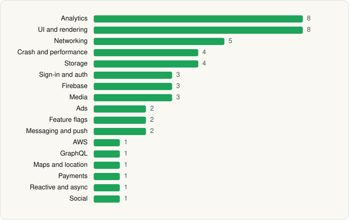

<picture><source media="(prefers-color-scheme: dark)" srcset="../../../../assets/logo/logo-dark.svg"></picture> [Tech Stack](../../../../README.md) / [CBS Interactive, Inc.](../../../../companies/cbs-interactive-inc.md) / CBS Sports

# CBS Sports: Live Scores & News

<picture><source media="(prefers-color-scheme: dark)" srcset="../../../../assets/badges/android-dark.svg"></picture> <picture><source media="(prefers-color-scheme: dark)" srcset="../../../../assets/badges/active-dark.svg"></picture>

[Google Play](https://play.google.com/store/apps/details?id=com.handmark.sportcaster) · [latest.json](latest.json)

| | |
|---|---|
| Company | [CBS Interactive, Inc.](../../../../companies/cbs-interactive-inc.md) |
| Store id | `com.handmark.sportcaster` |
| Bundle / package id | `com.handmark.sportcaster` |
| Latest version | 10.78 (analysed 2026-11-02) |
| Versions tracked | 2 |
| SDKs in latest version | 47 |
| Languages | C/C++ (native), Java, Kotlin, React Native / JavaScript |
| UI | Fresco, Glide, Jetpack Compose, Lottie, Material Components, Picasso |
| Build | Gradle (inferred) |
| Minimum OS | API 28, targets API 36 |
| Devices / ABIs | Android |
| Capabilities | 9 |
| Declares tracking | Yes |
| Tracked | Yes |

## SDKs by category

<picture><source media="(prefers-color-scheme: dark)" srcset="../../../../assets/charts/apps/android/cbs-interactive-inc/cbs-sports-dark.svg"></picture>

- **UI and rendering** (8): Fresco, Glide, Jetpack Compose, Lottie, Material Components, Picasso, React Native Reanimated, react-native-svg
- **Analytics** (7): Adobe Experience Platform, Amplitude, comScore, Facebook SDK, Firebase Analytics, Google App Measurement, Kochava
- **Networking** (6): Cronet, Cronet (Google), Ktor, OkHttp, Retrofit, Volley
- **Storage** (4): DataStore, Okio, Realm, Room
- **Sign-in and auth** (3): Credential Manager, Facebook Login, Google Sign-In / Auth
- **Firebase** (3): Firebase, Google DataTransport, Google Play services
- **Media** (3): Google Cast, Media3 (ExoPlayer), Mux
- **Ads** (2): Google Ad Manager, Google Mobile Ads (AdMob)
- **Crash and performance** (2): Firebase Crashlytics, Firebase Performance
- **Messaging and push** (2): Airship, Firebase Messaging
- **AWS** (1): AWS SDK
- **Feature flags** (1): Firebase Remote Config
- **GraphQL** (1): Apollo GraphQL
- **Maps and location** (1): Google Location
- **Payments** (1): Google Play Billing
- **Reactive and async** (1): Kotlin Coroutines
- **Social** (1): Facebook Share

Capabilities (9)

Advertising ID, Approximate location, Biometric auth, Fingerprint auth, Foreground service, Notifications, Precise location, Storage (read), Storage (write)

## Version history

| Version | Analysed | Store update | SDKs | Change | SDK list is a floor | Binary encrypted | File |
|---|---|---|---|---|---|---|---|
| 10.78 | 2026-11-02 | 2026-11-01 | 47 | +2 / −5 | No | No | [10.78.json](10.78.json) |
| 10.72.1 | 2026-06-19 |  | 50 |  | No | No | [10.72.1.json](10.72.1.json) |

### SDK changes between versions

- 10.72.1 → 10.78: added Ktor, Media3 (ExoPlayer); removed Branch, ExoPlayer, Optimizely, Sentry, Sentry (native)

---

Generated by `scripts/build_readme.py` from the JSON files. Do not edit by hand.
