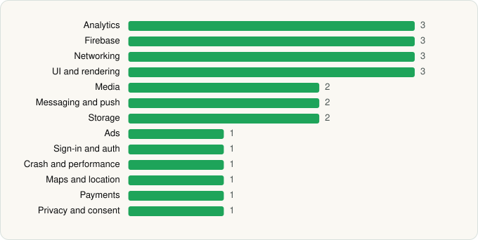

<picture><source media="(prefers-color-scheme: dark)" srcset="../../../../assets/logo/logo-dark.svg"></picture> [Tech Stack](../../../../README.md) / [CBS Interactive, Inc.](../../../../companies/cbs-interactive-inc.md) / Paramount+

# Paramount+

<picture><source media="(prefers-color-scheme: dark)" srcset="../../../../assets/badges/android-dark.svg"></picture> <picture><source media="(prefers-color-scheme: dark)" srcset="../../../../assets/badges/active-dark.svg"></picture>

[Google Play](https://play.google.com/store/apps/details?id=com.cbs.ott) · [latest.json](latest.json)

| | |
|---|---|
| Company | [CBS Interactive, Inc.](../../../../companies/cbs-interactive-inc.md) |
| Store id | `com.cbs.ott` |
| Bundle / package id | `com.cbs.ott` |
| Latest version | 16.12.0 (analysed 2026-06-23) |
| Versions tracked | 1 |
| SDKs in latest version | 24 |
| Languages | C/C++ (native), Java, Kotlin |
| UI | Glide, Jetpack Compose, Material Components |
| Build | Gradle (inferred) |
| Minimum OS | API 28, targets API 36 |
| Devices / ABIs | Android |
| Capabilities | 4 |
| Declares tracking | Yes |
| Tracked | Yes |

## SDKs by category

<picture><source media="(prefers-color-scheme: dark)" srcset="../../../../assets/charts/apps/android/cbs-interactive-inc/paramount-com-cbs-ott-dark.svg"></picture>

- **Analytics** (3): Adobe Experience Platform, comScore, Kochava
- **Firebase** (3): Firebase, Google DataTransport, Google Play services
- **Networking** (3): Ktor, OkHttp, Retrofit
- **UI and rendering** (3): Glide, Jetpack Compose, Material Components
- **Media** (2): Google Cast, Media3 (ExoPlayer)
- **Messaging and push** (2): Braze, Firebase Messaging
- **Storage** (2): Okio, Room
- **Ads** (1): Google Mobile Ads (AdMob)
- **Sign-in and auth** (1): Google Sign-In / Auth
- **Crash and performance** (1): New Relic
- **Maps and location** (1): Google Location
- **Payments** (1): Google Play Billing
- **Privacy and consent** (1): OneTrust

Capabilities (4)

Advertising ID, Foreground service, Microphone, Notifications

## Version history

| Version | Analysed | Store update | SDKs | Change | SDK list is a floor | Binary encrypted | File |
|---|---|---|---|---|---|---|---|
| 16.12.0 | 2026-06-23 |  | 24 |  | No | No | [16.12.0.json](16.12.0.json) |

## Model-written summary

> Android Kotlin/Java app with Jetpack Compose, Firebase, ExoPlayer, Kochava/Braze analytics, root detection, and TV launcher queries

Written by a language model from the detected signals (`inferred[]`). It is commentary, not measurement.

---

Generated by `scripts/build_readme.py` from the JSON files. Do not edit by hand.
