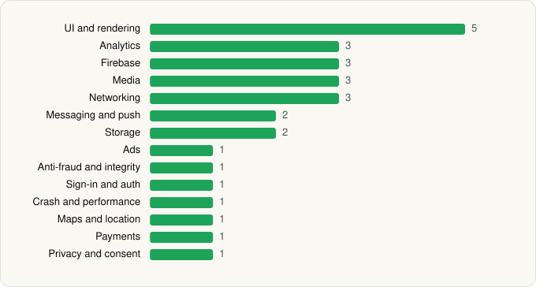

<picture><source media="(prefers-color-scheme: dark)" srcset="../../../../assets/logo/logo-dark.svg"></picture> [Tech Stack](../../../../README.md) / [CBS Interactive, Inc.](../../../../companies/cbs-interactive-inc.md) / Paramount+

# Paramount+

<picture><source media="(prefers-color-scheme: dark)" srcset="../../../../assets/badges/android-dark.svg"></picture> <picture><source media="(prefers-color-scheme: dark)" srcset="../../../../assets/badges/inactive-dark.svg"></picture>

[Google Play](https://play.google.com/store/apps/details?id=com.cbs.app) · [latest.json](latest.json)

| | |
|---|---|
| Company | [CBS Interactive, Inc.](../../../../companies/cbs-interactive-inc.md) |
| Store id | `com.cbs.app` |
| Bundle / package id | `com.cbs.app` |
| Latest version | 17.3.0 (analysed 2026-11-07) |
| Versions tracked | 2 |
| SDKs in latest version | 28 |
| Languages | C/C++ (native), Java, Kotlin |
| UI | Coil, Glide, Jetpack Compose, Material Components, Rive |
| Build | Gradle (inferred) |
| Minimum OS | API 29, targets API 36 |
| Devices / ABIs | Android |
| Capabilities | 4 |
| Declares tracking | Yes |
| Tracked | No. Kept for history. |

## SDKs by category

<picture><source media="(prefers-color-scheme: dark)" srcset="../../../../assets/charts/apps/android/cbs-interactive-inc/paramount-dark.svg"></picture>

- **UI and rendering** (5): Coil, Glide, Jetpack Compose, Material Components, Rive
- **Analytics** (3): Adobe Experience Platform, comScore, Kochava
- **Firebase** (3): Firebase, Google DataTransport, Google Play services
- **Media** (3): Google Cast, Media3 (ExoPlayer), Mux
- **Networking** (3): Ktor, OkHttp, Retrofit
- **Messaging and push** (2): Braze, Firebase Messaging
- **Storage** (2): Okio, Room
- **Ads** (1): Google Mobile Ads (AdMob)
- **Anti-fraud and integrity** (1): Play Integrity
- **Sign-in and auth** (1): Google Sign-In / Auth
- **Crash and performance** (1): New Relic
- **Maps and location** (1): Google Location
- **Payments** (1): Google Play Billing
- **Privacy and consent** (1): OneTrust

Capabilities (4)

Advertising ID, Approximate location, Foreground service, Notifications

## Version history

| Version | Analysed | Store update | SDKs | Change | SDK list is a floor | Binary encrypted | File |
|---|---|---|---|---|---|---|---|
| 17.3.0 | 2026-11-07 | 2026-10-27 | 28 | +4 / −1 | No | No | [17.3.0.json](17.3.0.json) |
| 16.13.0 | 2026-06-23 |  | 25 |  | No | No | [16.13.0.json](16.13.0.json) |

### SDK changes between versions

- 16.13.0 → 17.3.0: added Coil, Mux, Play Integrity, Rive; removed Kotlin Coroutines

---

Generated by `scripts/build_readme.py` from the JSON files. Do not edit by hand.
