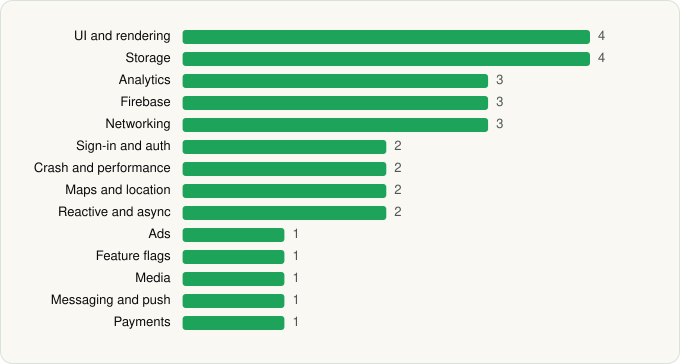

<picture><source media="(prefers-color-scheme: dark)" srcset="../../../../assets/logo/logo-dark.svg"></picture> [Tech Stack](../../../../README.md) / [Chick-fil-A, Inc.](../../../../companies/chick-fil-a-inc.md) / Chick-fil-A®

# Chick-fil-A®

<picture><source media="(prefers-color-scheme: dark)" srcset="../../../../assets/badges/android-dark.svg"></picture> <picture><source media="(prefers-color-scheme: dark)" srcset="../../../../assets/badges/inactive-dark.svg"></picture>

[Google Play](https://play.google.com/store/apps/details?id=com.chickfila.cfaflagship) · [latest.json](latest.json)

| | |
|---|---|
| Company | [Chick-fil-A, Inc.](../../../../companies/chick-fil-a-inc.md) |
| Store id | `com.chickfila.cfaflagship` |
| Bundle / package id | `com.chickfila.cfaflagship` |
| Latest version | 2026.11.1 (analysed 2026-06-23) |
| Versions tracked | 1 |
| SDKs in latest version | 30 |
| Languages | C/C++ (native), Java, Kotlin |
| UI | Coil, Jetpack Compose, Lottie, Material Components |
| Build | Gradle (inferred) |
| Minimum OS | API 29, targets API 36 |
| Devices / ABIs | Android |
| Capabilities | 11 |
| Declares tracking | Yes |
| Tracked | No. Kept for history. |

## SDKs by category

<picture><source media="(prefers-color-scheme: dark)" srcset="../../../../assets/charts/apps/android/chick-fil-a-inc/chick-fil-a-dark.svg"></picture>

- **UI and rendering** (4): Coil, Jetpack Compose, Lottie, Material Components
- **Storage** (4): DataStore, Okio, Room, SQLCipher
- **Analytics** (3): Facebook SDK, Firebase Analytics, Kochava
- **Firebase** (3): Firebase, Google DataTransport, Google Play services
- **Networking** (3): Ktor, OkHttp, Retrofit
- **Sign-in and auth** (2): Auth0, Google Sign-In / Auth
- **Crash and performance** (2): Bugsnag, Datadog
- **Maps and location** (2): Google Location, Google Maps
- **Reactive and async** (2): Kotlin Coroutines, RxJava
- **Ads** (1): Google Mobile Ads (AdMob)
- **Feature flags** (1): LaunchDarkly
- **Media** (1): Media3 (ExoPlayer)
- **Messaging and push** (1): Firebase Messaging
- **Payments** (1): Braintree

Capabilities (11)

Advertising ID, Approximate location, Background location, Biometric auth, Camera, Fingerprint auth, Foreground service, Foreground service: location, NFC, Notifications, Precise location

## Version history

| Version | Analysed | Store update | SDKs | Change | SDK list is a floor | Binary encrypted | File |
|---|---|---|---|---|---|---|---|
| 2026.11.1 | 2026-06-23 |  | 30 |  | No | No | [2026.11.1.json](2026.11.1.json) |

---

Generated by `scripts/build_readme.py` from the JSON files. Do not edit by hand.
