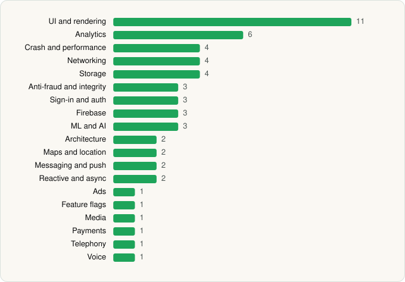

<picture><source media="(prefers-color-scheme: dark)" srcset="../../../../assets/logo/logo-dark.svg"></picture> [Tech Stack](../../../../README.md) / [Chime](../../../../companies/chime.md) / Chime®

# Chime® – Fee-Free Banking

<picture><source media="(prefers-color-scheme: dark)" srcset="../../../../assets/badges/android-dark.svg"></picture> <picture><source media="(prefers-color-scheme: dark)" srcset="../../../../assets/badges/inactive-dark.svg"></picture>

[Google Play](https://play.google.com/store/apps/details?id=com.onedebit.chime) · [latest.json](latest.json)

| | |
|---|---|
| Company | [Chime](../../../../companies/chime.md) |
| Store id | `com.onedebit.chime` |
| Bundle / package id | `com.onedebit.chime` |
| Latest version | 5.329.0 (analysed 2026-06-19) |
| Versions tracked | 1 |
| SDKs in latest version | 55 |
| Languages | C/C++ (native), Java, Kotlin, React Native / JavaScript |
| UI | Coil, Fresco, Glide, Jetpack Compose, Lottie, Material Components |
| Build | Gradle (inferred) |
| Minimum OS | API 29, targets API 36 |
| Devices / ABIs | Android |
| Capabilities | 15 |
| Declares tracking | Yes |
| Tracked | No. Kept for history. |

## SDKs by category

<picture><source media="(prefers-color-scheme: dark)" srcset="../../../../assets/charts/apps/android/chime/chime-dark.svg"></picture>

- **UI and rendering** (11): AndroidSVG, Coil, FlashList, Fresco, Glide, Jetpack Compose, Lottie, Markwon, Material Components, React Native Reanimated, react-native-svg
- **Analytics** (6): Amplitude, AppsFlyer, Branch, Firebase Analytics, Google App Measurement, Segment
- **Crash and performance** (4): Bugsnag, Datadog, Sentry, Sentry (native)
- **Networking** (4): axios, Ktor, OkHttp, Retrofit
- **Storage** (4): DataStore, Okio, Realm, Room
- **Anti-fraud and integrity** (3): Persona, Play Integrity, RootBeer
- **Sign-in and auth** (3): Auth0, Credential Manager, Google Sign-In / Auth
- **Firebase** (3): Firebase, Google DataTransport, Google Play services
- **ML and AI** (3): ML Kit, ML Kit (barcode/vision), Mobile Vision
- **Architecture** (2): CodePush, Redux
- **Maps and location** (2): Google Location, Google Maps
- **Messaging and push** (2): Braze, Firebase Messaging
- **Reactive and async** (2): Kotlin Coroutines, RxJava
- **Ads** (1): Google Mobile Ads (AdMob)
- **Feature flags** (1): Statsig
- **Media** (1): Media3 (ExoPlayer)
- **Payments** (1): Plaid
- **Telephony** (1): libphonenumber
- **Voice** (1): WebRTC

Capabilities (15)

Advertising ID, Approximate location, Background location, Biometric auth, Camera, Contacts (read), Fingerprint auth, Foreground service, Foreground service: microphone, Microphone, NFC, Notifications, Precise location, Storage (read), Storage (write)

## Version history

| Version | Analysed | Store update | SDKs | Change | SDK list is a floor | Binary encrypted | File |
|---|---|---|---|---|---|---|---|
| 5.329.0 | 2026-06-19 |  | 55 |  | No | No | [5.329.0.json](5.329.0.json) |

## Model-written summary

> Hybrid React Native (Hermes) Android banking app using Jetpack Compose, ML Kit with custom TFLite models, Plaid, extensive analytics, root detection, and Chime/Firebase backends

Written by a language model from the detected signals (`inferred[]`). It is commentary, not measurement.

---

Generated by `scripts/build_readme.py` from the JSON files. Do not edit by hand.
