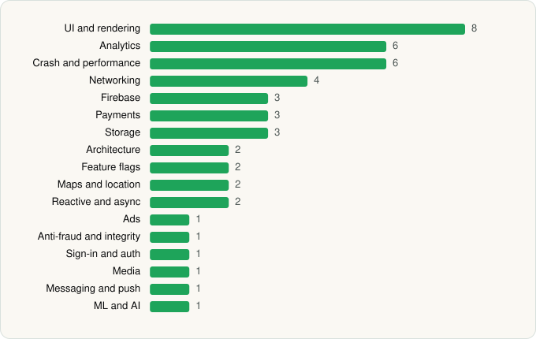

<picture><source media="(prefers-color-scheme: dark)" srcset="../../../../assets/logo/logo-dark.svg"></picture> [Tech Stack](../../../../README.md) / [ClassDojo](../../../../companies/classdojo.md) / ClassDojo

# ClassDojo

<picture><source media="(prefers-color-scheme: dark)" srcset="../../../../assets/badges/android-dark.svg"></picture> <picture><source media="(prefers-color-scheme: dark)" srcset="../../../../assets/badges/inactive-dark.svg"></picture> <picture><source media="(prefers-color-scheme: dark)" srcset="../../../../assets/badges/floor-dark.svg"></picture>

[Google Play](https://play.google.com/store/apps/details?id=com.classdojo.android) · [latest.json](latest.json)

| | |
|---|---|
| Company | [ClassDojo](../../../../companies/classdojo.md) |
| Store id | `com.classdojo.android` |
| Bundle / package id | `com.classdojo.android` |
| Latest version | 8.59.0 (analysed 2026-06-19) |
| Versions tracked | 1 |
| SDKs in latest version | 47 |
| Languages | C/C++ (native), Java, Kotlin, React Native / JavaScript |
| UI | Coil, Fresco, Jetpack Compose, Lottie, Material Components |
| Build | Gradle (inferred), R8 / ProGuard (name obfuscation detected) |
| Minimum OS | API 26, targets API 36 |
| Devices / ABIs | Android |
| Capabilities | 7 |
| Declares tracking | Yes |
| Tracked | No. Kept for history. |

## SDKs by category

<picture><source media="(prefers-color-scheme: dark)" srcset="../../../../assets/charts/apps/android/classdojo/classdojo-dark.svg"></picture>

- **UI and rendering** (8): AndroidSVG, Coil, Fresco, Jetpack Compose, Lottie, Material Components, React Native Reanimated, react-native-svg
- **Analytics** (6): Amplitude, AppsFlyer, Branch, Firebase Analytics, Google App Measurement, Mixpanel
- **Crash and performance** (6): Datadog, Datadog (native), Firebase Crashlytics, Firebase Performance, Sentry, Sentry (native)
- **Networking** (4): Ktor, OkHttp, Retrofit, TanStack Query
- **Firebase** (3): Firebase, Google DataTransport, Google Play services
- **Payments** (3): Google Play Billing, RevenueCat, Stripe
- **Storage** (3): DataStore, Realm, Room
- **Architecture** (2): CodePush, Redux
- **Feature flags** (2): Firebase Remote Config, Statsig
- **Maps and location** (2): Google Location, Google Maps
- **Reactive and async** (2): Kotlin Coroutines, RxJava
- **Ads** (1): Google Mobile Ads (AdMob)
- **Anti-fraud and integrity** (1): Play Integrity
- **Sign-in and auth** (1): Google Sign-In / Auth
- **Media** (1): Media3 (ExoPlayer)
- **Messaging and push** (1): Firebase Messaging
- **ML and AI** (1): ML Kit

Capabilities (7)

Biometric auth, Camera, Foreground service, Microphone, Notifications, Storage (read), Storage (write)

## Version history

| Version | Analysed | Store update | SDKs | Change | SDK list is a floor | Binary encrypted | File |
|---|---|---|---|---|---|---|---|
| 8.59.0 | 2026-06-19 |  | 47 |  | Yes | No | [8.59.0.json](8.59.0.json) |

---

Generated by `scripts/build_readme.py` from the JSON files. Do not edit by hand.
