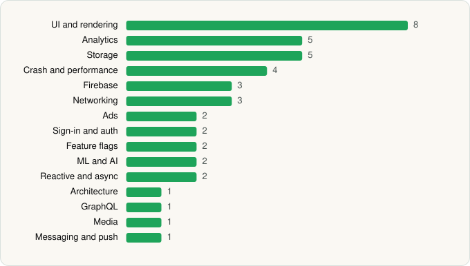

<picture><source media="(prefers-color-scheme: dark)" srcset="../../../../assets/logo/logo-dark.svg"></picture> [Tech Stack](../../../../README.md) / [Coinbase Wallet](../../../../companies/coinbase-wallet.md) / Base

# Base: Built to Trade & Earn

<picture><source media="(prefers-color-scheme: dark)" srcset="../../../../assets/badges/android-dark.svg"></picture> <picture><source media="(prefers-color-scheme: dark)" srcset="../../../../assets/badges/inactive-dark.svg"></picture>

[Google Play](https://play.google.com/store/apps/details?id=org.toshi) · [latest.json](latest.json)

| | |
|---|---|
| Company | [Coinbase Wallet](../../../../companies/coinbase-wallet.md) |
| Store id | `org.toshi` |
| Bundle / package id | `org.toshi` |
| Latest version | 29.97.0 (analysed 2026-06-19) |
| Versions tracked | 1 |
| SDKs in latest version | 42 |
| Languages | C/C++ (native), Java, Kotlin, React Native / JavaScript |
| UI | Fresco, Glide, Jetpack Compose, Lottie, Material Components |
| Build | Gradle (inferred) |
| Minimum OS | API 24, targets API 36 |
| Devices / ABIs | Android |
| Capabilities | 14 |
| Declares tracking | Yes |
| Tracked | No. Kept for history. |

## SDKs by category

<picture><source media="(prefers-color-scheme: dark)" srcset="../../../../assets/charts/apps/android/coinbase-wallet/base-dark.svg"></picture>

- **UI and rendering** (8): AndroidSVG, Fresco, Glide, Jetpack Compose, Lottie, Material Components, React Native Reanimated, react-native-svg
- **Analytics** (5): Amplitude, AppsFlyer, Branch, Firebase Analytics, Google App Measurement
- **Storage** (5): DataStore, MMKV, Okio, Realm, Room
- **Crash and performance** (4): Datadog, Firebase Crashlytics, Sentry, Sentry (native)
- **Firebase** (3): Firebase, Google DataTransport, Google Play services
- **Networking** (3): axios, OkHttp, Retrofit
- **Ads** (2): Google Ad Manager, Google Mobile Ads (AdMob)
- **Sign-in and auth** (2): Credential Manager, Google Sign-In / Auth
- **Feature flags** (2): Firebase Remote Config, Statsig
- **ML and AI** (2): ML Kit, ML Kit (barcode/vision)
- **Reactive and async** (2): Kotlin Coroutines, RxJava
- **Architecture** (1): Redux
- **GraphQL** (1): Apollo GraphQL
- **Media** (1): Media3 (ExoPlayer)
- **Messaging and push** (1): Firebase Messaging

Capabilities (14)

Activity / fitness recognition, Advertising ID, Biometric auth, Camera, Contacts (read), Contacts (write), Fingerprint auth, Foreground service, Foreground service: media playback, Media: audio, NFC, Notifications, Storage (read), Storage (write)

## Version history

| Version | Analysed | Store update | SDKs | Change | SDK list is a floor | Binary encrypted | File |
|---|---|---|---|---|---|---|---|
| 29.97.0 | 2026-06-19 |  | 42 |  | No | No | [29.97.0.json](29.97.0.json) |

---

Generated by `scripts/build_readme.py` from the JSON files. Do not edit by hand.
