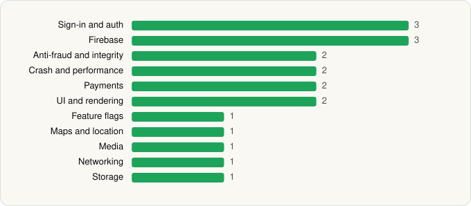

<picture><source media="(prefers-color-scheme: dark)" srcset="../../../../assets/logo/logo-dark.svg"></picture> [Tech Stack](../../../../README.md) / [Cosmic Kettle Software OÜ](../../../../companies/cosmic-kettle-software-ou.md) / Poshmark Bot

# Poshmark Bot: Poshwatch

<picture><source media="(prefers-color-scheme: dark)" srcset="../../../../assets/badges/android-dark.svg"></picture> <picture><source media="(prefers-color-scheme: dark)" srcset="../../../../assets/badges/inactive-dark.svg"></picture> <picture><source media="(prefers-color-scheme: dark)" srcset="../../../../assets/badges/floor-dark.svg"></picture>

[Google Play](https://play.google.com/store/apps/details?id=io.poshwatch.mobile) · [latest.json](latest.json)

| | |
|---|---|
| Company | [Cosmic Kettle Software OÜ](../../../../companies/cosmic-kettle-software-ou.md) |
| Store id | `io.poshwatch.mobile` |
| Bundle / package id | `io.poshwatch.mobile` |
| Latest version | 2.7.1 (analysed 2026-06-19) |
| Versions tracked | 1 |
| SDKs in latest version | 19 |
| Languages | C/C++ (native), Flutter / Dart, Java, Kotlin |
| UI | Coil, Jetpack Compose |
| Build | Gradle (inferred), R8 / ProGuard (name obfuscation detected) |
| Minimum OS | API 24, targets API 36 |
| Devices / ABIs | Android |
| Capabilities | 2 |
| Declares tracking | Yes |
| Tracked | No. Kept for history. |

## SDKs by category

<picture><source media="(prefers-color-scheme: dark)" srcset="../../../../assets/charts/apps/android/cosmic-kettle-software-ou/poshmark-bot-dark.svg"></picture>

- **Sign-in and auth** (3): Credential Manager, Firebase Auth, Google Sign-In / Auth
- **Firebase** (3): Firebase, Google DataTransport, Google Play services
- **Anti-fraud and integrity** (2): Play Integrity, reCAPTCHA
- **Crash and performance** (2): Sentry, Sentry (native)
- **Payments** (2): Google Play Billing, RevenueCat
- **UI and rendering** (2): Coil, Jetpack Compose
- **Feature flags** (1): Firebase Remote Config
- **Maps and location** (1): Google Location
- **Media** (1): Media3 (ExoPlayer)
- **Networking** (1): OkHttp
- **Storage** (1): DataStore

Capabilities (2)

Camera, Notifications

## Version history

| Version | Analysed | Store update | SDKs | Change | SDK list is a floor | Binary encrypted | File |
|---|---|---|---|---|---|---|---|
| 2.7.1 | 2026-06-19 |  | 19 |  | Yes | No | [2.7.1.json](2.7.1.json) |

---

Generated by `scripts/build_readme.py` from the JSON files. Do not edit by hand.
