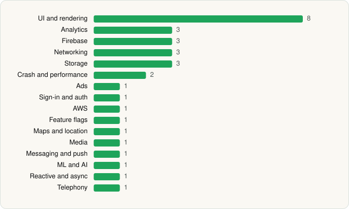

<picture><source media="(prefers-color-scheme: dark)" srcset="../../../../assets/logo/logo-dark.svg"></picture> [Tech Stack](../../../../README.md) / [Costco Wholesale](../../../../companies/costco-wholesale.md) / MyCostco Employee Portal

# MyCostco Employee Portal

<picture><source media="(prefers-color-scheme: dark)" srcset="../../../../assets/badges/android-dark.svg"></picture> <picture><source media="(prefers-color-scheme: dark)" srcset="../../../../assets/badges/inactive-dark.svg"></picture>

[Google Play](https://play.google.com/store/apps/details?id=com.ms.costco) · [latest.json](latest.json)

| | |
|---|---|
| Company | [Costco Wholesale](../../../../companies/costco-wholesale.md) |
| Store id | `com.ms.costco` |
| Bundle / package id | `com.ms.costco` |
| Latest version | 19.2.0 (analysed 2026-06-19) |
| Versions tracked | 1 |
| SDKs in latest version | 32 |
| Languages | C/C++ (native), Java, Kotlin |
| UI | Coil, Fresco, Jetpack Compose, Lottie, Material Components |
| Build | Gradle (inferred) |
| Minimum OS | API 21, targets API 35 |
| Devices / ABIs | Android |
| Capabilities | 13 |
| Declares tracking | Yes |
| Tracked | No. Kept for history. |

## SDKs by category

<picture><source media="(prefers-color-scheme: dark)" srcset="../../../../assets/charts/apps/android/costco-wholesale/mycostco-employee-portal-dark.svg"></picture>

- **UI and rendering** (8): AndroidSVG, Coil, Fresco, Jetpack Compose, jLaTeXMath, Lottie, Markwon, Material Components
- **Analytics** (3): Firebase Analytics, Google Analytics (legacy), Google App Measurement
- **Firebase** (3): Firebase, Google DataTransport, Google Play services
- **Networking** (3): Ktor, OkHttp, Retrofit
- **Storage** (3): DataStore, Okio, Room
- **Crash and performance** (2): Firebase Crashlytics, Firebase Performance
- **Ads** (1): Google Mobile Ads (AdMob)
- **Sign-in and auth** (1): Google Sign-In / Auth
- **AWS** (1): AWS SDK
- **Feature flags** (1): Firebase Remote Config
- **Maps and location** (1): Google Location
- **Media** (1): Media3 (ExoPlayer)
- **Messaging and push** (1): Firebase Messaging
- **ML and AI** (1): ML Kit
- **Reactive and async** (1): Kotlin Coroutines
- **Telephony** (1): libphonenumber

Capabilities (13)

Advertising ID, Approximate location, Biometric auth, Camera, Fingerprint auth, Foreground service, Foreground service: media playback, Media: audio, Microphone, Notifications, Precise location, Storage (read), Storage (write)

## Version history

| Version | Analysed | Store update | SDKs | Change | SDK list is a floor | Binary encrypted | File |
|---|---|---|---|---|---|---|---|
| 19.2.0 | 2026-06-19 |  | 32 |  | No | No | [19.2.0.json](19.2.0.json) |

## Model-written summary

> Kotlin/Java Android employee portal with Jetpack Compose, Firebase backend, biometric security, ML Kit translation, and queries to enterprise apps

Written by a language model from the detected signals (`inferred[]`). It is commentary, not measurement.

---

Generated by `scripts/build_readme.py` from the JSON files. Do not edit by hand.
