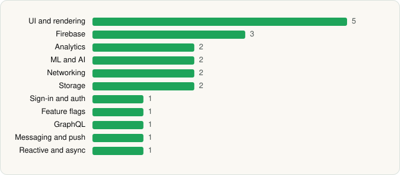

<picture><source media="(prefers-color-scheme: dark)" srcset="../../../../assets/logo/logo-dark.svg"></picture> [Tech Stack](../../../../README.md) / [Curebase](../../../../companies/curebase.md) / Walgreens Clinical Trials

# Walgreens Clinical Trials

<picture><source media="(prefers-color-scheme: dark)" srcset="../../../../assets/badges/android-dark.svg"></picture> <picture><source media="(prefers-color-scheme: dark)" srcset="../../../../assets/badges/inactive-dark.svg"></picture>

[Google Play](https://play.google.com/store/apps/details?id=com.curebase.walgreens) · [latest.json](latest.json)

| | |
|---|---|
| Company | [Curebase](../../../../companies/curebase.md) |
| Store id | `com.curebase.walgreens` |
| Bundle / package id | `com.curebase.walgreens` |
| Latest version | 1.0.30 (analysed 2026-06-19) |
| Versions tracked | 1 |
| SDKs in latest version | 18 |
| Languages | C/C++ (native), Java, Kotlin, React Native / JavaScript |
| UI | Fresco, Jetpack Compose, Material Components |
| Build | Gradle (inferred) |
| Minimum OS | API 24, targets API 35 |
| Devices / ABIs | Android |
| Capabilities | 6 |
| Declares tracking | Yes |
| Tracked | No. Kept for history. |

## SDKs by category

<picture><source media="(prefers-color-scheme: dark)" srcset="../../../../assets/charts/apps/android/curebase/walgreens-clinical-trials-dark.svg"></picture>

- **Firebase** (3): Firebase, Google DataTransport, Google Play services
- **UI and rendering** (3): Fresco, Jetpack Compose, Material Components
- **Analytics** (2): Firebase Analytics, Segment
- **ML and AI** (2): ML Kit, ML Kit (barcode/vision)
- **Networking** (2): OkHttp, Retrofit
- **Storage** (2): Okio, Room
- **Sign-in and auth** (1): Google Sign-In / Auth
- **Feature flags** (1): LaunchDarkly
- **Messaging and push** (1): Firebase Messaging
- **Reactive and async** (1): Kotlin Coroutines

Capabilities (6)

Camera, Draw over other apps, Microphone, Notifications, Storage (read), Storage (write)

## Version history

| Version | Analysed | Store update | SDKs | Change | SDK list is a floor | Binary encrypted | File |
|---|---|---|---|---|---|---|---|
| 1.0.30 | 2026-06-19 |  | 18 |  | No | No | [1.0.30.json](1.0.30.json) |

---

Generated by `scripts/build_readme.py` from the JSON files. Do not edit by hand.
