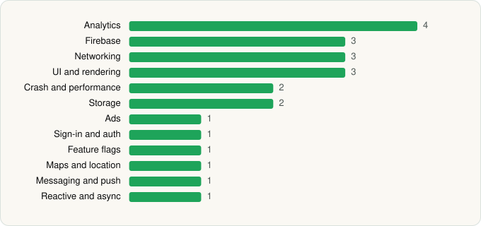

<picture><source media="(prefers-color-scheme: dark)" srcset="../../../../assets/logo/logo-dark.svg"></picture> [Tech Stack](../../../../README.md) / [CVS Pharmacy](../../../../companies/cvs-pharmacy.md) / CVS Specialty

# CVS Specialty

<picture><source media="(prefers-color-scheme: dark)" srcset="../../../../assets/badges/android-dark.svg"></picture> <picture><source media="(prefers-color-scheme: dark)" srcset="../../../../assets/badges/inactive-dark.svg"></picture> <picture><source media="(prefers-color-scheme: dark)" srcset="../../../../assets/badges/floor-dark.svg"></picture>

[Google Play](https://play.google.com/store/apps/details?id=com.cvshealth.specialtyrx) · [latest.json](latest.json)

| | |
|---|---|
| Company | [CVS Pharmacy](../../../../companies/cvs-pharmacy.md) |
| Store id | `com.cvshealth.specialtyrx` |
| Bundle / package id | `com.cvshealth.specialtyrx` |
| Latest version | 2.82 (analysed 2026-06-19) |
| Versions tracked | 1 |
| SDKs in latest version | 23 |
| Languages | C/C++ (native), Java, Kotlin |
| UI | Jetpack Compose, Material Components, Picasso |
| Build | Gradle (inferred), R8 / ProGuard (name obfuscation detected) |
| Minimum OS | API 26, targets API 36 |
| Devices / ABIs | Android |
| Capabilities | 9 |
| Declares tracking | Yes |
| Tracked | No. Kept for history. |

## SDKs by category

<picture><source media="(prefers-color-scheme: dark)" srcset="../../../../assets/charts/apps/android/cvs-pharmacy/cvs-specialty-dark.svg"></picture>

- **Analytics** (4): Adobe Experience Platform, Firebase Analytics, Google App Measurement, Medallia
- **Firebase** (3): Firebase, Google DataTransport, Google Play services
- **Networking** (3): OkHttp, Retrofit, Volley
- **UI and rendering** (3): Jetpack Compose, Material Components, Picasso
- **Crash and performance** (2): Firebase Crashlytics, Firebase Performance
- **Storage** (2): Okio, Room
- **Ads** (1): Google Mobile Ads (AdMob)
- **Sign-in and auth** (1): Google Sign-In / Auth
- **Feature flags** (1): Firebase Remote Config
- **Maps and location** (1): Google Maps
- **Messaging and push** (1): Firebase Messaging
- **Reactive and async** (1): Kotlin Coroutines

Capabilities (9)

Advertising ID, Approximate location, Camera, Fingerprint auth, Foreground service, Microphone, Notifications, Storage (read), Storage (write)

## Version history

| Version | Analysed | Store update | SDKs | Change | SDK list is a floor | Binary encrypted | File |
|---|---|---|---|---|---|---|---|
| 2.82 | 2026-06-19 |  | 23 |  | Yes | No | [2.82.json](2.82.json) |

---

Generated by `scripts/build_readme.py` from the JSON files. Do not edit by hand.
