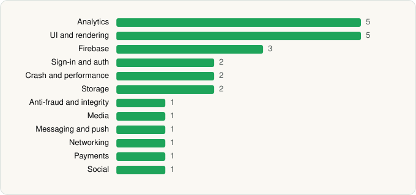

<picture><source media="(prefers-color-scheme: dark)" srcset="../../../../assets/logo/logo-dark.svg"></picture> [Tech Stack](../../../../README.md) / [DealSeek LLC](../../../../companies/dealseek-llc.md) / DealSeek

# DealSeek: Coupons & Discounts

<picture><source media="(prefers-color-scheme: dark)" srcset="../../../../assets/badges/android-dark.svg"></picture> <picture><source media="(prefers-color-scheme: dark)" srcset="../../../../assets/badges/inactive-dark.svg"></picture> <picture><source media="(prefers-color-scheme: dark)" srcset="../../../../assets/badges/floor-dark.svg"></picture>

[Google Play](https://play.google.com/store/apps/details?id=com.dealseekorg.dealseek) · [latest.json](latest.json)

| | |
|---|---|
| Company | [DealSeek LLC](../../../../companies/dealseek-llc.md) |
| Store id | `com.dealseekorg.dealseek` |
| Bundle / package id | `com.dealseekorg.dealseek` |
| Latest version | 1.64.0 (analysed 2026-11-02) |
| Versions tracked | 1 |
| SDKs in latest version | 25 |
| Languages | C/C++ (native), Java, Kotlin, React Native / JavaScript |
| UI | Fresco, Glide, Jetpack Compose, Material Components |
| Build | Gradle (inferred), R8 / ProGuard (name obfuscation detected) |
| Minimum OS | API 24, targets API 36 |
| Devices / ABIs | Android |
| Capabilities | 12 |
| Declares tracking | Yes |
| Tracked | No. Kept for history. |

## SDKs by category

<picture><source media="(prefers-color-scheme: dark)" srcset="../../../../assets/charts/apps/android/dealseek-llc/dealseek-dark.svg"></picture>

- **Analytics** (5): AppsFlyer, Facebook SDK, Firebase Analytics, Google App Measurement, PostHog
- **UI and rendering** (5): Fresco, Glide, Jetpack Compose, Markwon, Material Components
- **Firebase** (3): Firebase, Google DataTransport, Google Play services
- **Sign-in and auth** (2): Facebook Login, Google Sign-In / Auth
- **Crash and performance** (2): Sentry, Sentry (native)
- **Storage** (2): DataStore, Room
- **Anti-fraud and integrity** (1): Play Integrity
- **Media** (1): Media3 (ExoPlayer)
- **Messaging and push** (1): Firebase Messaging
- **Networking** (1): OkHttp
- **Payments** (1): Google Play Billing
- **Social** (1): Facebook Share

Capabilities (12)

Advertising ID, Biometric auth, Camera, Contacts (read), Contacts (write), Draw over other apps, Fingerprint auth, Foreground service, Microphone, Notifications, Storage (read), Storage (write)

## Version history

| Version | Analysed | Store update | SDKs | Change | SDK list is a floor | Binary encrypted | File |
|---|---|---|---|---|---|---|---|
| 1.64.0 | 2026-11-02 |  | 25 |  | Yes | No | [1.64.0.json](1.64.0.json) |

---

Generated by `scripts/build_readme.py` from the JSON files. Do not edit by hand.
