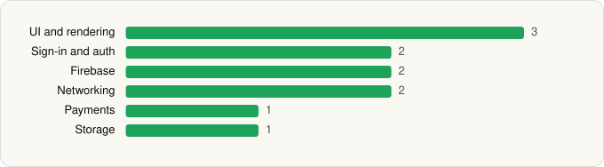

<picture><source media="(prefers-color-scheme: dark)" srcset="../../../../assets/logo/logo-dark.svg"></picture> [Tech Stack](../../../../README.md) / [DeepSeek](../../../../companies/deepseek.md) / DeepSeek

# DeepSeek - AI Assistant

<picture><source media="(prefers-color-scheme: dark)" srcset="../../../../assets/badges/android-dark.svg"></picture> <picture><source media="(prefers-color-scheme: dark)" srcset="../../../../assets/badges/active-dark.svg"></picture>

[Google Play](https://play.google.com/store/apps/details?id=com.deepseek.chat) · [latest.json](latest.json)

| | |
|---|---|
| Company | [DeepSeek](../../../../companies/deepseek.md) |
| Store id | `com.deepseek.chat` |
| Bundle / package id | `com.deepseek.chat` |
| Latest version | 2.7.1 (analysed 2026-10-24) |
| Versions tracked | 1 |
| SDKs in latest version | 11 |
| Languages | C/C++ (native), Java, Kotlin |
| UI | Jetpack Compose |
| Build | Gradle (inferred) |
| Minimum OS | API 32, targets API 36 |
| Devices / ABIs | Android |
| Capabilities | 11 |
| Declares tracking | No |
| Tracked | Yes |

## SDKs by category

<picture><source media="(prefers-color-scheme: dark)" srcset="../../../../assets/charts/apps/android/deepseek/deepseek-dark.svg"></picture>

- **UI and rendering** (3): Jetpack Compose, jLaTeXMath, Markwon
- **Sign-in and auth** (2): Credential Manager, Google Sign-In / Auth
- **Firebase** (2): Google DataTransport, Google Play services
- **Networking** (2): Ktor, OkHttp
- **Payments** (1): Google Play Billing
- **Storage** (1): MMKV

Capabilities (11)

Bluetooth, Bluetooth (connect), Camera, Foreground service, Foreground service: media playback, Foreground service: microphone, Media: images, Microphone, Notifications, Storage (read), Storage (write)

## Version history

| Version | Analysed | Store update | SDKs | Change | SDK list is a floor | Binary encrypted | File |
|---|---|---|---|---|---|---|---|
| 2.7.1 | 2026-10-24 | 2026-10-23 | 11 |  | No | No | [2.7.1.json](2.7.1.json) |

---

Generated by `scripts/build_readme.py` from the JSON files. Do not edit by hand.
