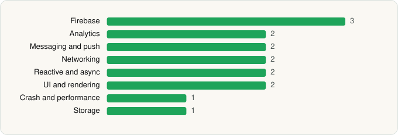

<picture><source media="(prefers-color-scheme: dark)" srcset="../../../../assets/logo/logo-dark.svg"></picture> [Tech Stack](../../../../README.md) / [Deezer Music](../../../../companies/deezer-music.md) / Deezer for Creators

# Deezer for Creators

<picture><source media="(prefers-color-scheme: dark)" srcset="../../../../assets/badges/android-dark.svg"></picture> <picture><source media="(prefers-color-scheme: dark)" srcset="../../../../assets/badges/active-dark.svg"></picture> <picture><source media="(prefers-color-scheme: dark)" srcset="../../../../assets/badges/floor-dark.svg"></picture>

[Google Play](https://play.google.com/store/apps/details?id=com.deezer.analytics) · [latest.json](latest.json)

| | |
|---|---|
| Company | [Deezer Music](../../../../companies/deezer-music.md) |
| Store id | `com.deezer.analytics` |
| Bundle / package id | `com.deezer.analytics` |
| Latest version | 3.0.1 (analysed 2026-06-19) |
| Versions tracked | 1 |
| SDKs in latest version | 15 |
| Languages | C/C++ (native), Java, Kotlin |
| UI | Glide, Material Components |
| Build | Gradle (inferred), R8 / ProGuard (name obfuscation detected) |
| Minimum OS | API 23, targets API 36 |
| Devices / ABIs | Android |
| Capabilities | 2 |
| Declares tracking | Yes |
| Tracked | Yes |

## SDKs by category

<picture><source media="(prefers-color-scheme: dark)" srcset="../../../../assets/charts/apps/android/deezer-music/deezer-for-creators-dark.svg"></picture>

- **Firebase** (3): Firebase, Google DataTransport, Google Play services
- **Analytics** (2): Firebase Analytics, Google App Measurement
- **Messaging and push** (2): Braze, Firebase Messaging
- **Networking** (2): OkHttp, Retrofit
- **Reactive and async** (2): Kotlin Coroutines, RxJava
- **UI and rendering** (2): Glide, Material Components
- **Crash and performance** (1): Firebase Crashlytics
- **Storage** (1): DataStore

Capabilities (2)

Advertising ID, Notifications

## Version history

| Version | Analysed | Store update | SDKs | Change | SDK list is a floor | Binary encrypted | File |
|---|---|---|---|---|---|---|---|
| 3.0.1 | 2026-06-19 | 2025-08-04 | 15 |  | Yes | No | [3.0.1.json](3.0.1.json) |

---

Generated by `scripts/build_readme.py` from the JSON files. Do not edit by hand.
