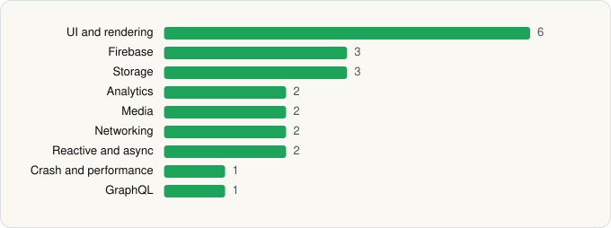

<picture><source media="(prefers-color-scheme: dark)" srcset="../../../../assets/logo/logo-dark.svg"></picture> [Tech Stack](../../../../README.md) / [Deezer Music](../../../../companies/deezer-music.md) / Deezer

# Deezer: Music & Podcast Player

<picture><source media="(prefers-color-scheme: dark)" srcset="../../../../assets/badges/android-dark.svg"></picture> <picture><source media="(prefers-color-scheme: dark)" srcset="../../../../assets/badges/active-dark.svg"></picture> <picture><source media="(prefers-color-scheme: dark)" srcset="../../../../assets/badges/floor-dark.svg"></picture>

[Google Play](https://play.google.com/store/apps/details?id=deezer.android.app) · [latest.json](latest.json)

| | |
|---|---|
| Company | [Deezer Music](../../../../companies/deezer-music.md) |
| Store id | `deezer.android.app` |
| Bundle / package id | `deezer.android.app` |
| Latest version | 1.0.1.1 (analysed 2026-06-19) |
| Versions tracked | 1 |
| SDKs in latest version | 22 |
| Languages | C/C++ (native), Java, Kotlin |
| UI | Coil, Glide, Jetpack Compose, Lottie, Material Components |
| Build | Gradle (inferred), R8 / ProGuard (name obfuscation detected) |
| Minimum OS | API 23, targets API 35 |
| Devices / ABIs | Android |
| Capabilities | 3 |
| Declares tracking | Yes |
| Tracked | Yes |

## SDKs by category

<picture><source media="(prefers-color-scheme: dark)" srcset="../../../../assets/charts/apps/android/deezer-music/deezer-dark.svg"></picture>

- **UI and rendering** (6): AndroidSVG, Coil, Glide, Jetpack Compose, Lottie, Material Components
- **Firebase** (3): Firebase, Google DataTransport, Google Play services
- **Storage** (3): DataStore, Room, SQLDelight
- **Analytics** (2): Firebase Analytics, Google App Measurement
- **Media** (2): FFmpeg, Media3 (ExoPlayer)
- **Networking** (2): Ktor, OkHttp
- **Reactive and async** (2): Kotlin Coroutines, RxJava
- **Crash and performance** (1): Firebase Crashlytics
- **GraphQL** (1): Apollo GraphQL

Capabilities (3)

Advertising ID, Foreground service, Foreground service: media playback

## Version history

| Version | Analysed | Store update | SDKs | Change | SDK list is a floor | Binary encrypted | File |
|---|---|---|---|---|---|---|---|
| 1.0.1.1 | 2026-06-19 |  | 22 |  | Yes | No | [1.0.1.1.json](1.0.1.1.json) |

---

Generated by `scripts/build_readme.py` from the JSON files. Do not edit by hand.
