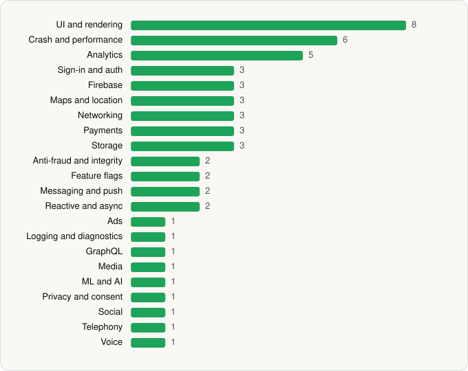

<picture><source media="(prefers-color-scheme: dark)" srcset="../../../../assets/logo/logo-dark.svg"></picture> [Tech Stack](../../../../README.md) / [Deliveroo](../../../../companies/deliveroo.md) / Deliveroo

# Deliveroo: Food & Shopping

<picture><source media="(prefers-color-scheme: dark)" srcset="../../../../assets/badges/android-dark.svg"></picture> <picture><source media="(prefers-color-scheme: dark)" srcset="../../../../assets/badges/active-dark.svg"></picture>

[Google Play](https://play.google.com/store/apps/details?id=com.deliveroo.orderapp) · [latest.json](latest.json)

| | |
|---|---|
| Company | [Deliveroo](../../../../companies/deliveroo.md) |
| Store id | `com.deliveroo.orderapp` |
| Bundle / package id | `com.deliveroo.orderapp` |
| Latest version | 3.295.0 (analysed 2026-10-24) |
| Versions tracked | 1 |
| SDKs in latest version | 54 |
| Languages | C/C++ (native), Java, Kotlin |
| UI | Coil, Fresco, Glide, Jetpack Compose, Lottie, Material Components |
| Build | Gradle (inferred) |
| Minimum OS | API 24, targets API 36 |
| Devices / ABIs | Android |
| Capabilities | 8 |
| Declares tracking | Yes |
| Tracked | Yes |

## SDKs by category

<picture><source media="(prefers-color-scheme: dark)" srcset="../../../../assets/charts/apps/android/deliveroo/deliveroo-dark.svg"></picture>

- **UI and rendering** (8): AndroidSVG, Coil, Fresco, Glide, Jetpack Compose, Lottie, Markwon, Material Components
- **Crash and performance** (6): Datadog, Firebase Crashlytics, Firebase Performance, OpenTelemetry, Sentry, Sentry (native)
- **Analytics** (5): AppsFlyer, Facebook SDK, Firebase Analytics, Google App Measurement, Segment
- **Sign-in and auth** (3): Credential Manager, Facebook Login, Google Sign-In / Auth
- **Firebase** (3): Firebase, Google DataTransport, Google Play services
- **Maps and location** (3): Google Location, Google Maps, Mapbox
- **Networking** (3): OkHttp, Retrofit, Volley
- **Payments** (3): Adyen, Braintree, Stripe
- **Storage** (3): DataStore, Okio, Room
- **Anti-fraud and integrity** (2): Play Integrity, reCAPTCHA
- **Feature flags** (2): Firebase Remote Config, LaunchDarkly
- **Messaging and push** (2): Braze, Firebase Messaging
- **Reactive and async** (2): Kotlin Coroutines, RxJava
- **Ads** (1): Google Mobile Ads (AdMob)
- **Logging and diagnostics** (1): Chucker
- **GraphQL** (1): Apollo GraphQL
- **Media** (1): Media3 (ExoPlayer)
- **ML and AI** (1): ML Kit
- **Privacy and consent** (1): OneTrust
- **Social** (1): Facebook Share
- **Telephony** (1): libphonenumber
- **Voice** (1): Twilio

Capabilities (8)

Advertising ID, Approximate location, Camera, Foreground service, Foreground service: microphone, Microphone, Notifications, Precise location

## Version history

| Version | Analysed | Store update | SDKs | Change | SDK list is a floor | Binary encrypted | File |
|---|---|---|---|---|---|---|---|
| 3.295.0 | 2026-10-24 | 2026-10-19 | 54 |  | No | No | [3.295.0.json](3.295.0.json) |

---

Generated by `scripts/build_readme.py` from the JSON files. Do not edit by hand.
