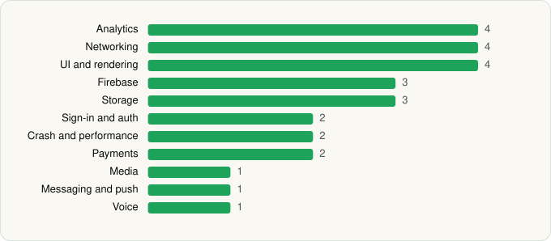

<picture><source media="(prefers-color-scheme: dark)" srcset="../../../../assets/logo/logo-dark.svg"></picture> [Tech Stack](../../../../README.md) / [Discord Inc.](../../../../companies/discord-inc.md) / Discord

# Discord - Talk, Play, Hang Out

<picture><source media="(prefers-color-scheme: dark)" srcset="../../../../assets/badges/android-dark.svg"></picture> <picture><source media="(prefers-color-scheme: dark)" srcset="../../../../assets/badges/inactive-dark.svg"></picture> <picture><source media="(prefers-color-scheme: dark)" srcset="../../../../assets/badges/floor-dark.svg"></picture>

[Google Play](https://play.google.com/store/apps/details?id=com.discord) · [latest.json](latest.json)

| | |
|---|---|
| Company | [Discord Inc.](../../../../companies/discord-inc.md) |
| Store id | `com.discord` |
| Bundle / package id | `com.discord` |
| Latest version | 352.17 - Stable (analysed 2026-11-10) |
| Versions tracked | 2 |
| SDKs in latest version | 27 |
| Languages | C/C++ (native), Java, Kotlin, React Native / JavaScript |
| UI | Fresco, Material Components, Rive |
| Build | Gradle (inferred), R8 / ProGuard (name obfuscation detected) |
| Minimum OS | API 24, targets API 36 |
| Devices / ABIs | Android |
| Capabilities | 13 |
| Declares tracking | Yes |
| Tracked | No. Kept for history. |

## SDKs by category

<picture><source media="(prefers-color-scheme: dark)" srcset="../../../../assets/charts/apps/android/discord-inc/discord-dark.svg"></picture>

- **Analytics** (4): Amplitude, AppsFlyer, Branch, Google Analytics (legacy)
- **Networking** (4): Cronet, Cronet (Chromium net), Cronet (Google), OkHttp
- **UI and rendering** (4): Fresco, Material Components, React Native Reanimated, Rive
- **Firebase** (3): Firebase, Google DataTransport, Google Play services
- **Storage** (3): DataStore, MMKV, Room
- **Sign-in and auth** (2): Credential Manager, Google Sign-In / Auth
- **Crash and performance** (2): Sentry, Sentry (native)
- **Payments** (2): Google Play Billing, Stripe
- **Media** (1): ExoPlayer
- **Messaging and push** (1): Firebase Messaging
- **Voice** (1): WebRTC

Capabilities (13)

Advertising ID, Camera, Contacts (read), Draw over other apps, Foreground service, Foreground service: camera, Foreground service: microphone, Media: images, Media: video, Microphone, Notifications, Storage (read), Storage (write)

## Version history

| Version | Analysed | Store update | SDKs | Change | SDK list is a floor | Binary encrypted | File |
|---|---|---|---|---|---|---|---|
| 352.17 - Stable | 2026-11-10 | 2026-11-02 | 27 | +3 / −6 | Yes | No | [352.17_-_Stable.json](352.17_-_Stable.json) |
| 350.8 - Stable | 2026-10-24 | 2026-10-23 | 30 |  | Yes | No | [350.8_-_Stable.json](350.8_-_Stable.json) |

### SDK changes between versions

- 350.8 - Stable → 352.17 - Stable: added Branch, Cronet (Chromium net), Stripe; removed Google Mobile Ads (AdMob), Jetpack Compose, Kotlin Coroutines, Okio, Play Integrity, react-native-svg

---

Generated by `scripts/build_readme.py` from the JSON files. Do not edit by hand.
