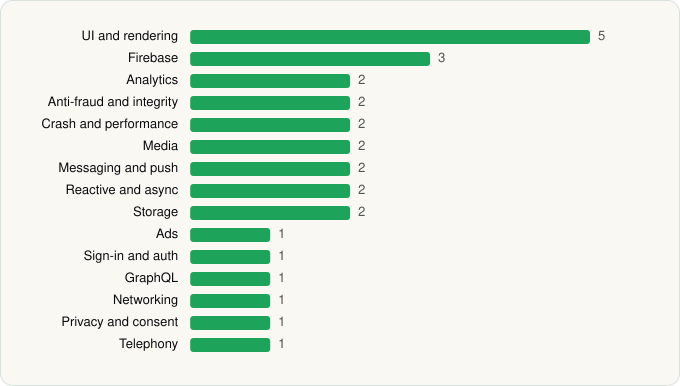

<picture><source media="(prefers-color-scheme: dark)" srcset="../../../../assets/logo/logo-dark.svg"></picture> [Tech Stack](../../../../README.md) / [Disney](../../../../companies/disney.md) / Disney+

# Disney+

<picture><source media="(prefers-color-scheme: dark)" srcset="../../../../assets/badges/android-dark.svg"></picture> <picture><source media="(prefers-color-scheme: dark)" srcset="../../../../assets/badges/active-dark.svg"></picture> <picture><source media="(prefers-color-scheme: dark)" srcset="../../../../assets/badges/floor-dark.svg"></picture>

[Google Play](https://play.google.com/store/apps/details?id=com.disney.disneyplus) · [latest.json](latest.json)

| | |
|---|---|
| Company | [Disney](../../../../companies/disney.md) |
| Store id | `com.disney.disneyplus` |
| Bundle / package id | `com.disney.disneyplus` |
| Latest version | 26.9.0+rc2-2026.06.01 (analysed 2026-06-19) |
| Versions tracked | 1 |
| SDKs in latest version | 28 |
| Languages | C/C++ (native), Java, Kotlin |
| UI | Glide, Jetpack Compose, Lottie, Material Components, Rive |
| Build | Gradle (inferred), R8 / ProGuard (name obfuscation detected) |
| Minimum OS | API 23, targets API 36 |
| Devices / ABIs | Android |
| Capabilities | 4 |
| Declares tracking | Yes |
| Tracked | Yes |

## SDKs by category

<picture><source media="(prefers-color-scheme: dark)" srcset="../../../../assets/charts/apps/android/disney/disney-dark.svg"></picture>

- **UI and rendering** (5): Glide, Jetpack Compose, Lottie, Material Components, Rive
- **Firebase** (3): Firebase, Google DataTransport, Google Play services
- **Analytics** (2): Firebase Analytics, Google App Measurement
- **Anti-fraud and integrity** (2): Play Integrity, reCAPTCHA
- **Crash and performance** (2): Datadog, Datadog (native)
- **Media** (2): Google Cast, Media3 (ExoPlayer)
- **Messaging and push** (2): Braze, Firebase Messaging
- **Reactive and async** (2): Kotlin Coroutines, RxJava
- **Storage** (2): Okio, Room
- **Ads** (1): Google Mobile Ads (AdMob)
- **Sign-in and auth** (1): Google Sign-In / Auth
- **GraphQL** (1): Apollo GraphQL
- **Networking** (1): OkHttp
- **Privacy and consent** (1): OneTrust
- **Telephony** (1): libphonenumber

Capabilities (4)

Advertising ID, Foreground service, Microphone, Notifications

## Version history

| Version | Analysed | Store update | SDKs | Change | SDK list is a floor | Binary encrypted | File |
|---|---|---|---|---|---|---|---|
| 26.9.0+rc2-2026.06.01 | 2026-06-19 |  | 28 |  | Yes | No | [26.9.0_rc2-2026.06.01.json](26.9.0_rc2-2026.06.01.json) |

## Model-written summary

> Obfuscated Kotlin/Java Android app with Jetpack Compose, Rive rendering, Datadog native monitoring, Media3 and Braze.

Written by a language model from the detected signals (`inferred[]`). It is commentary, not measurement.

---

Generated by `scripts/build_readme.py` from the JSON files. Do not edit by hand.
