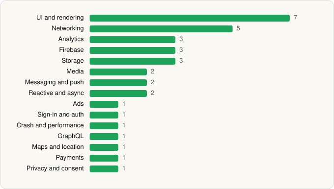

<picture><source media="(prefers-color-scheme: dark)" srcset="../../../../assets/logo/logo-dark.svg"></picture> [Tech Stack](../../../../README.md) / [Disney](../../../../companies/disney.md) / ESPN Fantasy Sports

# ESPN Fantasy Sports

<picture><source media="(prefers-color-scheme: dark)" srcset="../../../../assets/badges/android-dark.svg"></picture> <picture><source media="(prefers-color-scheme: dark)" srcset="../../../../assets/badges/active-dark.svg"></picture>

[Google Play](https://play.google.com/store/apps/details?id=com.espn.fantasy.lm.football) · [latest.json](latest.json)

| | |
|---|---|
| Company | [Disney](../../../../companies/disney.md) |
| Store id | `com.espn.fantasy.lm.football` |
| Bundle / package id | `com.espn.fantasy.lm.football` |
| Latest version | 9.12.0 (analysed 2026-11-01) |
| Versions tracked | 2 |
| SDKs in latest version | 34 |
| Languages | C/C++ (native), Java, Kotlin |
| UI | Coil, Glide, Jetpack Compose, Lottie, Material Components, Rive |
| Build | Gradle (inferred) |
| Minimum OS | API 24, targets API 36 |
| Devices / ABIs | Android |
| Capabilities | 11 |
| Declares tracking | Yes |
| Tracked | Yes |

## SDKs by category

<picture><source media="(prefers-color-scheme: dark)" srcset="../../../../assets/charts/apps/android/disney/espn-fantasy-sports-dark.svg"></picture>

- **UI and rendering** (7): AndroidSVG, Coil, Glide, Jetpack Compose, Lottie, Material Components, Rive
- **Networking** (5): Cronet, Cronet (Google), OkHttp, Retrofit, Volley
- **Analytics** (3): Adobe Experience Platform, comScore, Firebase Analytics
- **Firebase** (3): Firebase, Google DataTransport, Google Play services
- **Storage** (3): DataStore, Okio, Room
- **Media** (2): Google Cast, Media3 (ExoPlayer)
- **Messaging and push** (2): Braze, Firebase Messaging
- **Reactive and async** (2): Kotlin Coroutines, RxJava
- **Ads** (1): Google Mobile Ads (AdMob)
- **Sign-in and auth** (1): Google Sign-In / Auth
- **Crash and performance** (1): New Relic
- **GraphQL** (1): Apollo GraphQL
- **Maps and location** (1): Google Location
- **Payments** (1): Google Play Billing
- **Privacy and consent** (1): OneTrust

Capabilities (11)

Advertising ID, Approximate location, Biometric auth, Camera, Fingerprint auth, Foreground service, Media: images, Notifications, Phone / carrier info, Storage (read), Storage (write)

## Version history

| Version | Analysed | Store update | SDKs | Change | SDK list is a floor | Binary encrypted | File |
|---|---|---|---|---|---|---|---|
| 9.12.0 | 2026-11-01 | 2026-10-17 | 34 | +4 / −1 | No | No | [9.12.0.json](9.12.0.json) |
| 9.8.0 | 2026-06-19 |  | 31 |  | No | No | [9.8.0.json](9.8.0.json) |

### SDK changes between versions

- 9.8.0 → 9.12.0: added Cronet, Cronet (Google), Rive, Volley; removed Kochava

---

Generated by `scripts/build_readme.py` from the JSON files. Do not edit by hand.
