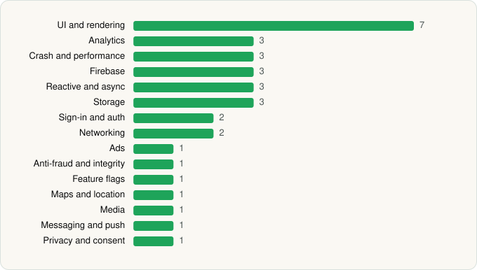

<picture><source media="(prefers-color-scheme: dark)" srcset="../../../../assets/logo/logo-dark.svg"></picture> [Tech Stack](../../../../README.md) / [Disney](../../../../companies/disney.md) / Hulu

# Hulu: Stream TV shows & movies

<picture><source media="(prefers-color-scheme: dark)" srcset="../../../../assets/badges/android-dark.svg"></picture> <picture><source media="(prefers-color-scheme: dark)" srcset="../../../../assets/badges/active-dark.svg"></picture>

[Google Play](https://play.google.com/store/apps/details?id=com.hulu.plus) · [latest.json](latest.json)

| | |
|---|---|
| Company | [Disney](../../../../companies/disney.md) |
| Store id | `com.hulu.plus` |
| Bundle / package id | `com.hulu.plus` |
| Latest version | 6.34.0+18552420-google (analysed 2026-11-02) |
| Versions tracked | 2 |
| SDKs in latest version | 33 |
| Languages | C/C++ (native), Java, Kotlin |
| UI | Coil, Glide, Jetpack Compose, Lottie, Material Components, Picasso |
| Build | Gradle (inferred) |
| Minimum OS | API 25, targets API 36 |
| Devices / ABIs | Android |
| Capabilities | 5 |
| Declares tracking | Yes |
| Tracked | Yes |

## SDKs by category

<picture><source media="(prefers-color-scheme: dark)" srcset="../../../../assets/charts/apps/android/disney/hulu-dark.svg"></picture>

- **UI and rendering** (7): AndroidSVG, Coil, Glide, Jetpack Compose, Lottie, Material Components, Picasso
- **Analytics** (3): AppsFlyer, Firebase Analytics, Google App Measurement
- **Crash and performance** (3): Datadog, Firebase Crashlytics, Firebase Performance
- **Firebase** (3): Firebase, Google DataTransport, Google Play services
- **Reactive and async** (3): Kotlin Coroutines, RxJava, RxJava 3
- **Storage** (3): DataStore, Okio, Room
- **Sign-in and auth** (2): Credential Manager, Google Sign-In / Auth
- **Networking** (2): OkHttp, Retrofit
- **Ads** (1): Google Mobile Ads (AdMob)
- **Anti-fraud and integrity** (1): Play Integrity
- **Feature flags** (1): Firebase Remote Config
- **Maps and location** (1): Google Location
- **Media** (1): Google Cast
- **Messaging and push** (1): Firebase Messaging
- **Privacy and consent** (1): OneTrust

Capabilities (5)

Advertising ID, Approximate location, Foreground service, Notifications, Precise location

## Version history

| Version | Analysed | Store update | SDKs | Change | SDK list is a floor | Binary encrypted | File |
|---|---|---|---|---|---|---|---|
| 6.34.0+18552420-google | 2026-11-02 | 2026-10-01 | 33 | +0 / −0 | No | No | [6.34.0_18552420-google.json](6.34.0_18552420-google.json) |
| 6.29.0+16756762-google | 2026-06-19 |  | 33 |  | No | No | [6.29.0_16756762-google.json](6.29.0_16756762-google.json) |

---

Generated by `scripts/build_readme.py` from the JSON files. Do not edit by hand.
