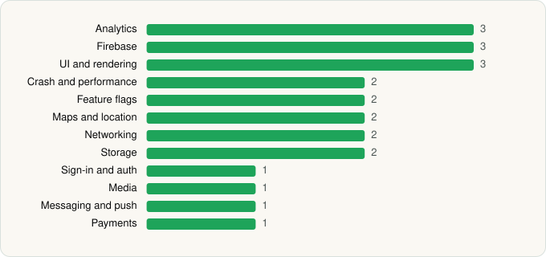

<picture><source media="(prefers-color-scheme: dark)" srcset="../../../../assets/logo/logo-dark.svg"></picture> [Tech Stack](../../../../README.md) / [Domino's Pizza LLC](../../../../companies/domino-s-pizza-llc.md) / Domino's Pizza USA

# Domino's Pizza USA

<picture><source media="(prefers-color-scheme: dark)" srcset="../../../../assets/badges/android-dark.svg"></picture> <picture><source media="(prefers-color-scheme: dark)" srcset="../../../../assets/badges/active-dark.svg"></picture>

[Google Play](https://play.google.com/store/apps/details?id=com.dominospizza) · [latest.json](latest.json)

| | |
|---|---|
| Company | [Domino's Pizza LLC](../../../../companies/domino-s-pizza-llc.md) |
| Store id | `com.dominospizza` |
| Bundle / package id | `com.dominospizza` |
| Latest version | 13.6.0 (analysed 2026-06-19) |
| Versions tracked | 1 |
| SDKs in latest version | 35 |
| Languages | C/C++ (native), Java, Kotlin |
| UI | Coil, Glide, Jetpack Compose, Material Components |
| Build | Gradle (inferred) |
| Minimum OS | API 28, targets API 35 |
| Devices / ABIs | Android |
| Capabilities | 10 |
| Declares tracking | Yes |
| Tracked | Yes |

## SDKs by category

<picture><source media="(prefers-color-scheme: dark)" srcset="../../../../assets/charts/apps/android/domino-s-pizza-llc/domino-s-pizza-usa-dark.svg"></picture>

- **UI and rendering** (6): AndroidSVG, Coil, Glide, Jetpack Compose, Markwon, Material Components
- **Analytics** (4): Branch, Facebook SDK, Firebase Analytics, Google App Measurement
- **Firebase** (3): Firebase, Google DataTransport, Google Play services
- **Networking** (3): OkHttp, Retrofit, Volley
- **Storage** (3): DataStore, Okio, Room
- **Anti-fraud and integrity** (2): Play Integrity, reCAPTCHA
- **Crash and performance** (2): Firebase Crashlytics, Firebase Performance
- **Feature flags** (2): Firebase Remote Config, LaunchDarkly
- **Maps and location** (2): Google Location, Google Maps
- **Ads** (1): Google Mobile Ads (AdMob)
- **Sign-in and auth** (1): Google Sign-In / Auth
- **Logging and diagnostics** (1): Chucker
- **GraphQL** (1): Apollo GraphQL
- **Media** (1): Media3 (ExoPlayer)
- **Messaging and push** (1): Firebase Messaging
- **Payments** (1): Braintree
- **Reactive and async** (1): Kotlin Coroutines

Capabilities (10)

Advertising ID, Approximate location, Background location, Bluetooth, Foreground service, Microphone, Notifications, Phone / carrier info, Precise location, Storage (write)

## Version history

| Version | Analysed | Store update | SDKs | Change | SDK list is a floor | Binary encrypted | File |
|---|---|---|---|---|---|---|---|
| 13.6.0 | 2026-06-19 |  | 35 |  | No | No | [13.6.0.json](13.6.0.json) |

---

Generated by `scripts/build_readme.py` from the JSON files. Do not edit by hand.
