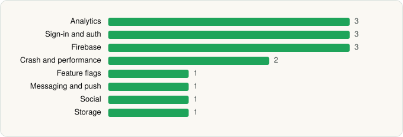

<picture><source media="(prefers-color-scheme: dark)" srcset="../../../../assets/logo/logo-dark.svg"></picture> [Tech Stack](../../../../README.md) / [drawnames](../../../../companies/drawnames.md) / drawnames

# drawnames \| Secret Santa app

<picture><source media="(prefers-color-scheme: dark)" srcset="../../../../assets/badges/android-dark.svg"></picture> <picture><source media="(prefers-color-scheme: dark)" srcset="../../../../assets/badges/inactive-dark.svg"></picture> <picture><source media="(prefers-color-scheme: dark)" srcset="../../../../assets/badges/floor-dark.svg"></picture>

[Google Play](https://play.google.com/store/apps/details?id=com.meetrixonline.drawnames) · [latest.json](latest.json)

| | |
|---|---|
| Company | [drawnames](../../../../companies/drawnames.md) |
| Store id | `com.meetrixonline.drawnames` |
| Bundle / package id | `com.meetrixonline.drawnames` |
| Latest version | 1.81.13 (analysed 2026-11-05) |
| Versions tracked | 1 |
| SDKs in latest version | 15 |
| Languages | C/C++ (native), Flutter / Dart, Java, Kotlin |
| UI | Android Views (inferred) |
| Build | Gradle (inferred), R8 / ProGuard (name obfuscation detected) |
| Minimum OS | API 24, targets API 37 |
| Devices / ABIs | Android |
| Capabilities | 6 |
| Declares tracking | Yes |
| Tracked | No. Kept for history. |

## SDKs by category

<picture><source media="(prefers-color-scheme: dark)" srcset="../../../../assets/charts/apps/android/drawnames/drawnames-secret-santa-app-dark.svg"></picture>

- **Analytics** (3): Facebook SDK, Firebase Analytics, Google App Measurement
- **Sign-in and auth** (3): Credential Manager, Facebook Login, Google Sign-In / Auth
- **Firebase** (3): Firebase, Google DataTransport, Google Play services
- **Crash and performance** (2): Sentry, Sentry (native)
- **Feature flags** (1): Firebase Remote Config
- **Messaging and push** (1): Firebase Messaging
- **Social** (1): Facebook Share
- **Storage** (1): DataStore

Capabilities (6)

Advertising ID, Biometric auth, Camera, Fingerprint auth, Notifications, Storage (read)

## Version history

| Version | Analysed | Store update | SDKs | Change | SDK list is a floor | Binary encrypted | File |
|---|---|---|---|---|---|---|---|
| 1.81.13 | 2026-11-05 | 2026-11-03 | 15 |  | Yes | No | [1.81.13.json](1.81.13.json) |

---

Generated by `scripts/build_readme.py` from the JSON files. Do not edit by hand.
